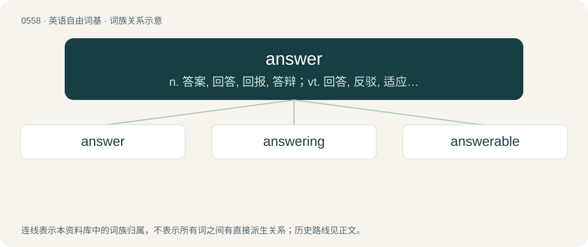

# 0625 · answer — n. 答案, 回答, 回报, 答辩；vt. 回答, 反驳, 适应, 响应, 符合；vi. 回答, 答应, 负责, 符合, 成功

[总目录](../00_总目录_按常用程度.md)

**类型**：英语自由词基　｜　**来源语言**：见词源记录

## 核心含义与来源

- 核心含义：n. 答案, 回答, 回报, 答辩；vt. 回答, 反驳, 适应, 响应, 符合；vi. 回答, 答应, 负责, 符合, 成功
- 英文含义：A response or reply; something said or done in reaction to a statement or question.
- 词形：answer

**多个词源／构词路径**：同一拼写可能有不同来源；以下按词性和含义分别列出。

**来源记录 1**（名词；A response or reply; something said or done in reaction to a statement or question.）

From Middle English answere, andsware, from Old English andswaru (“answer”), from and- (“against”) + swaru (“affirmation”), (from Proto-Indo-European \*h₂ent- (“front, forehead”) and Old English swerian (“to swear”), from Proto-Indo-European \*swer-), suggesting an original meaning of "a sworn statement rebutting a charge". The cognates suggest the existence of Proto-Germanic \*andaswarō (“a reply to a question”). Cognate with Old Frisian ondser (“answer”), Old Saxon andswōr (“answer”), Danish and Swedish ansvar (“liability, responsibility, answer”), Icelandic andsvar (“answer, response”). Compare also Old English andwyrde (“answer”) (cognate to Dutch antwoord, German Antwort), Old English andcwiss (“reply”), German Schwur (“oath, vow”).

**来源记录 2**（动词；To make a reply or response to.）

From Middle English answeren, andswaren, answerien, from Old English andswarian, answarien (“to answer, to respond, to deny an allegation under oath”), from Proto-Germanic \*andaswarōną, \*andaswarjaną (“to answer, to give a response, to rebut”), from \*anda- (“against”) + \*swarjaną, \*swarōną (“to swear an oath, to answer, to respond”), from Proto-Indo-European \*h₂ent- (“face, forehead”) and \*swer- (“to swear”). Cognate with Old Frisian ondswera (“to answer”), Danish ansvare (“to answer, account for”), Swedish ansvara (“to answer, account for”), Icelandic andsvara (“to answer, reply”).

## 词族图

## 单词速览（常用到不常用）

| 单词 | 音标 | 释义 |
|---|---|---|
| [answer](#w-1) | 英 /ˈɑːn.sə/；美 /ˈæn.sɚ/ | n. 答案, 回答, 回报, 答辩；vt. 回答, 反驳, 适应, 响应, 符合；vi. 回答, 答应, 负责, 符合, 成功 |
| [answering](#w-2) | 英 /ˈɑːn.sə.ɹɪŋ/；美 /ˈæn.sɚ.ɪŋ/ | \[计\] 应答 |
| [answerable](#w-3) | 英 /ˈɑːnsəɹəb(ə)l/；美 /ˈæn.səɹ.ə.bl/ | a. 有责任的, 可回答的；\[法\] 应负责任的, 可驳斥的, 可答覆的 |

## 逐词详解

### 1. answer

**词性**：名词　｜　**音标**：英 /ˈɑːn.sə/；美 /ˈæn.sɚ/

**中文释义**：n. 答案, 回答, 回报, 答辩；vt. 回答, 反驳, 适应, 响应, 符合；vi. 回答, 答应, 负责, 符合, 成功

**英文义项**：A response or reply; something said or done in reaction to a statement or question. / A solution to a problem.

**词源与演化**：

From Middle English answere, andsware, from Old English andswaru (“answer”), from and- (“against”) + swaru (“affirmation”), (from Proto-Indo-European \*h₂ent- (“front, forehead”) and Old English swerian (“to swear”), from Proto-Indo-European \*swer-), suggesting an original meaning of "a sworn statement rebutting a charge". The cognates suggest the existence of Proto-Germanic \*andaswarō (“a reply to a question”). Cognate with Old Frisian ondser (“answer”), Old Saxon andswōr (“answer”), Danish and Swedish ansvar (“liability, responsibility, answer”), Icelandic andsvar (“answer, response”). Compare also Old English andwyrde (“answer”) (cognate to Dutch antwoord, German Antwort), Old English andcwiss (“reply”), German Schwur (“oath, vow”).

**例句**：

> Her answer to his proposal was a slap in the face.

该用例对应义项：A response or reply; something said or done in reaction to a statement or question.

### 2. answering

**词性**：名词　｜　**音标**：英 /ˈɑːn.sə.ɹɪŋ/；美 /ˈæn.sɚ.ɪŋ/

**中文释义**：\[计\] 应答

**英文义项**：The act of giving an answer.

**构词拆分**：answer + -ing

**词源与演化**：

From Middle English answerynge; equivalent to answer + -ing.

**例句**：

> Fadil quickly realized that answering that question would be no simple task.

### 3. answerable

**词性**：形容词　｜　**音标**：英 /ˈɑːnsəɹəb(ə)l/；美 /ˈæn.səɹ.ə.bl/

**中文释义**：a. 有责任的, 可回答的；\[法\] 应负责任的, 可驳斥的, 可答覆的

**英文义项**：Required to justify one's actions (to somebody); accountable, responsible. / Able to be answered.

**构词拆分**：answer + -able

**词源与演化**：

From answer + -able.

**例句**：

> Parents are answerable for their child's acts.

该用例对应义项：morally or legally responsible to a higher authority
