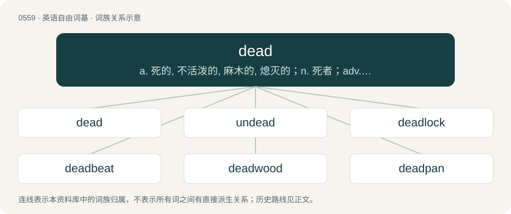

# 0626 · dead — a. 死的, 不活泼的, 麻木的, 熄灭的；n. 死者；adv. 完全地, 直接地

[总目录](../00_总目录_按常用程度.md)

**类型**：英语自由词基　｜　**来源语言**：见词源记录

## 核心含义与来源

- 核心含义：a. 死的, 不活泼的, 麻木的, 熄灭的；n. 死者；adv. 完全地, 直接地
- 英文含义：No longer living; deceased. (Also used as a noun.)
- 词形：dead

**来源记录 1**（形容词；No longer living; deceased. (Also used as a noun.)）

From Middle English ded, deed, from Old English dēad, from Proto-West Germanic \*daud, from Proto-Germanic \*daudaz. Compare West Frisian dead, dea, Dutch dood, German tot, Danish and Norwegian Bokmål død, Norwegian Nynorsk daud, Swedish död.

## 词族图

## 单词速览（常用到不常用）

| 单词 | 音标 | 释义 |
|---|---|---|
| [dead](#w-1) | /dɛd/ | a. 死的, 不活泼的, 麻木的, 熄灭的；n. 死者；adv. 完全地, 直接地 |
| [undead](#w-2) | /ʌnˈdɛd/ | n. 亡灵, 不死的人, 活死人 |
| [deadlock](#w-3) | 英 /ˈdɛdˌlɒk/；美 /ˈdɛdˌlɑk/ | n. 僵局, 停顿；v. (使)停顿, (使)相持不下；\[计\] 死锁 |
| [deadbeat](#w-4) | 英 /ˈdɛdbiːt/ | n. 赖债不还的人, 游手好闲的人, 落魄者；a. 直进式的, 非周期的 |
| [deadwood](#w-5) | 英 /ˈdɛdwʊd/ | n. 枯枝, 朽木, 无用(或冗赘的)人员 |
| [deadpan](#w-6) | /ˈdɛdpæn/ | n. 无表情的脸 |
| [deadlift](#w-7) | /ˈdɛdlɪft/ | 【英文】A weight training exercise where one lifts a loaded barbell off the ground from a stabilized bent-over position. |
| [deadman](#w-8) | /ˈdedmæn/ | n. 木桩或水泥桩, 临时支撑物 |
| [deadass](#w-9) | /ˈdedˈæs/ | n. 大笨蛋,头号傻瓜 |
| [deadbolt](#w-10) | 美 /ˈdɛdˌboʊ̯lt/ | = deadlock (2) |
| [deadhead](#w-11) | /ˈdɛdhɛd/ | n. 免费乘客, 免费入场者 |

## 逐词详解

### 1. dead

**词性**：形容词　｜　**音标**：/dɛd/

**中文释义**：a. 死的, 不活泼的, 麻木的, 熄灭的；n. 死者；adv. 完全地, 直接地

**英文义项**：No longer living; deceased. (Also used as a noun.) / Devoid of living things; barren.

**词源与演化**：

From Middle English ded, deed, from Old English dēad, from Proto-West Germanic \*daud, from Proto-Germanic \*daudaz. Compare West Frisian dead, dea, Dutch dood, German tot, Danish and Norwegian Bokmål død, Norwegian Nynorsk daud, Swedish död.

**例句**：

> There are several dead laws still on the books regulating where horses may be hitched.

该用例对应义项：No longer used or required.

### 2. undead

**词性**：名词　｜　**音标**：/ʌnˈdɛd/

**中文释义**：n. 亡灵, 不死的人, 活死人

**英文义项**：A creature that is undead; that is, dead but still animate. / Those who are undead.

**构词拆分**：un- + dead

**词源与演化**：

From Middle English undede, equivalent to un- + dead. The first attestation is from around 1400. The term was revived, popularized, and imbued with supernatural connotations by its usage in Bram Stoker's novel Dracula (1897).

**例句**：

> In the zombie movie, an army of the undead accosted some unsuspecting teenagers.

该用例对应义项：Those who are undead.

### 3. deadlock

**词性**：名词　｜　**音标**：英 /ˈdɛdˌlɒk/；美 /ˈdɛdˌlɑk/

**中文释义**：n. 僵局, 停顿；v. (使)停顿, (使)相持不下；\[计\] 死锁

**英文义项**：A standstill resulting from the opposition of two evenly matched forces; a stalemate or impasse. / An inability to continue due to two programs or devices each requiring a response from the other before completing an operation.

**构词拆分**：dead + lock

**词源与演化**：

From dead + lock.

**例句**：

> The negotiation ended in deadlock, with neither party willing to compromise on the price.

该用例对应义项：A standstill resulting from the opposition of two evenly matched forces; a stalemate or impasse.

### 4. deadbeat

**词性**：名词　｜　**音标**：英 /ˈdɛdbiːt/

**中文释义**：n. 赖债不还的人, 游手好闲的人, 落魄者；a. 直进式的, 非周期的

**英文义项**：A lazy or irresponsible person who is often unemployed, often depending upon wealthy or otherwise financially independent people for support. / A person who defaults on debts.

**构词拆分**：dead + beat

**词源与演化**：

From dead + beat. As an adjective, of a person, to be exhausted, first use appears c. the 1820s. During the American Civil War, it also became a derogatory adjective, in the sense of "a person that defaults on their debts or avoids responsibilities" and "sponger", "vagabond". This sense dates from c. 1863. Possibly related to good for nothing.

**例句**：

> Why would she go out of her way to help a deadbeat like you?

### 5. deadwood

**词性**：名词　｜　**音标**：英 /ˈdɛdwʊd/

**中文释义**：n. 枯枝, 朽木, 无用(或冗赘的)人员

**英文义项**：Dead branches or wood on a tree, or coarse woody debris. / People or things judged to be superfluous to an organization or project.

**构词拆分**：dead + wood

**词源与演化**：

From dead + wood.

**例句**：

> I like prune the deadwood from plants to allow them to regrow healthy branches that bear fruit.

### 6. deadpan

**词性**：形容词　｜　**音标**：/ˈdɛdpæn/

**中文释义**：n. 无表情的脸

**英文义项**：Deliberately impassive or expressionless. / Having such a face or look.

**构词拆分**：dead + pan (“face”)

**词源与演化**：

From dead + pan (“face”).

**例句**：

> The comedian remained deadpan.

该用例对应义项：Having such a face or look.

### 7. deadlift

**词性**：名词　｜　**音标**：/ˈdɛdlɪft/

**英文义项**：A weight training exercise where one lifts a loaded barbell off the ground from a stabilized bent-over position. / Any lift performed without help or leverage.

**构词拆分**：dead + lift

**词源与演化**：

From dead + lift.

**例句**：

> The deadlift is a compound movement that trains the gluteus maximus, hamstrings, and other muscles in the posterior chain such as the erector spinae.

### 8. deadman

**词性**：名词　｜　**音标**：/ˈdedmæn/

**中文释义**：n. 木桩或水泥桩, 临时支撑物

**英文义项**：A long object, often a timber or log, buried to serve as an anchor for a wall or for stays. / A cutout device that operates in the event that an operator releases the control handles, leaves the operator's seat, or otherwise seems to be no longer present and alert.

**构词拆分**：dead + man

**词源与演化**：

From dead + man. In the sense referring to a safety switch, the notion of an operator who is dead is the figurative archetype representing any incapacitation, absence, or inattention. See also Dead Hand in that regard.

**用法示例／搭配（非完整句）**：

> a deadman device

该用例对应义项：A cutout device that operates in the event that an operator releases the control handles, leaves the operator's seat, or otherwise seems to be no longer present and alert.

### 9. deadass

**词性**：形容词　｜　**音标**：/ˈdedˈæs/

**中文释义**：n. 大笨蛋,头号傻瓜

**英文义项**：Having very little activity; dead. / Genuine; real. Used as a negative intensifier.

**构词拆分**：dead + -ass (“used to intensify an adjective”)；dead serious + -ass

**词源与演化**：

From dead + -ass (“used to intensify an adjective”). Some senses from an ellipsis of dead-ass serious, from dead serious + -ass. Originated in New York City, and popularized around the late 1990s–2000s.

**例句**：

> You need to quit talking about my mama. I'm deadass.

该用例对应义项：Dead serious.

### 10. deadbolt

**词性**：名词　｜　**音标**：美 /ˈdɛdˌboʊ̯lt/

**中文释义**：= deadlock (2)

**英文义项**：The part of the lock which is moved when the key is engaged. / A kind of lock in which the bolt (moving portion) is held in position by the cylinder rather than by a spring and so cannot be retracted except by turning the cylinder.

**构词拆分**：dead + bolt

**词源与演化**：

From dead + bolt.

### 11. deadhead

**词性**：动词　｜　**音标**：/ˈdɛdhɛd/

**中文释义**：n. 免费乘客, 免费入场者

**英文义项**：To admit to a performance without charge. / To travel as a deadhead, or non-paying passenger.

**构词拆分**：dead + head

**词源与演化**：

From dead + head. Some senses are derived from theater jargon (originally spelled dead head) for audience members admitted without paying, which probably arose in analogy to dead weight or deadwood in reference to their lack of contribution to revenue or in reference to their unenthusiastic (dead) response to performances. Perhaps even from Latin caput mortuum, alchemy term for distillation residue. As Paul Quinion writes: Similarly, the term was applied to a dull or lazy person, one who contributes nothing to an enterprise, only in the early years of the twentieth century, well after the theatrical and transport senses had become well established.

**例句**：

> If you deadhead your roses regularly, they will bloom all season.

该用例对应义项：(transitive) To remove spent or dead blossoms from a plant.
