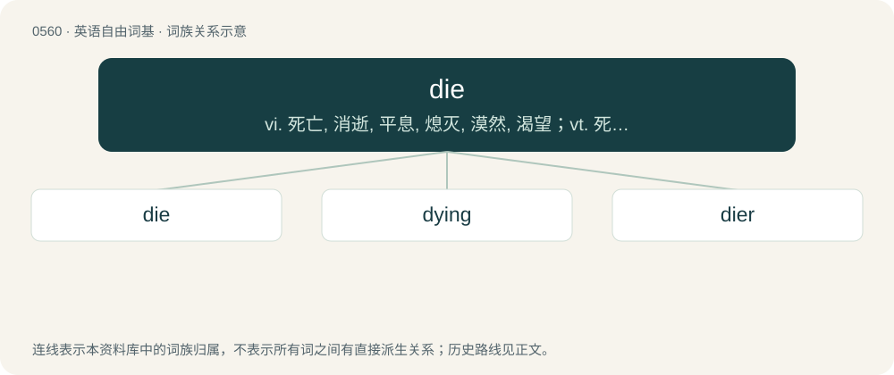

# 0627 · die — vi. 死亡, 消逝, 平息, 熄灭, 漠然, 渴望；vt. 死；n. 骰子, 冲模

[总目录](../00_总目录_按常用程度.md)

**类型**：英语自由词基　｜　**来源语言**：见词源记录

## 核心含义与来源

- 核心含义：vi. 死亡, 消逝, 平息, 熄灭, 漠然, 渴望；vt. 死；n. 骰子, 冲模
- 英文含义：To stop living; to become dead; to undergo death.
- 词形：die

**多个词源／构词路径**：同一拼写可能有不同来源；以下按词性和含义分别列出。

**来源记录 1**（动词；To stop living; to become dead; to undergo death.）

From Middle English deyen, probably from Old Norse deyja, from Proto-Germanic \*dawjaną (“to die”). Displaced native Old English sweltan, whence Modern English swelt, and Old English steorfan, whence modern starve.

**来源记录 2**（名词；The cubical part of a pedestal; a plinth.）

From Middle English dee, from Old French de (Modern French dé), from Latin datum, from datus (“given”), the past participle of dō (“to give”), from Proto-Indo-European \*deh₃- (“to lay out, to spread out”). Doublet of datum. Replaced Old English tasul, tesul (“die”), from Latin tessella (“die, cube”).

**来源记录 3**（副词；per day）

Borrowed from Latin die (“\[in a\] day”), locative of Latin dies (“day”).

## 词族图

## 单词速览（常用到不常用）

| 单词 | 音标 | 释义 |
|---|---|---|
| [die](#w-1) | /daɪ/ | vi. 死亡, 消逝, 平息, 熄灭, 漠然, 渴望；vt. 死；n. 骰子, 冲模 |
| [dying](#w-2) | /ˈdaɪ.ɪŋ/ | a. 垂死的；\[法\] 快要死的, 垂死的, 临终的 |
| [dier](#w-3) |  | 【英文】One who dies. |

## 逐词详解

### 1. die

**词性**：动词　｜　**音标**：/daɪ/

**中文释义**：vi. 死亡, 消逝, 平息, 熄灭, 漠然, 渴望；vt. 死；n. 骰子, 冲模

**英文义项**：To stop living; to become dead; to undergo death. / followed by of as an indication of direct cause; general use

**词源与演化**：

From Middle English deyen, probably from Old Norse deyja, from Proto-Germanic \*dawjaną (“to die”). Displaced native Old English sweltan, whence Modern English swelt, and Old English steorfan, whence modern starve.

**例句**：

> If anyone sees me wearing this ridiculous outfit, I'll die.

该用例对应义项：To be mortified or shocked by a situation.

### 2. dying

**词性**：形容词　｜　**音标**：/ˈdaɪ.ɪŋ/

**中文释义**：a. 垂死的；\[法\] 快要死的, 垂死的, 临终的

**英文义项**：Approaching death; about to die; moribund. / Declining, terminal, or drawing to an end.

**构词拆分**：From die + -ing.

**词源与演化**：

From die + -ing.

**例句**：

> In the dying moments of daylight I glimpsed a sail on the horizon.

该用例对应义项：Declining, terminal, or drawing to an end.

### 3. dier

**词性**：名词

**英文义项**：One who dies.

**构词拆分**：die + -er

**词源与演化**：

From die + -er.
