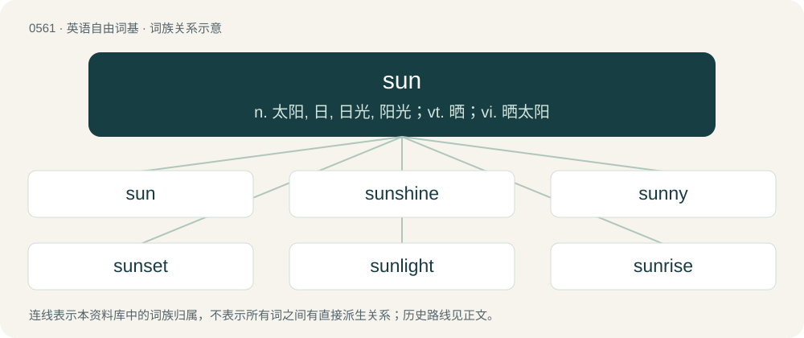

# 0629 · sun — n. 太阳, 日, 日光, 阳光；vt. 晒；vi. 晒太阳

[总目录](../00_总目录_按常用程度.md)

**类型**：英语自由词基　｜　**来源语言**：见词源记录

## 核心含义与来源

- 核心含义：n. 太阳, 日, 日光, 阳光；vt. 晒；vi. 晒太阳
- 英文含义：A star, especially when seen as the centre of any single solar system.
- 词形：sun

**多个词源／构词路径**：同一拼写可能有不同来源；以下按词性和含义分别列出。

**来源记录 1**（名词；A star, especially when seen as the centre of any single solar system.）

From Middle English soen, son, sone, sonne, sun, sune, sunna, sunne, sunnæ, synne, zonne, zunne, from Old English sunna, sunne, sunnu (“sun”), from Proto-West Germanic \*sunnā, from Proto-Germanic \*sunnǭ (“sun”), from heteroclitic inanimate Proto-Indo-European \*sh₂wen-, oblique of Proto-Indo-European \*sóh₂wl̥ (“sun”). Cognates Cognate with Scots sun (“sun”), Yola zin (“sun”), North Frisian san, Sen (“sun”), Saterland Frisian Sunne (“sun”), West Frisian sinne (“sun”), Alemannic German ŝchunna, ŝchunnà, sònnò, sunna, sunnu, Sunnä (“sun”), Bavarian Sun, suna, sune, Sunn, sunne (“sun”), Cimbrian sonde, sunn, zunna (“sun”), Dutch zon, zonne (“sun”), German Sonne (“sun”), Limburgish Ṣon, Sonn, zón (“sun”), Low German Sünn, Sünne (“sun”), Luxembourgish Sonn (“sun”), Mòcheno sunn (“sun”), Vilamovian zun, zunn (“sun”), West Flemish zunne (“sun”), Yiddish זון (zun, “sun”), Icelandic sunna (“sun”), Crimean Gothic sune (“sun”), Gothic 𐍃𐌿𐌽𐌽𐍉 (sunnō, “the Sun”); outside of Germanic, Cornish howl (“sun”), Irish súil (“eye; expectation, hope”), Manx sooill (“eye”), Scottish Gaelic sùil (“eye; vision; glance, look; expectation, hope”), Welsh haul, huan (“sun”), Latin sōl (“sun”), Greek ήλιος (ílios, “sun”), Albanian diell (“sun”), Latgalian and Latvian saule (“sun”), Lithuanian saulė (“sun”), Belarusian со́нца (sónca, “sun”), Bulgarian слъ́нце (slắnce, “sun”), Czech slunce (“sun”), Macedonian солнце (solnce), сонце (sonce, “sun”), Polish słońce (“sun”), Russian со́лнце (sólnce, “sun”), Serbo-Croatian су̑нце, sȗnce (“sun”), Slovak slnce (“sun”), Slovene sonce (“sun”), Ukrainian со́нце (sónce, “sun”), Avestan 𐬵𐬎𐬎𐬀𐬭𐬆 (huuar^ə, “sun”), Central Kurdish خۆر (xor, “sun”), Gurani وەر (wer, “sun; front”), Ossetian хор (xor), хур (xur, “sun”), Persian هور (hur), خور (xor / xwar, “sun”), Shughni хӣр (xīr, “sun”), Yaghnobi хур (xur, “sun”), Tocharian B swāñco (“beam, ray, sunbeam”), Hindi सूर्य (sūrya), Sanskrit स्वर् (svar, “sun”). Related to sol, Sol, Surya, and Helios. More at solar.

**来源记录 2**（名词；A traditional Japanese unit of length, approximately 30.3 millimetres (1.193 inches).）

From Japanese 寸 (sun). Doublet of cun.

## 词族图

## 单词速览（常用到不常用）

| 单词 | 音标 | 释义 |
|---|---|---|
| [sun](#w-1) | /sʌn/ | n. 太阳, 日, 日光, 阳光；vt. 晒；vi. 晒太阳 |
| [sunshine](#w-2) | /ˈsʌnʃaɪn/ | n. 阳光, 光明, 晴天 |
| [sunny](#w-3) | 英 /ˈsʌni/；/ˈsʊni/ | a. 阳光充足的, 乐观的, 快乐的, 像太阳的 |
| [sunset](#w-4) | /ˈsʌnˌsɛt/ | n. 日落, 晚年 |
| [sunlight](#w-5) | /ˈsʌnˌlaɪt/ | n. 日光；\[医\] 日光, 太阳光 |
| [sunrise](#w-6) | 美 /ˈsʌnɹaɪz/ | n. 日出, 黎明, 拂晓 |
| [sunglasses](#w-7) |  | n. 太阳镜, 墨镜, 太阳眼镜 |
| [sunflower](#w-8) | 英 /ˈsʌn.flaʊ.ə/；美 /ˈsʌn.flaʊ.əɹ/ | n. 向日葵 |
| [sunscreen](#w-9) | /ˈsʌn.skriːn/ | n. (防晒油中的)遮光剂 |
| [sundance](#w-10) |  | 【英文】Any of various Native American religious rituals with songs, dances, praying, etc. |
| [sundown](#w-11) | /ˈsʌnˌdaʊn/ | n. 日落, 阔边女帽 |
| [sunburn](#w-12) | 英 /ˈsʌnˌbɜːn/；美 /ˈsʌnˌbɝn/ | n. 日炙, 晒斑, 晒焦, 晒黑；vt.vi. (使)晒黑, (使)晒得退色, (使)晒焦 |
| [sunroof](#w-13) | 英 /ˈsʌnˌɹuːf/ | n. 汽车顶上可开启的遮阳篷顶 |
| [sunbeam](#w-14) | /ˈsʌnbiːm/ | n. 阳光 |
| [sunburst](#w-15) | /ˈsʌnbəːst/ | n. 阳光突现 |
| [sunspot](#w-16) | 英 /ˈsʌnspɒt/；美 /ˈsʌnspɑt/ | n. 太阳黑子, 雀斑 |
| [sundial](#w-17) | /ˈsʌnˌdaɪ.əl/ | n. 日规, 日晷 |
| [sunlit](#w-18) | 英 /ˈsʌnlɪt/；美 /ˈsʌnˌlɪt/ | a. 阳光照射的 |
| [sunblock](#w-19) | /ˈsʌnblɒk/ | n. 防晒霜, 紫外线防护霜 |
| [sunburnt](#w-20) | 美 /ˈsʌn.bɝnt/ | a. 晒黑的, 有晒斑的, 日炙的 |
| [sunfish](#w-21) | /ˈsʌnˌfɪʃ/ | n. 翻车鱼, 太阳鱼 |
| [sunless](#w-22) | /ˈsʌnlis/ | a. 阳光照射不到的, 阴暗的 |
| [suntan](#w-23) | /ˈsʌnˌtæn/ | n. 晒黑, 土黄色军服 |
| [sunbathe](#w-24) | /ˈsʌnbeɪð/ | n. 日光浴 |
| [sundress](#w-25) | 美 /ˈsʌnˌdɹɛs/ | n. 太阳裙,背心裙 |
| [sunstroke](#w-26) | 美 /ˈsʌnˌstɹoʊk/ | n. 中暑；\[医\] 日射病, 中暑 |
| [sunstone](#w-27) | /ˈsʌnstəun/ | n. 日长石 |
| [sunbed](#w-28) | /ˈsʌnˌbɛd/ | n. （人躺在上面照紫外线太阳灯的）太阳灯浴浴床 |
| [sunland](#w-29) |  | 【英文】A sunny region or landscape. |
| [sunroom](#w-30) | 美 /ˈsʌnˌɹum/ | n. (=sun parlor)日光浴室 |
| [sunray](#w-31) | /ˈsʌnrei/ | n. 太阳光线, 紫外线, 光线 |

## 逐词详解

### 1. sun

**词性**：名词　｜　**音标**：/sʌn/

**中文释义**：n. 太阳, 日, 日光, 阳光；vt. 晒；vi. 晒太阳

**英文义项**：A star, especially when seen as the centre of any single solar system. / The light and heat which are received from the Sun; sunshine or sunlight.

**词源与演化**：

From Middle English soen, son, sone, sonne, sun, sune, sunna, sunne, sunnæ, synne, zonne, zunne, from Old English sunna, sunne, sunnu (“sun”), from Proto-West Germanic \*sunnā, from Proto-Germanic \*sunnǭ (“sun”), from heteroclitic inanimate Proto-Indo-European \*sh₂wen-, oblique of Proto-Indo-European \*sóh₂wl̥ (“sun”). Cognates Cognate with Scots sun (“sun”), Yola zin (“sun”), North Frisian san, Sen (“sun”), Saterland Frisian Sunne (“sun”), West Frisian sinne (“sun”), Alemannic German ŝchunna, ŝchunnà, sònnò, sunna, sunnu, Sunnä (“sun”), Bavarian Sun, suna, sune, Sunn, sunne (“sun”), Cimbrian sonde, sunn, zunna (“sun”), Dutch zon, zonne (“sun”), German Sonne (“sun”), Limburgish Ṣon, Sonn, zón (“sun”), Low German Sünn, Sünne (“sun”), Luxembourgish Sonn (“sun”), Mòcheno sunn (“sun”), Vilamovian zun, zunn (“sun”), West Flemish zunne (“sun”), Yiddish זון (zun, “sun”), Icelandic sunna (“sun”), Crimean Gothic sune (“sun”), Gothic 𐍃𐌿𐌽𐌽𐍉 (sunnō, “the Sun”); outside of Germanic, Cornish howl (“sun”), Irish súil (“eye; expectation, hope”), Manx sooill (“eye”), Scottish Gaelic sùil (“eye; vision; glance, look; expectation, hope”), Welsh haul, huan (“sun”), Latin sōl (“sun”), Greek ήλιος (ílios, “sun”), Albanian diell (“sun”), Latgalian and Latvian saule (“sun”), Lithuanian saulė (“sun”), Belarusian со́нца (sónca, “sun”), Bulgarian слъ́нце (slắnce, “sun”), Czech slunce (“sun”), Macedonian солнце (solnce), сонце (sonce, “sun”), Polish słońce (“sun”), Russian со́лнце (sólnce, “sun”), Serbo-Croatian су̑нце, sȗnce (“sun”), Slovak slnce (“sun”), Slovene sonce (“sun”), Ukrainian со́нце (sónce, “sun”), Avestan 𐬵𐬎𐬎𐬀𐬭𐬆 (huuar^ə, “sun”), Central Kurdish خۆر (xor, “sun”), Gurani وەر (wer, “sun; front”), Ossetian хор (xor), хур (xur, “sun”), Persian هور (hur), خور (xor / xwar, “sun”), Shughni хӣр (xīr, “sun”), Yaghnobi хур (xur, “sun”), Tocharian B swāñco (“beam, ray, sunbeam”), Hindi सूर्य (sūrya), Sanskrit स्वर् (svar, “sun”). Related to sol, Sol, Surya, and Helios. More at solar.

**例句**：

> I have been broiling in the sun all morning.

该用例对应义项：The light and heat which are received from the Sun; sunshine or sunlight.

### 2. sunshine

**词性**：名词　｜　**音标**：/ˈsʌnʃaɪn/

**中文释义**：n. 阳光, 光明, 晴天

**英文义项**：The direct rays, light or warmth of the sun. / A location on which the sun's rays fall.

**构词拆分**：sun + shine

**词源与演化**：

In the Coverdale Bible in 1535, in Genesis and Exodus about 1250 as Middle English sunnesine; synchronically sun + shine. Compare isolated Old English sunsċīn (“mirror”).

**例句**：

> OK, sunshine, listen up and listen good. There's five vandalised telephone boxes out there and I know you're responsible.

该用例对应义项：An ironic form of address directed toward someone perceived as inferior or troublesome.

### 3. sunny

**词性**：形容词　｜　**音标**：英 /ˈsʌni/；/ˈsʊni/

**中文释义**：a. 阳光充足的, 乐观的, 快乐的, 像太阳的

**英文义项**：Featuring a lot of sunshine. / Receiving a lot of sunshine.

**构词拆分**：sun + -y

**词源与演化**：

From Middle English sunni, from Old English \*sunniġ. Cognate with West Frisian sinnich, Low German sünnig, sonnig, Dutch zonnig, German sonnig. Equivalent to sun + -y.

**例句**：

> I would describe Spain as sunny, but it's nothing in comparison to the Sahara.

该用例对应义项：Receiving a lot of sunshine.

### 4. sunset

**词性**：名词　｜　**音标**：/ˈsʌnˌsɛt/

**中文释义**：n. 日落, 晚年

**英文义项**：The moment each evening when the sun disappears below the western horizon. / The changes in color of the sky before and after sunset.

**构词拆分**：sun + set

**词源与演化**：

From Middle English son-sett, Sonne set, equivalent to sun + set. In Gower's Confessio Amantis, before 1393.

**例句**：

> The tax increase legislation included a sunset clause requiring renewal to prevent the tax increase from expiring.

该用例对应义项：A set termination date.

### 5. sunlight

**词性**：名词　｜　**音标**：/ˈsʌnˌlaɪt/

**中文释义**：n. 日光；\[医\] 日光, 太阳光

**英文义项**：All the electromagnetic radiation given off by the Sun; especially, that in the visible spectrum and that bathes the Earth. / Brightness, hope; a positive outlook.

**构词拆分**：sun + light

**词源与演化**：

From Middle English sonnelight, sunneliht, from Old English sunnan lēoht (“sunlight”), equivalent to sun + light. Cognate with Dutch zonlicht (“sunlight”), German Low German Sünnenlücht (“sunlight”), German Sonnenlicht (“sunlight”).

**例句**：

> Sunlight on the skin gives you vitamin D.

该用例对应义项：All the electromagnetic radiation given off by the Sun; especially, that in the visible spectrum and that bathes the Earth.

### 6. sunrise

**词性**：名词　｜　**音标**：美 /ˈsʌnɹaɪz/

**中文释义**：n. 日出, 黎明, 拂晓

**英文义项**：The time of day when the sun appears above the eastern horizon. / The change in color of the sky at dawn.

**构词拆分**：sun + rise

**词源与演化**：

From Middle English sonne-rys, sunne ryse, equivalent to sun + rise. Compare Middle English son risyng, sunne rijsyng, sonne-rysing (“sunrise”, literally “sun rising”).

**例句**：

> Did you see the beautiful sunrise this morning?

该用例对应义项：The change in color of the sky at dawn.

### 7. sunglasses

**词性**：名词

**中文释义**：n. 太阳镜, 墨镜, 太阳眼镜

**英文义项**：Tinted glasses worn to protect the eyes from the sun or other bright light, and may also be worn as a fashion accessory. / A person wearing sunglasses

**构词拆分**：sun + glasses

**词源与演化**：

From sun + glasses.

**例句**：

> Tom opened the glove compartment and took out a pair of sunglasses.

### 8. sunflower

**词性**：名词　｜　**音标**：英 /ˈsʌn.flaʊ.ə/；美 /ˈsʌn.flaʊ.əɹ/

**中文释义**：n. 向日葵

**英文义项**：Any plant of the genus Helianthus, so called probably from the form and color of its floral head, having the form of a large disk surrounded by yellow ray flowers. / The commonly cultivated species, Helianthus annuus, a native of America.

**构词拆分**：sun + flower

**词源与演化**：

From sun + flower. Compare English sunbloom.

**例句**：

> You bought sunflower oil, but I asked you to buy olive oil.

### 9. sunscreen

**词性**：名词　｜　**音标**：/ˈsʌn.skriːn/

**中文释义**：n. (防晒油中的)遮光剂

**英文义项**：A topical substance formulated to protect the skin from the harmful effects of ultraviolet radiation by absorbing, reflecting or scattering ultraviolet rays.

**构词拆分**：sun + screen

**词源与演化**：

From sun + screen.

**例句**：

> Remember to wear sunscreen and protect your skin from the sun.

### 10. sundance

**词性**：名词

**英文义项**：Any of various Native American religious rituals with songs, dances, praying, etc. / Gaillardia pulchella, a flowering plant of the Southern United States, from Arizona to Florida, and northern Mexico.

**构词拆分**：sun + dance

**词源与演化**：

From sun + dance.

### 11. sundown

**词性**：名词　｜　**音标**：/ˈsʌnˌdaʊn/

**中文释义**：n. 日落, 阔边女帽

**英文义项**：Sunset. / A hat with a wide brim to shade the eyes from sunlight.

**构词拆分**：sun + down

**词源与演化**：

From sun + down.

**例句**：

> We’ll meet by the pier at sundown.

该用例对应义项：Sunset.

### 12. sunburn

**词性**：名词　｜　**音标**：英 /ˈsʌnˌbɜːn/；美 /ˈsʌnˌbɝn/

**中文释义**：n. 日炙, 晒斑, 晒焦, 晒黑；vt.vi. (使)晒黑, (使)晒得退色, (使)晒焦

**英文义项**：A burn on the skin caused by excess exposure to the sun's rays. / A burn on the tissue of crop plants or their fruits (especially if they are rich in water like tomatoes, grapes, apples, gooseberries) caused by excess exposure to the sun's rays.

**构词拆分**：sun + burn

**词源与演化**：

From Middle English \*sunne burnen, \*sonne brennen, \*sunne brennen (suggested by derivatives sonne brennynge, sunne brennynge (“sunburn”, literally “sun-burning”) and sunne brente (“sunburnt”), equivalent to sun + burn. Compare West Frisian sinnebrân (“sunburn”), Dutch zonnebrand (“sunburn”), German Sonnenbrand (“sunburn”), Swedish solbränna (“sunburn”), and Icelandic sólbruni (“sunburn”), as well as Old English sunbryne (“sunburn”).

**例句**：

> Tom didn't protect himself against the sun properly and got a sunburn.

### 13. sunroof

**词性**：名词　｜　**音标**：英 /ˈsʌnˌɹuːf/

**中文释义**：n. 汽车顶上可开启的遮阳篷顶

**英文义项**：A fixed or operable opening in a vehicle roof (car or truck) which allows fresh air and/or light to enter the passenger compartment. A sunroof may include a transparent or opaque panel and may be manually operated or power driven.

**构词拆分**：sun + roof

**词源与演化**：

From sun + roof.

**例句**：

> `sunshine-roof' is a British term for `sunroof'.

该用例对应义项：an automobile roof having a sliding or raisable panel

### 14. sunbeam

**词性**：名词　｜　**音标**：/ˈsʌnbiːm/

**中文释义**：n. 阳光

**英文义项**：A ray of sunlight; especially, a demarcated, narrow, and intense (relative to ambient light) ray of sunlight (as revealed by, for example, its diffraction among dust particles). / Any of various lycaenid butterflies of the genus Curetis.

**构词拆分**：sun + beam

**词源与演化**：

From Middle English sonnebem, sonnebeem, from Old English sunnbēam, sunnebēam (“sunbeam”), equivalent to sun + beam.

**例句**：

> The first sunbeam, she knew, would be her death.

### 15. sunburst

**词性**：名词　｜　**音标**：/ˈsʌnbəːst/

**中文释义**：n. 阳光突现

**英文义项**：A figure or shape showing rays radiating from a central point. / A strong outburst of sunlight.

**构词拆分**：sun + burst

**词源与演化**：

From sun + burst.

### 16. sunspot

**词性**：名词　｜　**音标**：英 /ˈsʌnspɒt/；美 /ˈsʌnspɑt/

**中文释义**：n. 太阳黑子, 雀斑

**英文义项**：A region on the sun's surface with a lower temperature than its surroundings and intense magnetic activity. / A random shock in the foreign exchange currency market.

**构词拆分**：sun + spot

**词源与演化**：

From sun + spot.

### 17. sundial

**词性**：名词　｜　**音标**：/ˈsʌnˌdaɪ.əl/

**中文释义**：n. 日规, 日晷

**英文义项**：A device measuring the time of day by the position of a shadow cast by a pole or plate (gnomon) upon an engraved series of marks. / A sea snail of the genus Heliacus.

**构词拆分**：sun + dial

**词源与演化**：

From sun + dial, a clarification of dial after it was used for other objects as well.

**例句**：

> The birdbath includes a small gnomon that acts as a sundial with markings on the basin if it's aligned correctly with the sun.

该用例对应义项：A device measuring the time of day by the position of a shadow cast by a pole or plate (gnomon) upon an engraved series of marks.

### 18. sunlit

**词性**：形容词　｜　**音标**：英 /ˈsʌnlɪt/；美 /ˈsʌnˌlɪt/

**中文释义**：a. 阳光照射的

**英文义项**：Illuminated by sunlight.

**构词拆分**：sun + lit

**词源与演化**：

From sun + lit.

**例句**：

> The sunlit slopes of the canyon.

该用例对应义项：lighted by sunlight

### 19. sunblock

**词性**：名词　｜　**音标**：/ˈsʌnblɒk/

**中文释义**：n. 防晒霜, 紫外线防护霜

**英文义项**：A sunscreen with a high sun protection factor (SPF).

**构词拆分**：sun + block

**词源与演化**：

From sun + block.

**例句**：

> Sunblock contains chemicals that can reflect or absorb the ultraviolet light.

### 20. sunburnt

**词性**：形容词　｜　**音标**：美 /ˈsʌn.bɝnt/

**中文释义**：a. 晒黑的, 有晒斑的, 日炙的

**英文义项**：Having a sunburn or dark tan; having been burned by the sun's rays. / Dried out by the sun's rays.

**构词拆分**：sun + burnt

**词源与演化**：

From Middle English sunne brente, equivalent to sun + burnt.

**例句**：

> The van was painted a sunburnt brown.

该用例对应义项：Resembling a sunburn in color.

### 21. sunfish

**词性**：名词　｜　**音标**：/ˈsʌnˌfɪʃ/

**中文释义**：n. 翻车鱼, 太阳鱼

**英文义项**：Any of various small freshwater fishes of the family Centrarchidae, often with iridescent colours and having a laterally compressed body. / Any of various large marine fishes of the family Molidae that have an oval compressed body.

**构词拆分**：sun + fish

**词源与演化**：

\* From sun + fish. \* (type of fish): Perhaps from the rounded body shape.

**例句**：

> Then, in the middle of the Tasman Sea, the 98-foot yacht's progress was temporarily halted when it ran into a giant sunfish.

### 22. sunless

**词性**：形容词　｜　**音标**：/ˈsʌnlis/

**中文释义**：a. 阳光照射不到的, 阴暗的

**英文义项**：Without the sun or sunshine; shaded; shadowed. / Dreary, cheerless.

**构词拆分**：sun + -less

**词源与演化**：

From sun + -less.

**例句**：

> Keep love in your heart. A life without it is like a sunless garden when the flowers are dead.

### 23. suntan

**词性**：名词　｜　**音标**：/ˈsʌnˌtæn/

**中文释义**：n. 晒黑, 土黄色军服

**英文义项**：A darkening of the skin resulting from exposure to sunlight or similar light sources.

**构词拆分**：sun + tan

**词源与演化**：

From sun + tan.

**例句**：

> Mary wanted Tom to put suntan lotion on her back.

### 24. sunbathe

**词性**：名词　｜　**音标**：/ˈsʌnbeɪð/

**中文释义**：n. 日光浴

**英文义项**：A sunbathing session: a sunbath.

**构词拆分**：sun + bathe

**词源与演化**：

From sun + bathe.

**例句**：

> Do you think it's warm enough outside for a sunbathe?

该用例对应义项：A sunbathing session: a sunbath.

### 25. sundress

**词性**：名词　｜　**音标**：美 /ˈsʌnˌdɹɛs/

**中文释义**：n. 太阳裙,背心裙

**英文义项**：A typically sleeveless dress, usually a minidress, made of light, loose-fitting material for spring and summer wear.

**构词拆分**：sun + dress

**词源与演化**：

From sun + dress.

### 26. sunstroke

**词性**：名词　｜　**音标**：美 /ˈsʌnˌstɹoʊk/

**中文释义**：n. 中暑；\[医\] 日射病, 中暑

**英文义项**：Heat stroke caused by an excessive exposure to the sun's rays.

**构词拆分**：sun + stroke

**词源与演化**：

From sun + stroke.

### 27. sunstone

**词性**：名词　｜　**音标**：/ˈsʌnstəun/

**中文释义**：n. 日长石

**英文义项**：A translucent form of feldspar having flakes of hematite, used as an ornamental stone. / A stone, possibly Icelandic spar, said in late medieval sources to have been used by navigators in the Viking Age and later to find the location of the sun in an overcast sky, possibly via polarization of light.

**构词拆分**：sun + stone

**词源与演化**：

sun + stone. Compare Icelandic sólarsteinn.

### 28. sunbed

**词性**：名词　｜　**音标**：/ˈsʌnˌbɛd/

**中文释义**：n. （人躺在上面照紫外线太阳灯的）太阳灯浴浴床

**英文义项**：A device emitting ultraviolet radiation used to produce a cosmetic suntan. / A lounger, or reclining beach chair.

**构词拆分**：sun + bed

**词源与演化**：

From sun + bed.

### 29. sunland

**词性**：名词

**英文义项**：A sunny region or landscape.

**构词拆分**：sun + -land

**词源与演化**：

From sun + -land.

### 30. sunroom

**词性**：名词　｜　**音标**：美 /ˈsʌnˌɹum/

**中文释义**：n. (=sun parlor)日光浴室

**英文义项**：A room used for its abundant sunlight, especially one in a residence with numerous large glass windows.

**构词拆分**：sun + room

**词源与演化**：

From sun + room.

**例句**：

> He found them tanning in the sunroom, their unclothed bodies evenly browned from invisible light.

### 31. sunray

**词性**：名词　｜　**音标**：/ˈsʌnrei/

**中文释义**：n. 太阳光线, 紫外线, 光线

**英文义项**：A beam of sunlight; a sunbeam. / A beam of artificial light, especially one rich in ultraviolet.

**构词拆分**：sun + ray

**词源与演化**：

From sun + ray.
