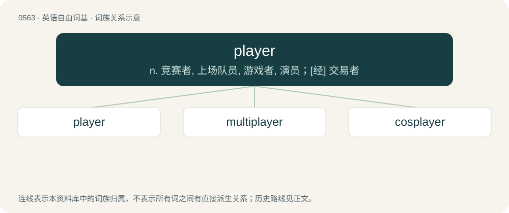

# 0632 · player — n. 竞赛者, 上场队员, 游戏者, 演员；\[经\] 交易者

[总目录](../00_总目录_按常用程度.md)

**类型**：英语自由词基　｜　**来源语言**：见词源记录

## 核心含义与来源

- 核心含义：n. 竞赛者, 上场队员, 游戏者, 演员；\[经\] 交易者
- 英文含义：One who plays any game or sport.
- 词形：player

**来源记录 1**（名词；One who plays any game or sport.）

From Middle English pleyer, playere, from Old English pleġere (“player, athlete, wrestler”), from Proto-West Germanic \*plegārī. Equivalent to play + -er.

## 词族图

## 单词速览（常用到不常用）

| 单词 | 音标 | 释义 |
|---|---|---|
| [player](#w-1) | 英 /ˈpleɪ.ə(ɹ)/；美 /ˈpleɪ.ɚ/ | n. 竞赛者, 上场队员, 游戏者, 演员；\[经\] 交易者 |
| [multiplayer](#w-2) | /ˌmʌl.tiˈpleɪ.əɹ/ | （电子游戏）多人的，多玩家的 |
| [cosplayer](#w-3) |  | 【英文】One who takes part in cosplay. |

## 逐词详解

### 1. player

**词性**：名词　｜　**音标**：英 /ˈpleɪ.ə(ɹ)/；美 /ˈpleɪ.ɚ/

**中文释义**：n. 竞赛者, 上场队员, 游戏者, 演员；\[经\] 交易者

**英文义项**：One who plays any game or sport. / An actor in a dramatic play.

**构词拆分**：play + -er

**词源与演化**：

From Middle English pleyer, playere, from Old English pleġere (“player, athlete, wrestler”), from Proto-West Germanic \*plegārī. Equivalent to play + -er.

**例句**：

> He thought he could become a player, at least at the state level.

该用例对应义项：A participant; one involved in something.

### 2. multiplayer

**词性**：名词　｜　**音标**：/ˌmʌl.tiˈpleɪ.əɹ/

**中文释义**：（电子游戏）多人的，多玩家的

**英文义项**：The feature of a video game where multiple human players play simultaneously. / Video game players who play multiplayer games.

**构词拆分**：multi- + player

**词源与演化**：

From multi- + player.

**例句**：

> I just heard that the game will have multiplayer when it comes out!

该用例对应义项：The feature of a video game where multiple human players play simultaneously.

### 3. cosplayer

**词性**：名词

**英文义项**：One who takes part in cosplay.

**构词拆分**：cos- + player；cosplay + -er

**词源与演化**：

From Japanese コスプレイヤー (kosupureiyā). Equivalent to cos- + player or cosplay + -er.

**例句**：

> I'm still a cosplayer at heart.
