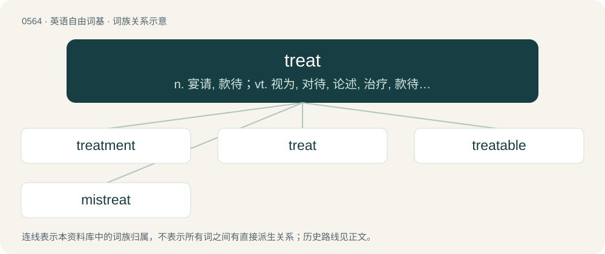

# 0633 · treat — n. 宴请, 款待；vt. 视为, 对待, 论述, 治疗, 款待；vi. 讨论, 谈判, 作东

[总目录](../00_总目录_按常用程度.md)

**类型**：英语自由词基　｜　**来源语言**：见词源记录

## 核心含义与来源

- 核心含义：n. 宴请, 款待；vt. 视为, 对待, 论述, 治疗, 款待；vi. 讨论, 谈判, 作东
- 英文含义：To negotiate, discuss terms, bargain (for or with).
- 词形：treat

**来源记录 1**（动词；To negotiate, discuss terms, bargain (for or with).）

From Middle English treten, from Anglo-Norman treter, Old French tretier, traiter, from Latin tractāre (“to pull", "to manage”), from the past participle stem of trahere (“to draw", "to pull”).

## 词族图

## 单词速览（常用到不常用）

| 单词 | 音标 | 释义 |
|---|---|---|
| [treatment](#w-1) | /ˈtɹiːtmənt/ | n. 治疗, 待遇, 处理；\[医\] 疗法, 治疗; 处理 |
| [treat](#w-2) | /tɹiːt/ | n. 宴请, 款待；vt. 视为, 对待, 论述, 治疗, 款待；vi. 讨论, 谈判, 作东 |
| [treatable](#w-3) |  | a. 好对付的, 能处理的, 能治疗的 |
| [mistreat](#w-4) | /mɪsˈtɹiːt/ | vt. 虐待；\[法\] 虐待, 苛待 |

## 逐词详解

### 1. treatment

**词性**：名词　｜　**音标**：/ˈtɹiːtmənt/

**中文释义**：n. 治疗, 待遇, 处理；\[医\] 疗法, 治疗; 处理

**英文义项**：The process or manner of treating someone or something. / Medical care for an illness or injury.

**构词拆分**：treat + -ment

**词源与演化**：

From treat + -ment. Compare French traitement.

**例句**：

> He still has nightmares resulting from the abusive treatment he received from his captors.

该用例对应义项：The process or manner of treating someone or something.

### 2. treat

**词性**：动词　｜　**音标**：/tɹiːt/

**中文释义**：n. 宴请, 款待；vt. 视为, 对待, 论述, 治疗, 款待；vi. 讨论, 谈判, 作东

**英文义项**：To negotiate, discuss terms, bargain (for or with). / To discourse; to handle a subject in writing or speaking; to conduct a discussion.

**词源与演化**：

From Middle English treten, from Anglo-Norman treter, Old French tretier, traiter, from Latin tractāre (“to pull", "to manage”), from the past participle stem of trahere (“to draw", "to pull”).

**例句**：

> The article treated feminism as a quintessentially modern movement.

该用例对应义项：To discourse on; to represent or deal with in a particular way, in writing or speaking.

### 3. treatable

**词性**：形容词

**中文释义**：a. 好对付的, 能处理的, 能治疗的

**英文义项**：Able to be treated; not incurable. / Not intractable; moderate.

**构词拆分**：treat + -able

**词源与演化**：

From Middle English tretable, from treten (“treat”) and Old French traitable, Anglo-Norman tretable; equivalent to treat + -able.

**例句**：

> In the 1980s, AIDS was not a treatable disease, and as a consequence the mortality rate at that time was very high.

该用例对应义项：Able to be treated; not incurable.

### 4. mistreat

**词性**：动词　｜　**音标**：/mɪsˈtɹiːt/

**中文释义**：vt. 虐待；\[法\] 虐待, 苛待

**英文义项**：To treat someone, or something roughly or badly. / To administer an incorrect treatment to a patient.

**构词拆分**：mis- + treat

**词源与演化**：

From mis- + treat.

**例句**：

> Tom is said to mistreat his wife.
