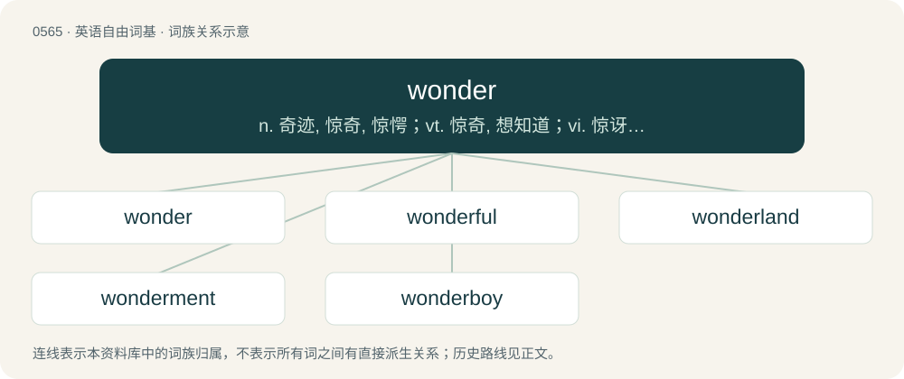

# 0634 · wonder — n. 奇迹, 惊奇, 惊愕；vt. 惊奇, 想知道；vi. 惊讶, 怀疑

[总目录](../00_总目录_按常用程度.md)

**类型**：英语自由词基　｜　**来源语言**：见词源记录

## 核心含义与来源

- 核心含义：n. 奇迹, 惊奇, 惊愕；vt. 惊奇, 想知道；vi. 惊讶, 怀疑
- 英文含义：A sense of awe, astonishment and curiosity, inspired by unexpected events, novel experiences and inexplicable circumstances, sometimes accompanied by surprise, shock or reverence.
- 词形：wonder

**来源记录 1**（名词；A sense of awe, astonishment and curiosity, inspired by unexpected events, novel experiences and inexplicable circumstances, sometimes accompanied by surprise, shock or reverence.）

From Middle English wonder, wunder, from Old English wundor (“wonder, miracle, marvel”), from Proto-West Germanic \*wundr, from Proto-Germanic \*wundrą. Cognate with Scots wunner (“wonder”), West Frisian wonder, wûnder (“wonder, miracle”), Dutch wonder (“miracle, wonder”), Low German wunner, wunder (“wonder”), German Wunder (“miracle, wonder”), Danish, Norwegian Bokmål, Norwegian Nynorsk, and Swedish under (“wonder, miracle”), Faroese and Icelandic undur (“wonder”). The verb is from Middle English wondren, from Old English wundrian, which is from Proto-Germanic \*wundrōną. Cognate with Saterland Frisian wunnerje, West Frisian wûnderje, Dutch wonderen, German Low German wunnern, German wundern, Swedish undra, Icelandic undra. Via PIE cognate with English wish (see more).

## 词族图

## 单词速览（常用到不常用）

| 单词 | 音标 | 释义 |
|---|---|---|
| [wonder](#w-1) | 英 /ˈwʌndə/；美 /ˈwʌndɚ/ | n. 奇迹, 惊奇, 惊愕；vt. 惊奇, 想知道；vi. 惊讶, 怀疑 |
| [wonderful](#w-2) | 英 /ˈwʌndəfl̩/；美 /ˈwʌndɚfl̩/ | a. 令人惊奇的, 奇妙的, 极好的 |
| [wonderland](#w-3) | 英 /ˈwʌndəˌlænd/；美 /ˈwʌndɚˌlænd/ | n. 奇境, 仙境, 非常奇妙的地方 |
| [wonderment](#w-4) | /ˈwʌndəmənt/ | n. 惊奇, 惊叹 |
| [wonderboy](#w-5) |  | 【英文】A male child prodigy, or (loosely) a talented male of any age. |

## 逐词详解

### 1. wonder

**词性**：名词　｜　**音标**：英 /ˈwʌndə/；美 /ˈwʌndɚ/

**中文释义**：n. 奇迹, 惊奇, 惊愕；vt. 惊奇, 想知道；vi. 惊讶, 怀疑

**英文义项**：A sense of awe, astonishment and curiosity, inspired by unexpected events, novel experiences and inexplicable circumstances, sometimes accompanied by surprise, shock or reverence. / Something that causes amazement or awe; a marvel.

**词源与演化**：

From Middle English wonder, wunder, from Old English wundor (“wonder, miracle, marvel”), from Proto-West Germanic \*wundr, from Proto-Germanic \*wundrą. Cognate with Scots wunner (“wonder”), West Frisian wonder, wûnder (“wonder, miracle”), Dutch wonder (“miracle, wonder”), Low German wunner, wunder (“wonder”), German Wunder (“miracle, wonder”), Danish, Norwegian Bokmål, Norwegian Nynorsk, and Swedish under (“wonder, miracle”), Faroese and Icelandic undur (“wonder”). The verb is from Middle English wondren, from Old English wundrian, which is from Proto-Germanic \*wundrōną. Cognate with Saterland Frisian wunnerje, West Frisian wûnderje, Dutch wonderen, German Low German wunnern, German wundern, Swedish undra, Icelandic undra. Via PIE cognate with English wish (see more).

**例句**：

> The idea was so ridiculous that it's a wonder anyone went along with it.

该用例对应义项：An astonishing and seemingly inexplicable turn of events.

### 2. wonderful

**词性**：形容词　｜　**音标**：英 /ˈwʌndəfl̩/；美 /ˈwʌndɚfl̩/

**中文释义**：a. 令人惊奇的, 奇妙的, 极好的

**英文义项**：Tending to excite wonder; surprising, extraordinary. / Surprisingly excellent; very good or admirable, extremely impressive.

**构词拆分**：wonder + -ful

**词源与演化**：

From Middle English wonderful, wondirful, from Old English wundorful (“wonderful”), from Proto-West Germanic \*wundrafull, equivalent to wonder + -ful. Cognate Dutch wondervol (“wonderful”), German wundervoll (“wonderful”). Compare Old English wuldorfull (“glorious”).

**例句**：

> What appears to be wonderful may turn out to be anything but.

该用例对应义项：Surprisingly excellent; very good or admirable, extremely impressive.

### 3. wonderland

**词性**：名词　｜　**音标**：英 /ˈwʌndəˌlænd/；美 /ˈwʌndɚˌlænd/

**中文释义**：n. 奇境, 仙境, 非常奇妙的地方

**英文义项**：A place full of wonder or marvels. / Synonym of headspace.

**构词拆分**：wonder + land

**词源与演化**：

From wonder + land.

**例句**：

> There really was an Alice, but Wonderland is a figment of the imagination.

### 4. wonderment

**词性**：名词　｜　**音标**：/ˈwʌndəmənt/

**中文释义**：n. 惊奇, 惊叹

**英文义项**：Wonder; astonishment. / A puzzle or curiosity.

**构词拆分**：wonder + -ment

**词源与演化**：

From wonder + -ment.

**例句**：

> The cat told the puppy a bedtime story with a series of trills, describing a world of swirling odors and wonderment.

### 5. wonderboy

**词性**：名词

**英文义项**：A male child prodigy, or (loosely) a talented male of any age.

**构词拆分**：wonder + boy

**词源与演化**：

From wonder + boy.
