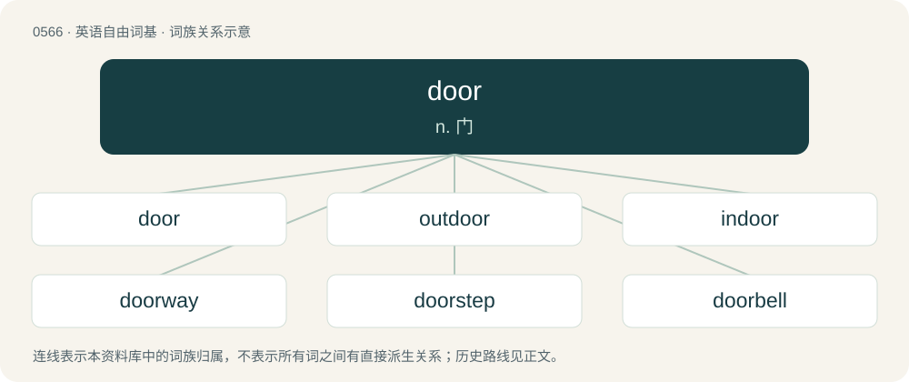

# 0635 · door — n. 门

[总目录](../00_总目录_按常用程度.md)

**类型**：英语自由词基　｜　**来源语言**：见词源记录

## 核心含义与来源

- 核心含义：n. 门
- 英文含义：A portal of entry into a building, room, or vehicle, typically consisting of a rigid plane movable on a hinge. It may have a handle to help open and close, a latch to hold it closed, and a lock that ensures it cannot be opened without a key.
- 词形：door

**来源记录 1**（名词；A portal of entry into a building, room, or vehicle, typically consisting of a rigid plane movable on a hinge. It may have a handle to help open and close, a latch to hold it closed, and a lock that ensures it cannot be opened without a key.）

From Middle English dore, dor, from Old English duru (“door”), dor (“gate”), from Proto-West Germanic \*dur, from Proto-Germanic \*durz, from Proto-Indo-European \*dʰwṓr, from \*dʰwer- (“doorway, door, gate”). Cognates Cognate with Scots door (“door”), Saterland Frisian Doore (“door”), West Frisian doar (“door”), Dutch deur (“door”), German Low German Door, Döör (“door”), German Tür (“door”), Tor (“gate”), Danish, Norn, Norwegian Bokmål, and Norwegian Nynorsk dør (“door”), Swedish dörr (“door”), Faroese and Icelandic dyr (“door”), Asturian, Aragonese and Spanish fuera (“outside”), Catalan, Leonese, and Portuguese fora (“outside”), French hors (“outside”), Galician fóra (“outside”), Italian fuori (“outside”), Mirandese fuora (“outside”), Latin foris and foras (“outside”), Ancient Greek θύρα (thúra), Albanian derë (“door”), Central Kurdish دەرگە (derge, “door”), Northern Kurdish derî (“door”), Persian در (dar, “door”), Belarusian дзве́ры (dzvjéry, “door”), Bulgarian две́ри (dvéri, “royal doors”), Czech dveře (“door”), Latvian durvis (“door”), Lithuanian durys (“door”), Macedonian двер (dver, “door”), Polish drzwi (“door”), Russian дверь (dverʹ), Serbo-Croatian dvȇri (“door”), dvar (“door”), Ukrainian две́рі (dvéri, “door”), Hindi द्वार (dvār, “door”), Armenian դուռ (duṙ, “door”), Irish doras (“door”), Sanskrit द्वार (dvāra, “door”). Despite similarities in spelling, not cognate with Dutch door, which is instead cognate with English through.

## 词族图

## 单词速览（常用到不常用）

| 单词 | 音标 | 释义 |
|---|---|---|
| [door](#w-1) | 英 /dɔː/；美 /doɹ/ | n. 门 |
| [outdoor](#w-2) | 英 /aʊtˈdɔː/ | a. 户外的, 屋外的, 露天的 |
| [indoor](#w-3) | 英 /ˈɪndɔː/；美 /ˈɪndoɹ/ | a. 户内的, 室内的 |
| [doorway](#w-4) | 英 /ˈdɔːweɪ/；美 /ˈdɔɹweɪ/ | n. 门口, 途径 |
| [doorstep](#w-5) | /ˈdɔː(ɹ)stɛp/ | n. 门阶 |
| [doorbell](#w-6) | 英 /ˈdɔː.bɛl/；美 /ˈdɔɹ.bɛl/ | n. 门铃 |
| [doorman](#w-7) | /ˈdɒːmæn/ | n. 看门人 |
| [doorknob](#w-8) | 英 /ˈdɔː.nɒb/；美 /ˈdɔɹ.nɑb/ | n. 球形门拉手 |
| [doormat](#w-9) | 英 /ˈdɔːˌmæt/；美 /ˈdɔɹˌmæt/ | n. 擦鞋垫 |
| [trapdoor](#w-10) | 英 /ˈtræpdɔː/；美 /ˈtræpdoɹ/ | n. 地板门, 活板门, 活动天窗 |
| [doorstop](#w-11) | /ˈdɒːstɒp/ | n. 制门器 |
| [doorframe](#w-12) | 英 /ˈdɔːˌfɹeɪm/；美 /ˈdɔɹˌfɹeɪm/ | n. 门框 |

## 逐词详解

### 1. door

**词性**：名词　｜　**音标**：英 /dɔː/；美 /doɹ/

**中文释义**：n. 门

**英文义项**：A portal of entry into a building, room, or vehicle, typically consisting of a rigid plane movable on a hinge. It may have a handle to help open and close, a latch to hold it closed, and a lock that ensures it cannot be opened without a key. / A building with a door, especially a house.

**词源与演化**：

From Middle English dore, dor, from Old English duru (“door”), dor (“gate”), from Proto-West Germanic \*dur, from Proto-Germanic \*durz, from Proto-Indo-European \*dʰwṓr, from \*dʰwer- (“doorway, door, gate”). Cognates Cognate with Scots door (“door”), Saterland Frisian Doore (“door”), West Frisian doar (“door”), Dutch deur (“door”), German Low German Door, Döör (“door”), German Tür (“door”), Tor (“gate”), Danish, Norn, Norwegian Bokmål, and Norwegian Nynorsk dør (“door”), Swedish dörr (“door”), Faroese and Icelandic dyr (“door”), Asturian, Aragonese and Spanish fuera (“outside”), Catalan, Leonese, and Portuguese fora (“outside”), French hors (“outside”), Galician fóra (“outside”), Italian fuori (“outside”), Mirandese fuora (“outside”), Latin foris and foras (“outside”), Ancient Greek θύρα (thúra), Albanian derë (“door”), Central Kurdish دەرگە (derge, “door”), Northern Kurdish derî (“door”), Persian در (dar, “door”), Belarusian дзве́ры (dzvjéry, “door”), Bulgarian две́ри (dvéri, “royal doors”), Czech dveře (“door”), Latvian durvis (“door”), Lithuanian durys (“door”), Macedonian двер (dver, “door”), Polish drzwi (“door”), Russian дверь (dverʹ), Serbo-Croatian dvȇri (“door”), dvar (“door”), Ukrainian две́рі (dvéri, “door”), Hindi द्वार (dvār, “door”), Armenian դուռ (duṙ, “door”), Irish doras (“door”), Sanskrit द्वार (dvāra, “door”). Despite similarities in spelling, not cognate with Dutch door, which is instead cognate with English through.

**例句**：

> The bar owner gives each band a percentage of the door and charges customers more to get in.

该用例对应义项：The proceeds from entrance fees and/or ticket sales at a venue such as a bar or nightclub, especially in relation to portion paid to the entertainers.

### 2. outdoor

**词性**：形容词　｜　**音标**：英 /aʊtˈdɔː/

**中文释义**：a. 户外的, 屋外的, 露天的

**英文义项**：Situated in, designed to be used in, or carried on in the open air. / Pertaining to charity administered or received away from, or independently from, a workhouse or other institution.

**构词拆分**：out- + door

**词源与演化**：

From out- + door.

**例句**：

> Badminton and other outdoor games.

该用例对应义项：located, suited for, or taking place in the open air

### 3. indoor

**词性**：形容词　｜　**音标**：英 /ˈɪndɔː/；美 /ˈɪndoɹ/

**中文释义**：a. 户内的, 室内的

**英文义项**：Situated in, or designed to be used in, or carried on within, the interior of a building.

**构词拆分**：(with)in + door

**词源与演化**：

From (with)in + door, first attested 1711.

**例句**：

> These fireworks are not for indoor use!

该用例对应义项：Situated in, or designed to be used in, or carried on within, the interior of a building.

### 4. doorway

**词性**：名词　｜　**音标**：英 /ˈdɔːweɪ/；美 /ˈdɔɹweɪ/

**中文释义**：n. 门口, 途径

**英文义项**：The passage of a door; a door-shaped entrance into a house or a room. / An opening or passage in general.

**构词拆分**：door + way

**词源与演化**：

From door + way.

**例句**：

> Soon after dawn, he came to the doorway of my tent.

该用例对应义项：An opening or passage in general.

### 5. doorstep

**词性**：名词　｜　**音标**：/ˈdɔː(ɹ)stɛp/

**中文释义**：n. 门阶

**英文义项**：An outside step leading up to the door of a building, usually a home. / One's immediate neighborhood or locality.

**构词拆分**：door + step

**词源与演化**：

From door + step.

**例句**：

> They want to build the prison right on our doorstep; it will only be half a mile away and being that close scares me.

该用例对应义项：One's immediate neighborhood or locality.

### 6. doorbell

**词性**：动词　｜　**音标**：英 /ˈdɔː.bɛl/；美 /ˈdɔɹ.bɛl/

**中文释义**：n. 门铃

**英文义项**：To ring many doorbells in an effort to contact people and thereby spread information or solicit. / To ring many doorbells of (target people or an area) in an effort to contact people and thereby spread information or solicit.

**构词拆分**：door + bell

**词源与演化**：

From door + bell.

**例句**：

> We doorbelled the whole district in an effort to get out the vote.

该用例对应义项：To ring many doorbells of (target people or an area) in an effort to contact people and thereby spread information or solicit.

### 7. doorman

**词性**：名词　｜　**音标**：/ˈdɒːmæn/

**中文释义**：n. 看门人

**英文义项**：A person who holds open the door at the entryway (entrance) to a building, summons taxicabs, and provides an element of security; in apartment buildings, he also accepts deliveries and may perform certain concierge type services.

**构词拆分**：door + -man

**词源与演化**：

From door + -man.

**例句**：

> I showed my ticket to the doorman and went into the theatre.

### 8. doorknob

**词性**：名词　｜　**音标**：英 /ˈdɔː.nɒb/；美 /ˈdɔɹ.nɑb/

**中文释义**：n. 球形门拉手

**英文义项**：A circular device attached to a door, the rotation of which permits the unlatching of the door. / A stupid person.

**构词拆分**：door + knob

**词源与演化**：

From door + knob.

**例句**：

> The only fingerprints that the police found on the doorknob were Tom's.

### 9. doormat

**词性**：名词　｜　**音标**：英 /ˈdɔːˌmæt/；美 /ˈdɔɹˌmæt/

**中文释义**：n. 擦鞋垫

**英文义项**：A coarse mat at the entrance to a house, upon which one wipes one's shoes. / Someone who habitually yields to others' demands or mistreatment, failing to assert their own rights or interests.

**构词拆分**：door + mat

**词源与演化**：

From door + mat.

**例句**：

> Wipe your shoes on the doormat before you start plodding around in the house.

该用例对应义项：A coarse mat at the entrance to a house, upon which one wipes one's shoes.

### 10. trapdoor

**词性**：名词　｜　**音标**：英 /ˈtræpdɔː/；美 /ˈtræpdoɹ/

**中文释义**：n. 地板门, 活板门, 活动天窗

**英文义项**：A hinged or sliding door set into a floor or ceiling. / Such a trap set into the floor of a stage to allow fast exits and entrances.

**构词拆分**：trap + door

**词源与演化**：

From trap + door.

**例句**：

> Hey, damned children! Beware the trap, the trapdoor, and the dog!

### 11. doorstop

**词性**：名词　｜　**音标**：/ˈdɒːstɒp/

**中文释义**：n. 制门器

**英文义项**：Any device or object used to halt the motion of a door, as a large or heavy object, a wedge, or some piece of hardware fixed to the floor, door or wall. / A large book, which by implication could be used to stop a door.

**构词拆分**：door + stop

**词源与演化**：

From door + stop.

**例句**：

> The door was held open with a doorstop.

### 12. doorframe

**词性**：名词　｜　**音标**：英 /ˈdɔːˌfɹeɪm/；美 /ˈdɔɹˌfɹeɪm/

**中文释义**：n. 门框

**英文义项**：The frame into which a door is fitted.

**构词拆分**：door + frame

**词源与演化**：

From door + frame.

**例句**：

> He was leaning against the doorframe and waiting for me with his arms crossed.
