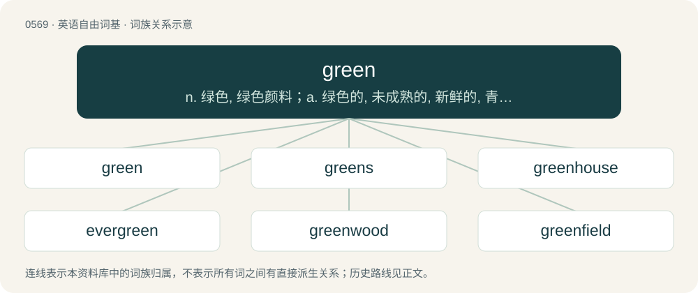

# 0637 · green — n. 绿色, 绿色颜料；a. 绿色的, 未成熟的, 新鲜的, 青春的, 无经验的, 脸色发青的

[总目录](../00_总目录_按常用程度.md)

**类型**：英语自由词基　｜　**来源语言**：见词源记录

## 核心含义与来源

- 核心含义：n. 绿色, 绿色颜料；a. 绿色的, 未成熟的, 新鲜的, 青春的, 无经验的, 脸色发青的
- 英文含义：The color of grass and leaves; a primary additive color midway between yellow and blue which is evoked by light between roughly 495–570 nm.
- 词形：green

**多个词源／构词路径**：同一拼写可能有不同来源；以下按词性和含义分别列出。

**来源记录 1**（名词；The color of grass and leaves; a primary additive color midway between yellow and blue which is evoked by light between roughly 495–570 nm.）

From Middle English grene, from Old English grēne, from Proto-West Germanic \*grōnī, from Proto-Germanic \*grōniz, from Proto-Indo-European \*gʰreh₁- (“to grow”). More at grow. Doublet of Gruen. See also North Frisian green, West Frisian grien, Dutch groen, Low German grön, green, greun, German grün, Danish and Norwegian Nynorsk grøn, Swedish grön, Norwegian Bokmål grønn, Faroese grønur, Icelandic grænn. The sense of obscene, pornographic, or sexual in the Philippines is a semantic loan from Spanish verde. In other varieties of English, blue is the color instead associated with obscenity or pornography.

**来源记录 2**（动词；To make or turn (something) green or greener.）

From Middle English grenen, from Old English grēnian (“to become green, flourish”), from Proto-West Germanic \*grōnijan, from Proto-Germanic \*grōnijōną, \*grōnijaną (“to become green”), from the adjective (see above). Cognate with Saterland Frisian gräinje, German Low German grönen, German grünen, Swedish gröna, Icelandic gróna.

**来源记录 3**（感叹词；Used to indicate that the speaker wishes to commence (or to continue a previously stopped) sexual activity.）

From the colors used on traffic lights; green being the one that allows vehicles to move on.

## 词族图

## 单词速览（常用到不常用）

| 单词 | 音标 | 释义 |
|---|---|---|
| [green](#w-1) | 英 /ˈɡɹiːn/；美 /ˈɡɹin/ | n. 绿色, 绿色颜料；a. 绿色的, 未成熟的, 新鲜的, 青春的, 无经验的, 脸色发青的 |
| [greens](#w-2) | /ɡɹiːnz/ | n. 绿叶蔬菜 |
| [greenhouse](#w-3) | 英 /ˈɡɹiːnhaʊs/；美 /ˈɡɹːnˌ(h)aʊs/ | n. 温室 |
| [evergreen](#w-4) | 英 /ˈɛvəɡɹiːn/；美 /ˈɛvɚɡɹin/ | n. 常绿树, 常绿植物；a. 常绿的 |
| [greenwood](#w-5) | 英 /ˈɡɹiːnwʊd/；美 /ˈɡɹinwʊd/ | n. 绿林, 湿材 |
| [greenfield](#w-6) | /ˈgriːnfiːld/ | a. 未开发地区的；待开发地区的 |
| [greenish](#w-7) | /ˈɡɹiːnɪʃ/ | a. 呈绿色的 |
| [greenery](#w-8) | /ˈɡɹiːnəɹi/ | n. 绿叶, 绿树, 装饰用的绿树枝或叶 |
| [greenway](#w-9) | /ˈ^riːnwei/ | n. &lt;主美&gt;\[常用作定语\]林荫道路,园林路 |
| [greenbrier](#w-10) | /ˈgriːnbraiə/ | n. 圆叶菝葜 |
| [greenback](#w-11) | /ˈgriːnbæk/ | n. 美钞, 绿背动物；\[法\] 美钞 |
| [wintergreen](#w-12) | /ˈwɪntə(ɹ)ˌɡɹiːn/ | \[医\] 冬绿\[树\] |
| [greenstone](#w-13) | /ˈgriːnstəun/ | n. 绿岩, 软玉 |
| [greengrocer](#w-14) | 英 /ˈɡɹinˌɡɹəʊs.ə(ɹ)/ | n. 蔬菜水果商, 菜贩 |
| [greeny](#w-15) | /ˈgriːni/ | a. 呈绿色的 |
| [greenness](#w-16) | 英 /ˈɡɹiːn.nəs/ | n. 绿色, 新鲜, 未熟 |

## 逐词详解

### 1. green

**词性**：形容词　｜　**音标**：英 /ˈɡɹiːn/；美 /ˈɡɹin/

**中文释义**：n. 绿色, 绿色颜料；a. 绿色的, 未成熟的, 新鲜的, 青春的, 无经验的, 脸色发青的

**英文义项**：Of a green hue. / Sickly, unwell.

**词源与演化**：

From Middle English grene, from Old English grēne, from Proto-West Germanic \*grōnī, from Proto-Germanic \*grōniz, from Proto-Indo-European \*gʰreh₁- (“to grow”). More at grow. Doublet of Gruen. See also North Frisian green, West Frisian grien, Dutch groen, Low German grön, green, greun, German grün, Danish and Norwegian Nynorsk grøn, Swedish grön, Norwegian Bokmål grønn, Faroese grønur, Icelandic grænn. The sense of obscene, pornographic, or sexual in the Philippines is a semantic loan from Spanish verde. In other varieties of English, blue is the color instead associated with obscenity or pornography.

**例句**：

> John's kind of green, so take it easy on him this first week.

该用例对应义项：Inexperienced.

### 2. greens

**词性**：名词　｜　**音标**：/ɡɹiːnz/

**中文释义**：n. 绿叶蔬菜

**英文义项**：Leaves and leaf-like parts of edible plants when eaten as vegetables or in salads. / Green vegetables; edible plants or plant parts that contain chlorophyll.

**构词拆分**：green + -s

**词源与演化**：

From Middle English grenes, equivalent to green + -s. Compare Saterland Frisian Gräinieten (“vegetable”), West Frisian grienten (“vegetables, greens”), Dutch groenten (“vegetables, greens”), German Low German Gröönten (“vegetables, greens”), Danish grøntsager (“vegetables”), Swedish grönsaker (“vegetables”).

**用法示例／搭配（非完整句）**：

> starches, meats, and greens

该用例对应义项：Green vegetables; edible plants or plant parts that contain chlorophyll.

### 3. greenhouse

**词性**：名词　｜　**音标**：英 /ˈɡɹiːnhaʊs/；美 /ˈɡɹːnˌ(h)aʊs/

**中文释义**：n. 温室

**英文义项**：A building used to grow plants, particularly one with large glass windows or plastic sheeting to trap heat from sunlight even in intemperate seasons or climates. / The glass of a plane's cockpit.

**构词拆分**：green + house

**词源与演化**：

From green + house ("house for growing greens"), in reference to the produce grown within.

**例句**：

> The industrial production of livestock is the leading contributor to greenhouse gases.

### 4. evergreen

**词性**：形容词　｜　**音标**：英 /ˈɛvəɡɹiːn/；美 /ˈɛvɚɡɹin/

**中文释义**：n. 常绿树, 常绿植物；a. 常绿的

**英文义项**：Of plants, especially trees, that do not shed their leaves seasonally. / Being a clause which causes an automatic renewal of a contract unless action is taken.

**构词拆分**：ever + green

**词源与演化**：

From ever + green.

**例句**：

> The Evergreen Point Floating Bridge is the world's longest floating bridge.

### 5. greenwood

**词性**：名词　｜　**音标**：英 /ˈɡɹiːnwʊd/；美 /ˈɡɹinwʊd/

**中文释义**：n. 绿林, 湿材

**英文义项**：A forest in full leaf, as in summer. / Wood that is green; in other words, not seasoned.

**构词拆分**：green + wood

**词源与演化**：

From Middle English grene wode (“a forest that is leafed out, a greenwood" also "unseasoned firewood”), equivalent to green + wood.

**例句**：

> The greenwood was Robin Hood's home.

该用例对应义项：woodlands in full leaf

### 6. greenfield

**词性**：名词　｜　**音标**：/ˈgriːnfiːld/

**中文释义**：a. 未开发地区的；待开发地区的

**英文义项**：A site, to be used for housing or commerce, whose previous use (if any) was agricultural.

**构词拆分**：green + field

**词源与演化**：

From green + field.

**用法示例／搭配（非完整句）**：

> greenfield development

该用例对应义项：A site, to be used for housing or commerce, whose previous use (if any) was agricultural.

### 7. greenish

**词性**：形容词　｜　**音标**：/ˈɡɹiːnɪʃ/

**中文释义**：a. 呈绿色的

**英文义项**：Somewhat green in color.

**构词拆分**：green + -ish

**词源与演化**：

From Middle English grenisch, grenysch, equivalent to green + -ish.

**例句**：

> There are greenish stone chairs next to the tree next to the teahouse.

### 8. greenery

**词性**：名词　｜　**音标**：/ˈɡɹiːnəɹi/

**中文释义**：n. 绿叶, 绿树, 装饰用的绿树枝或叶

**英文义项**：Green foliage or verdure. / Foliage used as decoration.

**构词拆分**：green + -ery

**词源与演化**：

From green + -ery.

**例句**：

> There is less crime in apartment buildings surrounded by trees and greenery.

### 9. greenway

**词性**：名词　｜　**音标**：/ˈ^riːnwei/

**中文释义**：n. &lt;主美&gt;\[常用作定语\]林荫道路,园林路

**英文义项**：A corridor of undeveloped land or parkland, set aside for environmental protection or recreational and primarily nonmotorized use, such as bicycle paths.

**构词拆分**：green + way

**词源与演化**：

From green + way.

### 10. greenbrier

**词性**：名词　｜　**音标**：/ˈgriːnbraiə/

**中文释义**：n. 圆叶菝葜

**英文义项**：Any of several American prickly woody vines of the genus Smilax.

**构词拆分**：green + brier

**词源与演化**：

From green + brier.

### 11. greenback

**词性**：名词　｜　**音标**：/ˈgriːnbæk/

**中文释义**：n. 美钞, 绿背动物；\[法\] 美钞

**英文义项**：Any bill that is legal tender in the US (originally printed with green and black ink) issued by the Federal Reserve. / The United States dollar.

**构词拆分**：green + back

**词源与演化**：

From green + back.

**例句**：

> The greenback lost ground against the yen.

### 12. wintergreen

**词性**：名词　｜　**音标**：/ˈwɪntə(ɹ)ˌɡɹiːn/

**中文释义**：\[医\] 冬绿\[树\]

**英文义项**：Gaultheria procumbens, native to North America, having solitary white flowers and aromatic leaves (checkerberry or teaberry) / Gaultheria humifusa – alpine wintergreen

**构词拆分**：winter + green

**词源与演化**：

From winter + green.

**例句**：

> He used flavorings from trees and plants like sassafras and sarsaparilla, wintergreen, birch bark, herbs and juniper berries.

### 13. greenstone

**词性**：名词　｜　**音标**：/ˈgriːnstəun/

**中文释义**：n. 绿岩, 软玉

**英文义项**：Any of several green-hued minerals used for making various artefacts in early Mesoamerican cultures, e.g. greenschist, chlorastrolite, serpentine, omphacite, or chrysoprase. / The pounamu, the green-hued minerals of New Zealand used by the Māori to make tools, ornaments and weapons (any of three varieties of nephrite jade or one variety of bowenite).

**构词拆分**：green + stone

**词源与演化**：

From green + stone.

### 14. greengrocer

**词性**：名词　｜　**音标**：英 /ˈɡɹinˌɡɹəʊs.ə(ɹ)/

**中文释义**：n. 蔬菜水果商, 菜贩

**英文义项**：A person who sells fresh vegetables and fruit, normally from a relatively small shop. / A relatively small shop selling fresh vegetables and fruit.

**构词拆分**：green + grocer

**词源与演化**：

From green + grocer.

**例句**：

> I built up some debts at the rice seller and at the greengrocer.

### 15. greeny

**词性**：形容词　｜　**音标**：/ˈgriːni/

**中文释义**：a. 呈绿色的

**英文义项**：greenish; somewhat green

**构词拆分**：green + -y

**词源与演化**：

From green + -y.

### 16. greenness

**词性**：名词　｜　**音标**：英 /ˈɡɹiːn.nəs/

**中文释义**：n. 绿色, 新鲜, 未熟

**英文义项**：The state or quality of being green; green colour. / Inexperience.

**构词拆分**：green + -ness

**词源与演化**：

From Middle English grennesse, from Old English grennes; equivalent to green + -ness.

**例句**：

> He was nostalgic about the greenness of his homeland.
