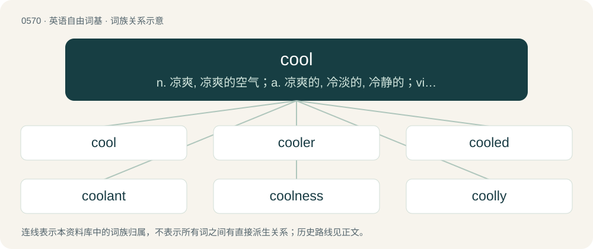

# 0639 · cool — n. 凉爽, 凉爽的空气；a. 凉爽的, 冷淡的, 冷静的；vi. 冷却, 平息

[总目录](../00_总目录_按常用程度.md)

**类型**：英语自由词基　｜　**来源语言**：见词源记录

## 核心含义与来源

- 核心含义：n. 凉爽, 凉爽的空气；a. 凉爽的, 冷淡的, 冷静的；vi. 冷却, 平息
- 英文含义：Of a mildly low temperature.
- 词形：cool

**多个词源／构词路径**：同一拼写可能有不同来源；以下按词性和含义分别列出。

**来源记录 1**（形容词；Of a mildly low temperature.）

From Middle English cool, from Old English cōl (“cool, cold, tranquil, calm”), from Proto-West Germanic \*kōl(ī), from Proto-Germanic \*kōluz (“cool”), from \*kalaną (“to be cold, to freeze”), Proto-Indo-European \*gel- (“to be cold, to freeze”). Cognates Cognate with North Frisian kool, koul, kuul, kölj, kööl (“cold”), Saterland Frisian köil (“cool”), West Frisian koel (“cool”), Cimbrian khuul (“chilly, cool”), Dutch koel (“cool”), German kühl (“cool”), Low German köhl (“cool”), Luxembourgish kill (“cool”), Vilamovian kił (“cool”); also Latin gelū, gelum, gelus (“frost; chill, cold”), Belarusian хо́лад (xólad, “cold”), Bulgarian хлад (hlad, “chill, coolness”), Czech chlad (“cold”), Macedonian лад (lad, “shade; coolness”), Polish chłód (“cold”), Russian and Ukrainian хо́лод (xólod, “cold”), Serbo-Croatian хла̑д, hlȃd (“shade”), Sanskrit जड (jaḍa, “cold; stiff”), जल (jala, “water”). Related to cold.

**来源记录 2**（动词；To lose heat, to get colder.）

From Middle English colen, from Old English cōlian (“to cool, grow cold, be cold”), from Proto-West Germanic \*kōlēn (“to become cold”), from Proto-Indo-European \*gel- (“to freeze”). Cognate with Dutch koelen (“to cool”), German kühlen (“to cool”), Swedish kyla (“to cool, refrigerate”). Also partially from Middle English kelen, from Old English cēlan (“to cool, be cold, become cold”), from Proto-West Germanic \*kōlijan, from Proto-Germanic \*kōlijaną (“to cool”), altered to resemble the adjective cool. See keel.

## 词族图

## 单词速览（常用到不常用）

| 单词 | 音标 | 释义 |
|---|---|---|
| [cool](#w-1) | 英 /kuːl/；美 /kul/ | n. 凉爽, 凉爽的空气；a. 凉爽的, 冷淡的, 冷静的；vi. 冷却, 平息 |
| [cooler](#w-2) | 英 /ˈkuː.lə(ɹ)/；美 /ˈku.lɚ/ | n. 冷却器；\[化\] 冷却器 |
| [cooled](#w-3) | 英 /kuːld/；美 /kuld/ | a. 冷却的；v. （使）变凉( cool的过去式 ); （使）冷静 |
| [coolant](#w-4) | /ˈkuːlənt/ | n. 冷却剂；\[计\] 冷却剂 |
| [coolness](#w-5) | /ˈkuːlnəs/ | n. 冷, 凉爽, 冷静 |
| [coolly](#w-6) | /ˈkuːl.li/ | adv. 沉着, 自若 |
| [bool](#w-7) |  | 【英文】To relax or hang out (especially with someone). |
| [coolio](#w-8) | 美 /ˈkulioʊ/ | \[人名\]库里奥 |

## 逐词详解

### 1. cool

**词性**：形容词　｜　**音标**：英 /kuːl/；美 /kul/

**中文释义**：n. 凉爽, 凉爽的空气；a. 凉爽的, 冷淡的, 冷静的；vi. 冷却, 平息

**英文义项**：Of a mildly low temperature. / Allowing or suggesting heat relief.

**词源与演化**：

From Middle English cool, from Old English cōl (“cool, cold, tranquil, calm”), from Proto-West Germanic \*kōl(ī), from Proto-Germanic \*kōluz (“cool”), from \*kalaną (“to be cold, to freeze”), Proto-Indo-European \*gel- (“to be cold, to freeze”). Cognates Cognate with North Frisian kool, koul, kuul, kölj, kööl (“cold”), Saterland Frisian köil (“cool”), West Frisian koel (“cool”), Cimbrian khuul (“chilly, cool”), Dutch koel (“cool”), German kühl (“cool”), Low German köhl (“cool”), Luxembourgish kill (“cool”), Vilamovian kił (“cool”); also Latin gelū, gelum, gelus (“frost; chill, cold”), Belarusian хо́лад (xólad, “cold”), Bulgarian хлад (hlad, “chill, coolness”), Czech chlad (“cold”), Macedonian лад (lad, “shade; coolness”), Polish chłód (“cold”), Russian and Ukrainian хо́лод (xólod, “cold”), Serbo-Croatian хла̑д, hlȃd (“shade”), Sanskrit जड (jaḍa, “cold; stiff”), जल (jala, “water”). Related to cold.

**例句**：

> I like cool weather the most 'cause it's not too hot to wear a jacket but I won't be too cold in my shorts.

该用例对应义项：Of a mildly low temperature.

### 2. cooler

**词性**：名词　｜　**音标**：英 /ˈkuː.lə(ɹ)/；美 /ˈku.lɚ/

**中文释义**：n. 冷却器；\[化\] 冷却器

**英文义项**：Anything which cools. / An insulated bin or box used with ice or freezer packs to keep food or beverages cold while picnicking or camping.

**构词拆分**：cool + -er

**词源与演化**：

From cool + -er.

**例句**：

> They served wine coolers in the afternoon.

该用例对应义项：A type of drink made with alcohol, especially wine, mixed with fruit juice.

### 3. cooled

**词性**：形容词　｜　**音标**：英 /kuːld/；美 /kuld/

**中文释义**：a. 冷却的；v. （使）变凉( cool的过去式 ); （使）冷静

**英文义项**：Brought to a lower temperature. / With a descriptive word: brought to a lower temperature by means of.

**构词拆分**：cool + -ed

**词源与演化**：

From cool + -ed.

**用法示例／搭配（非完整句）**：

> a water-cooled engine

该用例对应义项：With a descriptive word: brought to a lower temperature by means of.

### 4. coolant

**词性**：名词　｜　**音标**：/ˈkuːlənt/

**中文释义**：n. 冷却剂；\[计\] 冷却剂

**英文义项**：A medium, usually fluid, used to draw heat from an object.

**构词拆分**：cool + -ant

**词源与演化**：

From cool + -ant.

**例句**：

> Coolant is used in car engines and industrial processes, where excess heat could cause machine damage.

该用例对应义项：A medium, usually fluid, used to draw heat from an object.

### 5. coolness

**词性**：名词　｜　**音标**：/ˈkuːlnəs/

**中文释义**：n. 冷, 凉爽, 冷静

**英文义项**：Moderate chilliness. / Calmness, confidence, or level-headedness.

**构词拆分**：cool + -ness

**词源与演化**：

From Middle English colnes, colnesse, from Old English cōlnes, cœ̄lnes, cēlnes (“coolness; cool air, breeze”), from Proto-West Germanic \*kōlinassī, equivalent to cool + -ness. Cognate with Middle High German kuolnisse, küelnisse (“cooling, coolness”).

**例句**：

> We felt the coolness when we arrived at the river.

### 6. coolly

**词性**：副词　｜　**音标**：/ˈkuːl.li/

**中文释义**：adv. 沉着, 自若

**英文义项**：At a moderately low temperature. / In a cool, unpanicked or collected manner.

**构词拆分**：cool + -ly

**词源与演化**：

From cool + -ly (adverbial suffix).

**例句**：

> They walked in, not even wearing masks, and coolly robbed the bank of twelve thousand pounds.

该用例对应义项：With calm impudence.

### 7. bool

**词性**：动词

**英文义项**：To relax or hang out (especially with someone).

**构词拆分**：b- + (c)ool

**词源与演化**：

From b- + (c)ool, likely originally (or in imitation of) Blood slang.

**例句**：

> I'm going to go bool with the boys.

该用例对应义项：To relax or hang out (especially with someone).

### 8. coolio

**词性**：形容词　｜　**音标**：美 /ˈkulioʊ/

**中文释义**：\[人名\]库里奥

**英文义项**：Cool; awesome; all right.

**构词拆分**：cool + -i- + -o

**词源与演化**：

From cool + -i- + -o.
