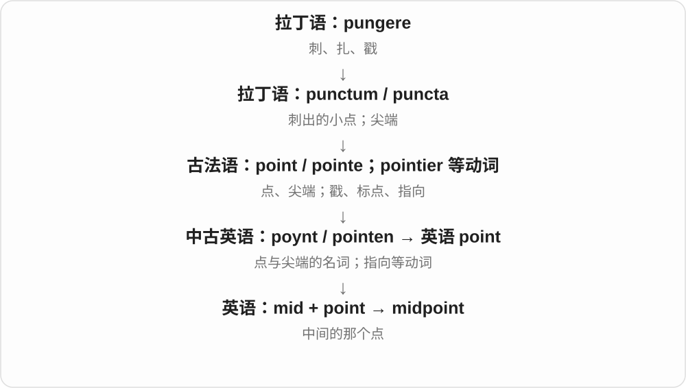

# 0640 · mid — 中间；时间中段；质量一般般的口语评价

[逐词精讲目录](../00_逐词精讲目录.md) · [总目录](../00_总目录_按常用程度.md)

## 核心词根与来源

mid 从古英语 midd、midde 及更早日耳曼语中间材料延续，与 middle 同族。现代非正式评价进一步把中间档用于质量。

**MID：先定位在中间，再看是否在评价中间档**

midpoint 是中点，midair 在空中；口语说 a mid film，则常在说影片平平、没什么亮点。

- **中间位置与基本词族**：mid · middle
- **具体位置与时间、空间参照**：midpoint · midair · amid
- **mid → middes → midst：中间、正当其中**：midst

## 词形与演化规律

mid + point → midpoint；mid + air → midair；amid 接较早 on middan 等中间位置表达，不是现代前缀公式的临时作品。

mid 接旧副词性 -s 成 middes，后来出现 t，原因有最高级类比等解释。末尾 -st 不是现代最高级后缀；in the midst of 可用于空间和事件过程。

## 单词速览（按词族由简到繁）

同一基础词的相关扩展放在一起，先读基础形式，再读扩展；各组之间优先读常用的。具体词源关系见各词讲解。

| 单词 | 音标 | 核心意思 |
|---|---|---|
| [mid](#w-1) | /mɪd/ | 中间的；中期的；一般般、不出色的〔口语〕 |
| [middle](#w-5) | /ˈmɪdəl/ | 中间；中部；中间的 |
| [midpoint](#w-3) | 英、美 /ˈmɪdpɔɪnt/ | 中点；中途时点 |
| [midair](#w-4) | 英 /ˌmɪdˈeə/；美 /ˌmɪdˈer/ | 在空中；半空 |
| [amid](#w-2) | /əˈmɪd/ | 在……当中；处于……包围、背景之中〔较书面〕 |
| [midst](#w-6) | 英、美 /mɪdst/ | 中间、当中；事情进行之中 |

## 逐词讲解

### 1. mid — 中间的；中期的；一般般、不出色的〔口语〕

**音标**：/mɪd/

**先抓住这个画面**

原先把位置放在中间，后来评价东西也能说卡在中间档：不算很差，但没什么亮点。That film was mid 常是这种随意评价。

**怎么拆**

接古英语 midd、midde，经中古英语延续，属于中间、居中的旧日耳曼语词族。现代口语把中间档引到质量一般，与 middling 等表达也有联系。

**怎么变成今天的意思**

**古英语 midd、midde → 中古英语 mid**  
中间位置、时间中段

↓

**现代 mid 的一般般义**  
质量平平、没有特别出色的地方

mid to late October 十月中下旬；That game was mid. 那个游戏一般般。后一个是口语评价，正式评价中通常用更具体的说法。

**常见搭配与例句**

mid to late；a rather mid performance。

> We expect the work to finish in mid to late November.

我们预计工作会在十一月中下旬结束。

> The acting was good, but the story was mid.

表演不错，但故事一般般。

**别混淆**

middle 常作独立名词或完整修饰语；mid 很多传统用法在组合中。口语 mid 说质量平平，不是把影片播放进度停在一半。

### 2. middle — 中间；中部；中间的

**音标**：/ˈmɪdəl/

**先抓住这个画面**

两头之间的那一段，也能把一个过程、年龄或次序想成有开头和结尾的一条线。

**怎么拆**

继承古英语 middel，与 mid 中间的同族。现代 -le 在这里不是随意添加、表示小的英语后缀，不把历史词形硬拆成 mid + 小东西。

**怎么变成今天的意思**

**古英语 middel → 中古英语 middel、myddel → middle**  
中间、中心；与 mid 同族

↓

**现代 middle**  
空间中部 → 时间、次序、等级等的中间

in the middle of 在……中间，the middle seat 中间座位，the middle of the night 半夜；middle school 是学校阶段名称，具体学段因地区而异。

**常见搭配与例句**

in the middle of；the middle seat；the middle of the night；middle age。

> She sat in the middle of the row.

她坐在那一排中间。

> The phone rang in the middle of the meeting.

会议进行中，电话响了。

**别混淆**

middle 是中间区域，centre 常强调中心点；in the middle of a meeting 说会议进行中，不要求恰好进行到总时长一半。

### 3. midpoint — 中点；中途时点

**音标**：英、美 /ˈmɪdpɔɪnt/

**先抓住这个画面**

把两端连起来，正好走了一半的那个位置。

**怎么拆**

mid“中间” + point。

**怎么变成今天的意思**

数学里的 midpoint 到线段两端距离相等；一般话语里也说项目、故事进行到一半。

**常见搭配与例句**

the midpoint of a line；at the midpoint；reach the midpoint。

> The midpoint of the segment lies at the centre of the circle.

这条线段的中点位于圆心。

> At the midpoint of the course, we reviewed our progress.

课程进行到一半时，我们回顾了学习进度。

**别混淆**

middle 可以是一片中间区域；midpoint 更明确地指正中的一个位置或阶段。

### 4. midair — 在空中；半空

**音标**：英 /ˌmɪdˈeə/；美 /ˌmɪdˈer/

**先抓住这个画面**

还没落到地面，也不搁在支撑面上，东西正处在空中。

**怎么拆**

mid（中间）+ air，形成空中、半空的整体表达；不是必须位于大气层高度的精确中点。

**怎么变成今天的意思**

**英语 mid；air**  
并列组合的两部分

↓

**mid + air → midair**  
处在空中、离地状态

in midair 是在半空，a midair collision 是空中相撞，catch a ball in midair 是球落地前接住。也有 mid-air 拼法。

**常见搭配与例句**

in midair；a midair collision；suspended in midair。

> The dancer seemed to pause in midair.

舞者仿佛在半空停了一瞬。

> She caught the falling leaf in midair.

她在半空接住了飘落的叶子。

**别混淆**

midair 关注离地、在空中，midday 是一天中午；mid- 给出中间感觉，但整体对象不同。

### 5. amid — 在……当中；处于……包围、背景之中〔较书面〕

**音标**：/əˈmɪd/

**先抓住这个画面**

四周是噪声、混乱、欢呼或树林，你把某个人、事情放到这片背景里，可以用 amid。

**怎么拆**

古英语 on middan 在中间，经中古英语 amidde 等收缩而来，保留 mid 中间的关系。不是 am〔我是〕后面再接一个 id。

**怎么变成今天的意思**

**古英语 on middan → 中古英语 amidde**  
在中间、在周围环绕之中

↓

**现代 amid**  
在某种环境、情势当中

amid the noise 在嘈杂声中；amid growing concern 在日益担忧的气氛中。可说实体背景，也可说抽象局面，比普通 in 常更有环绕感。

**常见搭配与例句**

amid confusion；amid the trees；amid concerns。

> He remained calm amid the confusion.

一片混乱中，他仍很镇定。

> A small house stood amid the tall trees.

一座小屋坐落在高大树木之间。

**别混淆**

among 常看群体及成员，amid 常把周围情势当背景；amid 可以搭配抽象噪声、争议，不一定有能数出的多人。

### 6. midst — 中间、当中；事情进行之中

**音标**：英、美 /mɪdst/

**先抓住这个画面**

站在人群当中，或正忙在一场变化里，常用 in the midst of。它把“周围都是这件事、自己处在其中”的感觉说出来。

**怎么拆**

中古英语 mid 中间 + 旧副词性属格 -s → middes，后来出现 t，可能受最高级等形式影响。末尾 st 不是现代把 mid 变成最高级。

**怎么变成今天的意思**

**mid 中间 + 旧副词性 -s → middes**  
中古英语的历史构词，不是现代复数

↓

**middes → midst**  
t 的增加有类比解释；名词用于中间、过程中

in the midst of a crowd 是在人群中；in the midst of a move 是正忙着搬家；in our midst 是在我们当中。

**常见搭配与例句**

in the midst of；in our midst；in the midst of change。

> We arrived in the midst of a lively discussion.

我们到时，一场热烈讨论正进行着。

> She remained calm in the midst of the confusion.

混乱之中，她仍保持镇定。

**别混淆**

midst 常在固定结构里用；普通说房间正中，也常直接用 in the middle of the room。midst 不能自动表示精确几何中心。

## 这一组要分清什么

midwife 中的 mid 是旧的 with 与、陪同材料，不是中间的妻子；mid 的口语平平义也不是 middle 这个名词在所有句中都能直接替代。

## 串起来练习

At the midpoint of the story, the ball seems to hang in midair.

故事进行到一半时，那个球仿佛悬在半空。
