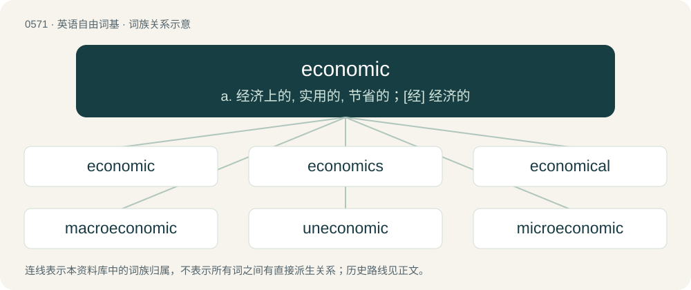

# 0642 · economic — a. 经济上的, 实用的, 节省的；\[经\] 经济的

[总目录](../00_总目录_按常用程度.md)

**类型**：英语自由词基　｜　**来源语言**：见词源记录

## 核心含义与来源

- 核心含义：a. 经济上的, 实用的, 节省的；\[经\] 经济的
- 英文含义：Pertaining to an economy.
- 词形：economic

**来源记录 1**（形容词；Pertaining to an economy.）

By surface analysis, economy + -ic.

## 词族图

## 单词速览（常用到不常用）

| 单词 | 音标 | 释义 |
|---|---|---|
| [economic](#w-1) | 英 /ˌiːkəˈnɒmɪk/；美 /ˌɛkəˈnɑmɪk/ | a. 经济上的, 实用的, 节省的；\[经\] 经济的 |
| [economics](#w-2) | 英 /ˌiːkəˈnɒmɪks/；美 /ˌɛkəˈnɑmɪks/ | n. 经济学；\[经\] 经济学 |
| [economical](#w-3) | 英 /ˌiː.kəˈnɒm.ɪ.kəl/；美 /ˌɛk.əˈnɑ.mɪ.kəl/ | a. 节俭的, 经济的, 合算的；\[经\] 经济的, 节约的 |
| [macroeconomic](#w-4) | 英 /ˌmækɹəʊˌiːkəˈnɒmɪk/；美 /ˌmækɹoʊˌɛkəˈnɑːmɪk/ | n. 整体经济 |
| [uneconomic](#w-5) |  | a. 不经济的, 浪费的；\[经\] 不经济的, 不实用的 |
| [microeconomic](#w-6) | /ˈmaɪkrəʊˌɪkəˈnɒmɪk/ | n. 个体经济, 微观经济 |

## 逐词详解

### 1. economic

**词性**：形容词　｜　**音标**：英 /ˌiːkəˈnɒmɪk/；美 /ˌɛkəˈnɑmɪk/

**中文释义**：a. 经济上的, 实用的, 节省的；\[经\] 经济的

**英文义项**：Pertaining to an economy. / Frugal; cheap (in the sense of representing good value); economical.

**词源与演化**：

By surface analysis, economy + -ic.

**例句**：

> He wrote the book primarily for economic reasons.

该用例对应义项：concerned with worldly necessities of life (especially money)

### 2. economics

**词性**：名词　｜　**音标**：英 /ˌiːkəˈnɒmɪks/；美 /ˌɛkəˈnɑmɪks/

**中文释义**：n. 经济学；\[经\] 经济学

**英文义项**：Now chiefly home economics: the art or science of household management, especially relating to the appropriate organization of resources; housekeeping. / Management of household finances; also, the financial situation of a household.

**构词拆分**：economic + -s；economic (noun) (obsolete) + -s (suffix forming pluralia tantum, and regular plural forms of nouns)

**词源与演化**：

From economic (noun) (obsolete) + -s (suffix forming pluralia tantum, and regular plural forms of nouns). Economic is derived from Middle English economike, iconomique (“household management”), and then: \* from Middle French iconomique, oeconomique, and Old French iconomike (“(noun) household management; person in charge of household management; (adjective) relating to household management; relating to domestic or family matters; relating to management of a state; reducing costs or expenses, economical”) (modern French économique); and \* from their etymon Latin oeconomicus (“(noun) household manager, housekeeper, steward; (adjective) relating to orderly arrangement of written material”) (whence Late Latin economicus (“relating to (management of) a household”)), and economica (“household management”), both from Ancient Greek οἰκονομῐκός (oikonomĭkós, “skilled in household management; frugal, thrifty, economical”) (whence Koine Greek οἰκονομῐκός (oikonomĭkós, “relating to orderly arrangement of written material”)); from οἰκονόμος (oikonómos, “master of a house; household manager, steward; administrator, manager”) + -ῐκός (-ĭkós, suffix meaning ‘of or relating to’ forming adjectives). Οἰκονόμος (Oikonómos) is derived from οἶκος (oîkos, “dwelling place, house; estate”) (ultimately from Proto-Indo-European \*weyḱ- (“(verb) to enter in; to settle; (noun) settlement”)) + νόμος (nómos, “law, ordinance”) (from νέμω (némō, “to distribute; to possess”) (ultimately from Proto-Indo-European \*nem- (“to distribute; to give; to take”)) + -ος (-os, suffix forming o-grade action nouns from verbs)). By surface analysis, econom(y) + -ics (suffix forming nouns denoting fields of knowledge or practice).

**例句**：

> Mary studied economics for five years before going into banking.

该用例对应义项：The study of resource and wealth allocation, consumption, and distribution, of capital and investment, and of management of the factors of production.

### 3. economical

**词性**：形容词　｜　**音标**：英 /ˌiː.kəˈnɒm.ɪ.kəl/；美 /ˌɛk.əˈnɑ.mɪ.kəl/

**中文释义**：a. 节俭的, 经济的, 合算的；\[经\] 经济的, 节约的

**英文义项**：Careful with money so as not to spend too much; prudent; thrifty. / Saving money or resources.

**构词拆分**：economic + -al

**词源与演化**：

From economic + -al.

**例句**：

> The new, eco-friendly bicycle was an economical purchase.

该用例对应义项：Saving money or resources.

### 4. macroeconomic

**词性**：形容词　｜　**音标**：英 /ˌmækɹəʊˌiːkəˈnɒmɪk/；美 /ˌmækɹoʊˌɛkəˈnɑːmɪk/

**中文释义**：n. 整体经济

**英文义项**：Relating to macroeconomics. / Relating to the entire economy, including the growth rate, money and credit, exchange rates, the total amount of goods and services produced, total income earned, the level of employment of productive resources, and the general behavior of prices.

**构词拆分**：macro- + economic

**词源与演化**：

From macro- + economic.

**例句**：

> Algeria needs to implement macroeconomic policies to protect its economy.

### 5. uneconomic

**词性**：形容词

**中文释义**：a. 不经济的, 浪费的；\[经\] 不经济的, 不实用的

**英文义项**：Financially inefficient, costly, wasteful, or loss-making.

**构词拆分**：un- + economic

**词源与演化**：

From un- + economic.

**例句**：

> A privatized rail company could close the most uneconomic routes.

### 6. microeconomic

**词性**：形容词　｜　**音标**：/ˈmaɪkrəʊˌɪkəˈnɒmɪk/

**中文释义**：n. 个体经济, 微观经济

**英文义项**：Of, or relating to, microeconomics. / Of, or relating to, a microeconomy.

**构词拆分**：micro- + economic；microeconomy + -ic

**词源与演化**：

From micro- + economic or microeconomy + -ic.
