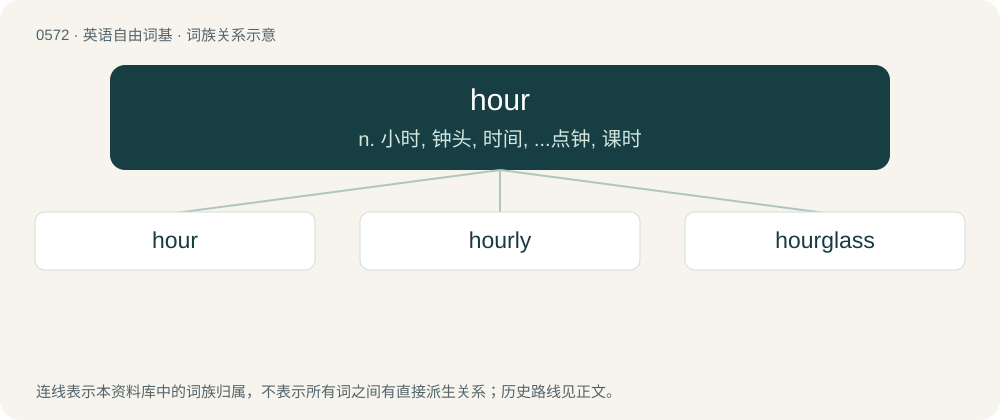

# 0643 · hour — n. 小时, 钟头, 时间, ...点钟, 课时

[总目录](../00_总目录_按常用程度.md)

**类型**：英语自由词基　｜　**来源语言**：见词源记录

## 核心含义与来源

- 核心含义：n. 小时, 钟头, 时间, ...点钟, 课时
- 英文含义：A unit of time of one twenty-fourth of a day (sixty minutes).
- 词形：hour

**来源记录 1**（名词；A unit of time of one twenty-fourth of a day (sixty minutes).）

From Middle English houre, hour, oure, from Old French houre, from Latin hōra (“hour”), from Ancient Greek ὥρα (hṓra, “any time or period, whether of the year, month, or day”), from Proto-Indo-European \*yóh₁r̥ (“year, season”). Akin to Old English ġēar (“year”). Doublet of hora and year. Compare horary. Partly displaced native Old English tīd (“time, hour”), whence Modern English tide.

## 词族图

## 单词速览（常用到不常用）

| 单词 | 音标 | 释义 |
|---|---|---|
| [hour](#w-1) | 英 /aʊə/；美 /aʊɚ/ | n. 小时, 钟头, 时间, ...点钟, 课时 |
| [hourly](#w-2) | 英 /ˈaʊ̯əli/；美 /ˈaʊ̯ɚli/ | a. 每小时的, 以小时计的, 频繁的；adv. 每小时地, 频繁地, 不绝地 |
| [hourglass](#w-3) | /ˈaʊəɡlɑːs/ | n. 时漏, 砂漏, 水漏；n. 沙漏标；\[计\] 沙漏标 |

## 逐词详解

### 1. hour

**词性**：名词　｜　**音标**：英 /aʊə/；美 /aʊɚ/

**中文释义**：n. 小时, 钟头, 时间, ...点钟, 课时

**英文义项**：A unit of time of one twenty-fourth of a day (sixty minutes). / A season, moment, or time.

**词源与演化**：

From Middle English houre, hour, oure, from Old French houre, from Latin hōra (“hour”), from Ancient Greek ὥρα (hṓra, “any time or period, whether of the year, month, or day”), from Proto-Indo-European \*yóh₁r̥ (“year, season”). Akin to Old English ġēar (“year”). Doublet of hora and year. Compare horary. Partly displaced native Old English tīd (“time, hour”), whence Modern English tide.

**例句**：

> The shop wasn't giving me enough hours so I started searching for a second job.

该用例对应义项：The amount of labor demanded by an employer in terms of time.

### 2. hourly

**词性**：形容词　｜　**音标**：英 /ˈaʊ̯əli/；美 /ˈaʊ̯ɚli/

**中文释义**：a. 每小时的, 以小时计的, 频繁的；adv. 每小时地, 频繁地, 不绝地

**英文义项**：Occurring every hour. / Unsalaried, paid by the hour; (by extension) blue-collar.

**构词拆分**：hour + -ly

**词源与演化**：

From hour + -ly.

**例句**：

> There are hourly express buses.

该用例对应义项：Occurring every hour.

### 3. hourglass

**词性**：名词　｜　**音标**：/ˈaʊəɡlɑːs/

**中文释义**：n. 时漏, 砂漏, 水漏；n. 沙漏标；\[计\] 沙漏标

**英文义项**：A clock made of two glass vessels connected by a narrow passage through which sand flows. / A cursor, often shaped like an hourglass, indicating that the computer is busy.

**构词拆分**：hour + glass

**词源与演化**：

From hour + glass.

**例句**：

> After each game turn, invert the hourglass to reset the time limit for the next player.

该用例对应义项：A clock made of two glass vessels connected by a narrow passage through which sand flows.
