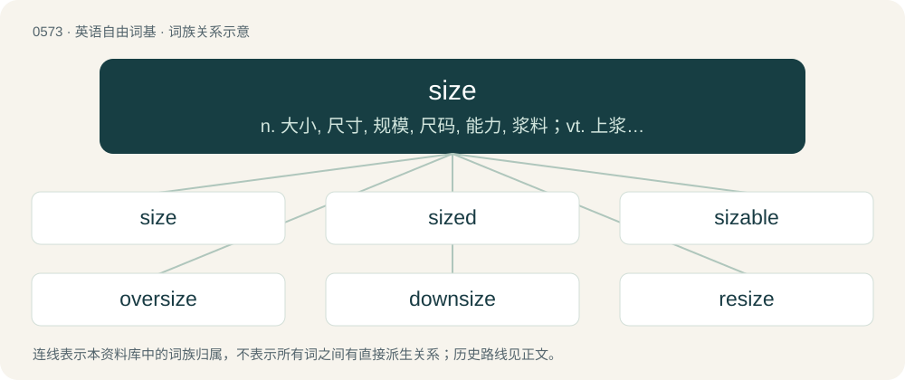

# 0645 · size — n. 大小, 尺寸, 规模, 尺码, 能力, 浆料；vt. 上浆, 依大小排列；vi. 可比拟

[总目录](../00_总目录_按常用程度.md)

**类型**：英语自由词基　｜　**来源语言**：见词源记录

## 核心含义与来源

- 核心含义：n. 大小, 尺寸, 规模, 尺码, 能力, 浆料；vt. 上浆, 依大小排列；vi. 可比拟
- 英文含义：The dimensions or magnitude of a thing; how big something is.
- 词形：size

**多个词源／构词路径**：同一拼写可能有不同来源；以下按词性和含义分别列出。

**来源记录 1**（名词；The dimensions or magnitude of a thing; how big something is.）

Attested since the 14th century, originally meant a “law or regulation that determines the amount to be paid”, from Middle English syse, sise (“regulation, control, limit”), from Old French cise, sise, aphetism of assise (“assize”), from the verb asseoir (“to sit down”), from Latin assidēre, composed of ad- (“to, towards, at”) + sedeō (“sit; settle down”), ultimately from Proto-Indo-European \*sed-. Displaced native Old English miċelnes (literally “bigness”).

**来源记录 2**（名词；A thin, weak glue used as primer for paper or canvas intended to be painted upon.）

From Middle English syse, of unclear origin; related to Old Italian sisa (“a glue used by painters”), perhaps ultimately related to size / syse (“amount”), or perhaps shortened from assisa, from assiso (“to make to sit, to seat, to place”)

## 词族图

## 单词速览（常用到不常用）

| 单词 | 音标 | 释义 |
|---|---|---|
| [size](#w-1) | /saɪz/ | n. 大小, 尺寸, 规模, 尺码, 能力, 浆料；vt. 上浆, 依大小排列；vi. 可比拟 |
| [sized](#w-2) | /ˈsaizd/ | a. 依大小排列的, 依大小调整的, 型号的, ...尺码的 |
| [sizable](#w-3) | /ˈsaɪzəbəl/ | a. 相当大的, 大小相当的 |
| [oversize](#w-4) | /ˈəuvəˈsaiz/ | a. 太大的, 超大型的；n. 特大型 |
| [downsize](#w-5) | /ˈdaʊnsaɪz/ | vt. 以较小尺寸设计；缩小尺寸；裁减人数 |
| [resize](#w-6) |  | \[计\] 调整大小 |
| [supersize](#w-7) | /ˈsuːpəsaɪz/ | n. the fast food industry phrase for extra large mea; 超级大餐 |
| [outsize](#w-8) | /ˈautsaiz/ | a. 特大的；n. 特大号 |

## 逐词详解

### 1. size

**词性**：名词　｜　**音标**：/saɪz/

**中文释义**：n. 大小, 尺寸, 规模, 尺码, 能力, 浆料；vt. 上浆, 依大小排列；vi. 可比拟

**英文义项**：The dimensions or magnitude of a thing; how big something is. / A specific set of dimensions for a manufactured article, especially clothing.

**词源与演化**：

Attested since the 14th century, originally meant a “law or regulation that determines the amount to be paid”, from Middle English syse, sise (“regulation, control, limit”), from Old French cise, sise, aphetism of assise (“assize”), from the verb asseoir (“to sit down”), from Latin assidēre, composed of ad- (“to, towards, at”) + sedeō (“sit; settle down”), ultimately from Proto-Indo-European \*sed-. Displaced native Old English miċelnes (literally “bigness”).

**例句**：

> The size of the building seemed to have increased since I was last there.

该用例对应义项：The dimensions or magnitude of a thing; how big something is.

### 2. sized

**词性**：形容词　｜　**音标**：/ˈsaizd/

**中文释义**：a. 依大小排列的, 依大小调整的, 型号的, ...尺码的

**英文义项**：Having a certain size. Usually used in combination with an adverb or a noun.

**构词拆分**：From size + -ed.

**词源与演化**：

From size + -ed.

**例句**：

> A badly-sized pair of shoes.

该用例对应义项：Having a certain size. Usually used in combination with an adverb or a noun.

### 3. sizable

**词性**：形容词　｜　**音标**：/ˈsaɪzəbəl/

**中文释义**：a. 相当大的, 大小相当的

**英文义项**：Fairly large.

**构词拆分**：size + -able

**词源与演化**：

From size + -able.

**例句**：

> He gave a sizable cash donation, sizable enough that the IRS wondered where all that money came from.

该用例对应义项：Fairly large.

### 4. oversize

**词性**：形容词　｜　**音标**：/ˈəuvəˈsaiz/

**中文释义**：a. 太大的, 超大型的；n. 特大型

**英文义项**：Larger than normal. / Excessively large.

**构词拆分**：over- + size

**词源与演化**：

From over- + size.

**例句**：

> Skura was wearing an oversize Kabyle dress.

### 5. downsize

**词性**：动词　｜　**音标**：/ˈdaʊnsaɪz/

**中文释义**：vt. 以较小尺寸设计；缩小尺寸；裁减人数

**英文义项**：To reduce in size or number. / To reduce the workforce of.

**构词拆分**：From down- + size.

**词源与演化**：

From down- + size.

**例句**：

> Joe and Edna moved to a bungalow after deciding to downsize when the children had left home.

该用例对应义项：To reduce in size or number.

### 6. resize

**词性**：动词

**中文释义**：\[计\] 调整大小

**英文义项**：To alter the size of something. / To change in size.

**构词拆分**：re- + size

**词源与演化**：

From re- + size.

### 7. supersize

**词性**：形容词　｜　**音标**：/ˈsuːpəsaɪz/

**中文释义**：n. the fast food industry phrase for extra large mea; 超级大餐

**英文义项**：Very large.

**构词拆分**：super- + size

**词源与演化**：

From super- + size.

**用法示例／搭配（非完整句）**：

> a supersize yacht

该用例对应义项：Very large.

### 8. outsize

**词性**：名词　｜　**音标**：/ˈautsaiz/

**中文释义**：a. 特大的；n. 特大号

**英文义项**：An unusually large garment size.

**构词拆分**：out- + size

**词源与演化**：

From out- + size.

**例句**：

> Because forests are massive sponges of carbon dioxide, reversing their loss would play an outsize role in fighting climate change.
