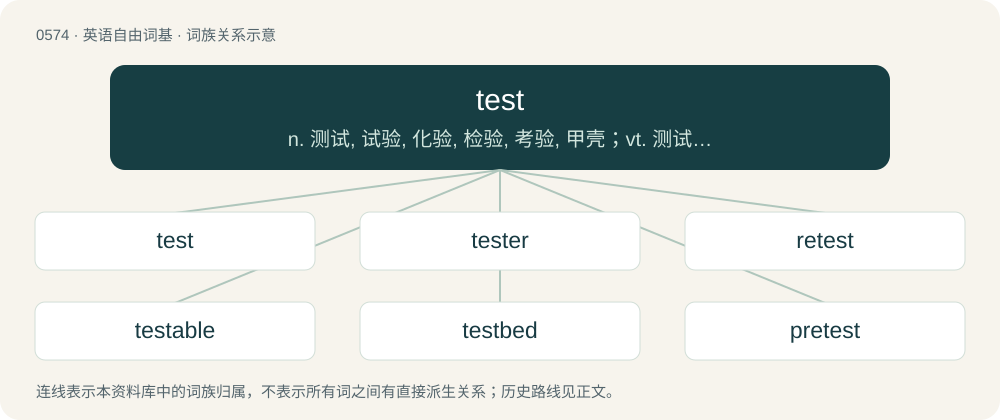

# 0646 · test — n. 测试, 试验, 化验, 检验, 考验, 甲壳；vt. 测试, 试验, 化验；vi. 接受测验, 进行测试

[总目录](../00_总目录_按常用程度.md)

**类型**：英语自由词基　｜　**来源语言**：见词源记录

## 核心含义与来源

- 核心含义：n. 测试, 试验, 化验, 检验, 考验, 甲壳；vt. 测试, 试验, 化验；vi. 接受测验, 进行测试
- 英文含义：A challenge, trial.
- 词形：test

**来源记录 1**（名词；A challenge, trial.）

From Middle English test, teste, from Old French test, teste (“an earthen vessel, especially a pot in which metals were tried”), from Latin testum (“the lid of an earthen vessel, an earthen vessel, an earthen pot”), from \*terstus, past participle of the root \*tersa (“dry land”). See terra, thirst. The examination sense came via metaphor of the metallurgical sense: the way a metallurgist puts to the test their gold, a teacher may put to the test their students' knowledge. Displaced Old English afandung.

## 词族图

## 单词速览（常用到不常用）

| 单词 | 音标 | 释义 |
|---|---|---|
| [test](#w-1) | 英 /tɛst/ | n. 测试, 试验, 化验, 检验, 考验, 甲壳；vt. 测试, 试验, 化验；vi. 接受测验, 进行测试 |
| [tester](#w-2) | 英 /ˈtɛstə/；美 /ˈtɛstəɹ/ | 【英文】A person who administers a test. |
| [retest](#w-3) | /ˈɹiːtɛst/ | \[计\] 重复测试；\[化\] 复试; 重新试验 |
| [testable](#w-4) | 英 /ˈtɛs.tə.bəl/ | a. 可试验的, 有资格作证人的, 有资格立遗嘱的, 可根据遗嘱处理的 |
| [testbed](#w-5) |  | \[计\] 试验台 |
| [pretest](#w-6) | /ˈpriːtest/ | n. 预测；v. 进行预测 |

## 逐词详解

### 1. test

**词性**：名词　｜　**音标**：英 /tɛst/

**中文释义**：n. 测试, 试验, 化验, 检验, 考验, 甲壳；vt. 测试, 试验, 化验；vi. 接受测验, 进行测试

**英文义项**：A challenge, trial. / An examination, given often during the academic term.

**词源与演化**：

From Middle English test, teste, from Old French test, teste (“an earthen vessel, especially a pot in which metals were tried”), from Latin testum (“the lid of an earthen vessel, an earthen vessel, an earthen pot”), from \*terstus, past participle of the root \*tersa (“dry land”). See terra, thirst. The examination sense came via metaphor of the metallurgical sense: the way a metallurgist puts to the test their gold, a teacher may put to the test their students' knowledge. Displaced Old English afandung.

**用法示例／搭配（非完整句）**：

> aptitude test

该用例对应义项：A standardised measure, consisting of one or more items.

### 2. tester

**词性**：名词　｜　**音标**：英 /ˈtɛstə/；美 /ˈtɛstəɹ/

**英文义项**：A person who administers a test. / A device used for testing.

**构词拆分**：test + -er

**词源与演化**：

From Middle English tester, equivalent to test + -er.

### 3. retest

**词性**：名词　｜　**音标**：/ˈɹiːtɛst/

**中文释义**：\[计\] 重复测试；\[化\] 复试; 重新试验

**英文义项**：A repeat test.

**构词拆分**：re- + test

**词源与演化**：

From re- + test.

### 4. testable

**词性**：形容词　｜　**音标**：英 /ˈtɛs.tə.bəl/

**中文释义**：a. 可试验的, 有资格作证人的, 有资格立遗嘱的, 可根据遗嘱处理的

**英文义项**：Susceptible to being tested. / With respect to the scientific method, capable of being proven true or false.

**构词拆分**：test + -able

**词源与演化**：

From test + -able.

**例句**：

> Evolutionary psychology generally does not make testable predictions, so it is often viewed as a pseudoscience.

### 5. testbed

**词性**：名词

**中文释义**：\[计\] 试验台

**英文义项**：Any platform used for testing a scientific theory, computational tool or new technology.

**构词拆分**：test + bed

**词源与演化**：

From test + bed.

**例句**：

> Before we try to evaluate the products, let’s set up a testbed so we can make fair comparisons.

### 6. pretest

**词性**：形容词　｜　**音标**：/ˈpriːtest/

**中文释义**：n. 预测；v. 进行预测

**英文义项**：Prior to taking a test.

**构词拆分**：pre- + test

**词源与演化**：

From pre- + test.
