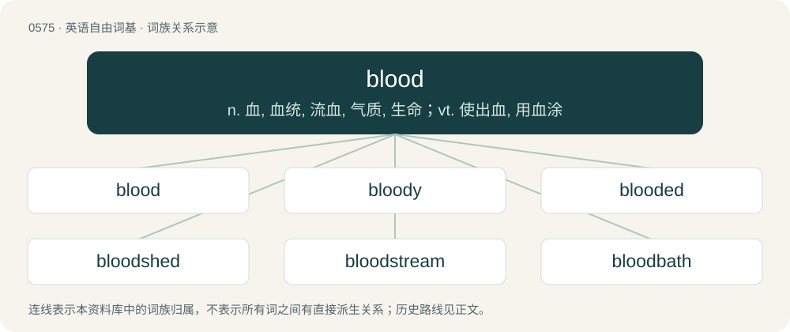

# 0647 · blood — n. 血, 血统, 流血, 气质, 生命；vt. 使出血, 用血涂

[总目录](../00_总目录_按常用程度.md)

**类型**：英语自由词基　｜　**来源语言**：见词源记录

## 核心含义与来源

- 核心含义：n. 血, 血统, 流血, 气质, 生命；vt. 使出血, 用血涂
- 英文含义：A vital liquid flowing in the bodies of many types of animals that usually conveys nutrients and oxygen. In vertebrates, it is colored red by hemoglobin, is conveyed by arteries and veins, is pumped by the heart and is usually generated in bone marrow.
- 词形：blood

**来源记录 1**（名词；A vital liquid flowing in the bodies of many types of animals that usually conveys nutrients and oxygen. In vertebrates, it is colored red by hemoglobin, is conveyed by arteries and veins, is pumped by the heart and is usually generated in bone marrow.）

From Middle English blood, from Old English blōd, from Proto-West Germanic \*blōd, from Proto-Germanic \*blōþą, possibly from Proto-Indo-European \*bʰel- ("to swell") + -ó- (thematic vowel) + -to (nominalizer), i.e. "that which bursts out". Cognate with Scots blude, bluid (“blood”), North Frisian blud, blödj, Blör (“blood”), Saterland Frisian Bloud (“blood”), West Frisian bloed (“blood”), Cimbrian pluat, pluut (“blood”), Dutch bloed (“blood”), German Blut (“blood”), German Low German Blood, Bloot (“blood”), Luxembourgish Blutt (“blood”), Vilamovian błüt (“blood”), Yiddish בלוט (blut, “blood”), Danish, Norwegian Bokmål, Norwegian Nynorsk, and Swedish blod (“blood”), Faroese and Icelandic blóð (“blood”), Crimean Gothic plut (“blood”), Gothic 𐌱𐌻𐍉𐌸 (blōþ, “blood”).

## 词族图

## 单词速览（常用到不常用）

| 单词 | 音标 | 释义 |
|---|---|---|
| [blood](#w-1) | /blʌd/ | n. 血, 血统, 流血, 气质, 生命；vt. 使出血, 用血涂 |
| [bloody](#w-2) | /ˈblʌ.di/ | a. 血腥的, 嗜杀的, 有血的 |
| [blooded](#w-3) | 美 /ˈblʌ.dəd/ | a. 纯种的, 血统优良的 |
| [bloodshed](#w-4) | /ˈblʌdˌʃɛd/ | n. 流血 |
| [bloodstream](#w-5) | 英 /ˈblʌd.stɹɪim/ | n. 血流 |
| [bloodbath](#w-6) | 英 /ˈblʌdˌbɑːθ/；美 /ˈblʌdˌbæθ/ | n. 大屠杀 |
| [bloodline](#w-7) | 美 /ˈblʌdˌlaɪn/ | n. 血统, 种系 |
| [bloodthirsty](#w-8) | 英 /ˈblʌdθəːsti/；美 /ˈblʌdˌθɚsti/ | a. 嗜杀的, 残忍的 |
| [bloodborne](#w-9) |  | 【英文】Usually of a pathogen: carried in the bloodstream and other body fluids. |
| [bloodhound](#w-10) | 英 /ˈblʌd.haʊnd/ | n. 侦探犬；\[法\] 血提犬, 侦探 |
| [bloodless](#w-11) | /ˈblʌdlis/ | a. 无血色的, 不流血的, 没精神的；\[医\] 无血的 |
| [lifeblood](#w-12) | 美 /ˈlaɪfˌblʌd/ | n. 鲜血, 血, 生机的根源 |
| [youngblood](#w-13) | /ˈjʌŋ,blʌd/ | n. 血性小子（电影名, 等于铁血男儿） |
| [bloodshot](#w-14) | /ˈblʌdʃɒt/ | a. 充血的 |
| [bloodstained](#w-15) | 美 /ˈblʌdˌsteɪnd/ | a. 血污的, 犯杀人罪的；\[法\] 犯杀人罪的, 血腥的, 有血痕的 |
| [bloodlust](#w-16) | 英 /ˈblʌdˌlʌst/ | n. 杀戮欲 |
| [bloodletting](#w-17) | /ˈblʌd.letiŋ/ | n. 放血；\[医\] 放血 |
| [bloodstock](#w-18) | /ˈblʌdstɒk/ | n. 纯种马 |
| [bloodstone](#w-19) | 美 /ˈblʌdˌstoʊn/ | n. 鸡血石, 血滴石；\[化\] 鸡血石 |

## 逐词详解

### 1. blood

**词性**：名词　｜　**音标**：/blʌd/

**中文释义**：n. 血, 血统, 流血, 气质, 生命；vt. 使出血, 用血涂

**英文义项**：A vital liquid flowing in the bodies of many types of animals that usually conveys nutrients and oxygen. In vertebrates, it is colored red by hemoglobin, is conveyed by arteries and veins, is pumped by the heart and is usually generated in bone marrow. / A family relationship due to birth, such as that between siblings; contrasted with relationships due to marriage or adoption. See blood relative, blood relation.

**词源与演化**：

From Middle English blood, from Old English blōd, from Proto-West Germanic \*blōd, from Proto-Germanic \*blōþą, possibly from Proto-Indo-European \*bʰel- ("to swell") + -ó- (thematic vowel) + -to (nominalizer), i.e. "that which bursts out". Cognate with Scots blude, bluid (“blood”), North Frisian blud, blödj, Blör (“blood”), Saterland Frisian Bloud (“blood”), West Frisian bloed (“blood”), Cimbrian pluat, pluut (“blood”), Dutch bloed (“blood”), German Blut (“blood”), German Low German Blood, Bloot (“blood”), Luxembourgish Blutt (“blood”), Vilamovian błüt (“blood”), Yiddish בלוט (blut, “blood”), Danish, Norwegian Bokmål, Norwegian Nynorsk, and Swedish blod (“blood”), Faroese and Icelandic blóð (“blood”), Crimean Gothic plut (“blood”), Gothic 𐌱𐌻𐍉𐌸 (blōþ, “blood”).

**例句**：

> She may not be my blood, but we grew up together, and as far as I'm concerned she's my sister.

该用例对应义项：A person or people related to one by birth; one's biological relative or relatives.

### 2. bloody

**词性**：形容词　｜　**音标**：/ˈblʌ.di/

**中文释义**：a. 血腥的, 嗜杀的, 有血的

**英文义项**：Covered in blood. / Characterised by bloodshed.

**构词拆分**：blood + -y

**词源与演化**：

From Middle English blody, blodi, from Old English blōdiġ, blōdeġ (“bloody”), from Proto-West Germanic \*blōdag, from Proto-Germanic \*blōþagaz (“bloody”), equivalent to blood + -y. Cognate with Saterland Frisian bläidich, blöidig, blouderch (“bloody”), West Frisian bloedich (“bloody”), Dutch bloedig (“bloody”), German Low German blödig (“bloody”), German blutig (“bloody”), Danish blodig (“bloody”), Swedish blodig (“bloody”), Faroese blóðigur (“bloody”), Icelandic blóðugur (“bloody”). See Wikipedia for thoughts on sense evolution.

**例句**：

> All that remained of his right hand after the accident was a bloody stump.

该用例对应义项：Covered in blood.

### 3. blooded

**词性**：形容词　｜　**音标**：美 /ˈblʌ.dəd/

**中文释义**：a. 纯种的, 血统优良的

**英文义项**：bloody, bleeding. / Experienced (especially in warfare).

**构词拆分**：blood + -ed

**词源与演化**：

From Middle English bloded, equivalent to blood + -ed.

**例句**：

> Only a cold-blooded killer could have done something like this.

该用例对应义项：Having a certain kind of temperament or disposition.

### 4. bloodshed

**词性**：名词　｜　**音标**：/ˈblʌdˌʃɛd/

**中文释义**：n. 流血

**英文义项**：The shedding or spilling of blood. / A slaughter; destruction of life, notably on a large scale.

**构词拆分**：blood + shed

**词源与演化**：

From attested early forms of such phrases as "there was much blood shed"; equivalent to blood + shed, past participle of shed.

**例句**：

> The revolution resulted in heavy bloodshed.

该用例对应义项：The shedding or spilling of blood.

### 5. bloodstream

**词性**：名词　｜　**音标**：英 /ˈblʌd.stɹɪim/

**中文释义**：n. 血流

**英文义项**：The flow of blood through the circulatory system of an animal

**构词拆分**：blood + stream

**词源与演化**：

From blood + stream.

**例句**：

> The drug quickly entered the bloodstream.

该用例对应义项：The flow of blood through the circulatory system of an animal

### 6. bloodbath

**词性**：名词　｜　**音标**：英 /ˈblʌdˌbɑːθ/；美 /ˈblʌdˌbæθ/

**中文释义**：n. 大屠杀

**英文义项**：Indiscriminate killing or slaughter; a massacre. / An aggressive or very violent contest or confrontation.

**构词拆分**：blood + bath

**词源与演化**：

From blood + bath, the latter used referring to a metaphorical deluge. Compare West Frisian bloedbad (“bloodbath”), Dutch bloedbad (“bloodbath”), German Blutbad (“bloodbath”), Danish blodbad (“bloodbath”), Norwegian Bokmål blodbad (“bloodbath”), Swedish blodbad (“bloodbath”), Icelandic blóðbad (“bloodbath”).

**例句**：

> A bloodbath took place when the leaders of the plot surrendered.

该用例对应义项：indiscriminate slaughter

### 7. bloodline

**词性**：名词　｜　**音标**：美 /ˈblʌdˌlaɪn/

**中文释义**：n. 血统, 种系

**英文义项**：The abstract link between a person and their ancestors. / The pedigree of an animal.

**构词拆分**：blood + line

**词源与演化**：

From blood + line.

### 8. bloodthirsty

**词性**：形容词　｜　**音标**：英 /ˈblʌdθəːsti/；美 /ˈblʌdˌθɚsti/

**中文释义**：a. 嗜杀的, 残忍的

**英文义项**：Thirsty for blood: inexorably violent or eager for bloodshed; murderous. / Of a book, film, etc.: depicting much violence; gory, violent.

**构词拆分**：blood + thirsty

**词源与演化**：

From blood + thirsty. Cognate with West Frisian bloeddorstich (“bloodthirsty”), Dutch bloeddorstig (“bloodthirsty”), German blutdürstig (“bloodthirsty”), Danish blodtørstig (“bloodthirsty”), Swedish blodtörstig (“bloodthristy”), Norwegian blodtørstig (“bloodthirsty”).

**例句**：

> A large number of monarchs throughout history have been bloodthirsty monsters.

### 9. bloodborne

**词性**：形容词

**英文义项**：Usually of a pathogen: carried in the bloodstream and other body fluids.

**构词拆分**：blood + borne

**词源与演化**：

From blood + borne.

**例句**：

> As far as Tom was concerned, Bloodborne was his Game of the Year.

### 10. bloodhound

**词性**：名词　｜　**音标**：英 /ˈblʌd.haʊnd/

**中文释义**：n. 侦探犬；\[法\] 血提犬, 侦探

**英文义项**：A large scenthound famed for its ability to follow a scent many days old, over vast distances. This dog is often used as a police dog to track missing people, fleeing suspects, or escaped prisoners. / A detective or other person skilled at finding people or clues.

**构词拆分**：blood + hound

**词源与演化**：

Inherited from Middle English blodhound, blodhond; equivalent to blood + hound. Cognate with Dutch bloedhond (“bloodhound”), Middle Low German blōthunt (“bloodhound”), German Bluthund (“bloodhound”), Danish blodhund (“bloodhound”), Swedish blodhund (“bloodhound”). The detective sense follows from the dog's ability to follow a trail.

**例句**：

> Detective Dan Anderson stayed on the trail like a bloodhound.

### 11. bloodless

**词性**：形容词　｜　**音标**：/ˈblʌdlis/

**中文释义**：a. 无血色的, 不流血的, 没精神的；\[医\] 无血的

**英文义项**：Lacking blood; ashen, anaemic. / Taking place without loss of blood.

**构词拆分**：By surface analysis, blood + -less

**词源与演化**：

From Middle English blodles, from Old English blōdlēas (“bloodless”). Cognate with Dutch bloedeloos (“bloodless”), German blutlos (“bloodless”), Danish blodløs (“bloodless”), Swedish blodlös (“bloodless”), Icelandic blóðlaus (“bloodless”). By surface analysis, blood + -less.

**用法示例／搭配（非完整句）**：

> a bloodless conquest; a bloodless coup d'état; a bloodless revolution; a bloodless victory

该用例对应义项：Taking place without loss of blood.

### 12. lifeblood

**词性**：名词　｜　**音标**：美 /ˈlaɪfˌblʌd/

**中文释义**：n. 鲜血, 血, 生机的根源

**英文义项**：Blood that is needed for continued life; blood regarded as the seat of life. / That which is required for continued existence or function.

**构词拆分**：life + blood

**词源与演化**：

From life + blood. Compare English heart-blood (“lifeblood”).

**例句**：

> Gasoline is the lifeblood of the modern city.

该用例对应义项：That which is required for continued existence or function.

### 13. youngblood

**词性**：名词　｜　**音标**：/ˈjʌŋ,blʌd/

**中文释义**：n. 血性小子（电影名, 等于铁血男儿）

**英文义项**：Someone who constitutes or brings fresh blood, especially a youngster who joins an older team etc. / A young black gangster.

**构词拆分**：young + blood

**词源与演化**：

From young + blood.

### 14. bloodshot

**词性**：形容词　｜　**音标**：/ˈblʌdʃɒt/

**中文释义**：a. 充血的

**英文义项**：Reddened and inflamed because of congested blood vessels.

**构词拆分**：blood + shot

**词源与演化**：

From blood + shot.

**例句**：

> She said she was perfectly fine but I could tell she was tired; her eyes were all bloodshot.

该用例对应义项：Reddened and inflamed because of congested blood vessels.

### 15. bloodstained

**词性**：形容词　｜　**音标**：美 /ˈblʌdˌsteɪnd/

**中文释义**：a. 血污的, 犯杀人罪的；\[法\] 犯杀人罪的, 血腥的, 有血痕的

**英文义项**：Stained, spotted or otherwise discolored with blood. / Having the color of something which has been stained with blood.

**构词拆分**：blood + stained

**词源与演化**：

From blood + stained.

**例句**：

> He walked into the room and everyone noticed he had bloodstained clothes.

### 16. bloodlust

**词性**：名词　｜　**音标**：英 /ˈblʌdˌlʌst/

**中文释义**：n. 杀戮欲

**英文义项**：A desire for bloodshed and carnage, often aroused in the heat of battle and leading to uncontrolled slaughter and torture.

**构词拆分**：blood + lust

**词源与演化**：

From blood + lust.

**例句**：

> Berzerkers are famous for the bloodlust, but what about their tender regard for poetry?

### 17. bloodletting

**词性**：名词　｜　**音标**：/ˈblʌd.letiŋ/

**中文释义**：n. 放血；\[医\] 放血

**英文义项**：The diminishment of any resource with the hope that this will lead to a positive effect. / A circumstance, such as a battle, where a large amount of blood is likely to be spilled through violence.

**构词拆分**：blood + letting；bloodlet + -ing

**词源与演化**：

From blood + letting, equal to bloodlet + -ing.

**例句**：

> Yet another round of corporate bloodletting.

该用例对应义项：The diminishment of any resource with the hope that this will lead to a positive effect.

### 18. bloodstock

**词性**：名词　｜　**音标**：/ˈblʌdstɒk/

**中文释义**：n. 纯种马

**英文义项**：Thoroughbred animals in general, but especially horses. / The breeding line of a thoroughbred horse or other animal.

**构词拆分**：blood + stock

**词源与演化**：

From blood + stock.

### 19. bloodstone

**词性**：名词　｜　**音标**：美 /ˈblʌdˌstoʊn/

**中文释义**：n. 鸡血石, 血滴石；\[化\] 鸡血石

**英文义项**：A green chalcedony that is sprinkled with red spots or veins of hematite. / Hematite.

**构词拆分**：blood + stone

**词源与演化**：

From blood + stone, from the fact that the red inclusions in the stone resemble blood.

**例句**：

> Heliotrope is a mineral aggregate commonly also known as bloodstone.
