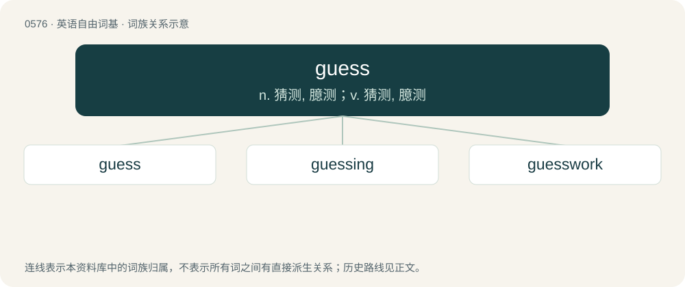

# 0648 · guess — n. 猜测, 臆测；v. 猜测, 臆测

[总目录](../00_总目录_按常用程度.md)

**类型**：英语自由词基　｜　**来源语言**：见词源记录

## 核心含义与来源

- 核心含义：n. 猜测, 臆测；v. 猜测, 臆测
- 英文含义：To reach a partly (or totally) unconfirmed conclusion; to engage in conjecture; to speculate.
- 词形：guess

**来源记录 1**（动词；To reach a partly (or totally) unconfirmed conclusion; to engage in conjecture; to speculate.）

From Middle English gessen (verb) and Middle English gesse (noun), probably of North Germanic origin, from Old Danish getse, gitse, getsa (“to guess”), from Old Norse \*getsa, \*gitsa, from Proto-Germanic \*gitisōną (“to guess”), from Proto-Germanic \*getaną (“to get”), from Proto-Indo-European \*gʰed- (“to take, seize”). Cognate with Danish gisne (“to guess”), Norwegian gissa, gjette (“to guess”), Swedish gissa (“to guess”), Saterland Frisian gisje (“to guess”), Dutch gissen (“to guess”), Low German gissen (“to guess”), Dutch gis (“a guess”). Related also to Icelandic giska ("to guess"; from Proto-Germanic \*gitiskōną). Compare also Russian гада́ть (gadátʹ, “to conjecture, guess, divine”), Albanian gjëzë (“riddle”) from gjej (“find, recover, obtain”). More at get.

## 词族图

## 单词速览（常用到不常用）

| 单词 | 音标 | 释义 |
|---|---|---|
| [guess](#w-1) | /ɡɛs/ | n. 猜测, 臆测；v. 猜测, 臆测 |
| [guessing](#w-2) | /ˈɡɛsɪŋ/ | v. 猜( guess的现在分词 ); （引出令人惊奇或激动的事）你猜; 猜对; 猜中 |
| [guesswork](#w-3) | /ˈgeswəːk/ | n. 臆测, 猜测, 凭猜测所作之工作 |

## 逐词详解

### 1. guess

**词性**：动词　｜　**音标**：/ɡɛs/

**中文释义**：n. 猜测, 臆测；v. 猜测, 臆测

**英文义项**：To reach a partly (or totally) unconfirmed conclusion; to engage in conjecture; to speculate. / To solve by a correct conjecture; to conjecture rightly.

**词源与演化**：

From Middle English gessen (verb) and Middle English gesse (noun), probably of North Germanic origin, from Old Danish getse, gitse, getsa (“to guess”), from Old Norse \*getsa, \*gitsa, from Proto-Germanic \*gitisōną (“to guess”), from Proto-Germanic \*getaną (“to get”), from Proto-Indo-European \*gʰed- (“to take, seize”). Cognate with Danish gisne (“to guess”), Norwegian gissa, gjette (“to guess”), Swedish gissa (“to guess”), Saterland Frisian gisje (“to guess”), Dutch gissen (“to guess”), Low German gissen (“to guess”), Dutch gis (“a guess”). Related also to Icelandic giska ("to guess"; from Proto-Germanic \*gitiskōną). Compare also Russian гада́ть (gadátʹ, “to conjecture, guess, divine”), Albanian gjëzë (“riddle”) from gjej (“find, recover, obtain”). More at get.

**例句**：

> That album is quite hard to find, but I guess you could try ordering it online.

该用例对应义项：To suppose, to imagine (introducing a proposition of uncertain plausibility).

### 2. guessing

**词性**：名词　｜　**音标**：/ˈɡɛsɪŋ/

**中文释义**：v. 猜( guess的现在分词 ); （引出令人惊奇或激动的事）你猜; 猜对; 猜中

**英文义项**：The act of making a guess; estimate or prediction; foresight.

**构词拆分**：guess + -ing

**词源与演化**：

From Middle English gessyng, gessynge, equivalent to guess + -ing.

**例句**：

> The frog and I took turns guessing what the secret recipe was.

### 3. guesswork

**词性**：名词　｜　**音标**：/ˈgeswəːk/

**中文释义**：n. 臆测, 猜测, 凭猜测所作之工作

**英文义项**：An estimate, judgment or opinion made by guessing, from limited information.

**构词拆分**：guess + work

**词源与演化**：

From guess + work. Compare Dutch giswerk (“guesswork”).

**例句**：

> I used guesswork for all my answers on this test and they were all correct.
