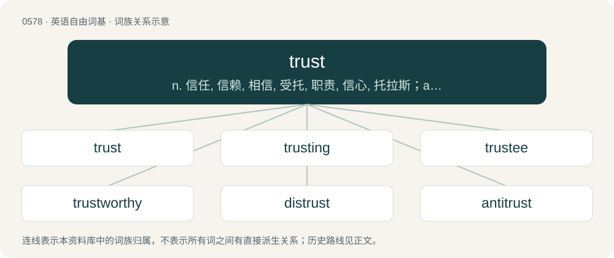

# 0650 · trust — n. 信任, 信赖, 相信, 受托, 职责, 信心, 托拉斯；a. 信托的, 托拉斯的；vt. 信赖, 信任, 相信, 盼望, 赊卖给

[总目录](../00_总目录_按常用程度.md)

**类型**：英语自由词基　｜　**来源语言**：见词源记录

## 核心含义与来源

- 核心含义：n. 信任, 信赖, 相信, 受托, 职责, 信心, 托拉斯；a. 信托的, 托拉斯的；vt. 信赖, 信任, 相信, 盼望, 赊卖给
- 英文含义：Confidence in or reliance on some person or quality.
- 词形：trust

**来源记录 1**（名词；Confidence in or reliance on some person or quality.）

From Middle English trust, trost (“trust, protection”). Long considered a borrowing from Old Norse traust (“confidence, help, protection”), from Proto-Germanic \*traustą, but the root vocalism is incompatible, so trust has come to be considered a reflex of an unattested Old English \*trust, from a rare zero-grade Proto-Germanic variant of the same root also attested in Middle High German getrüste (“host”). Ultimately from Proto-Indo-European \*deru- (“be firm, hard, solid”). Cognates Cognate with Saterland Frisian Traast (“comfort, solace”), West Frisian treast (“comfort, consolation, solace”), Dutch troost (“comfort, consolation”), German Trost (“comfort, consolation”), Low German Troost (“comfort, consolation”), Luxembourgish Trouscht (“consolation”), Danish trøst (“comfort, solace”), Icelandic traust (“faith, trust; confidence”), Norwegian Nynorsk trøst, trøyst (“consolation”), Swedish tröst (“comfort, consolation”), Gothic 𐍄𐍂𐌰𐌿𐍃𐍄𐌹 (trausti, “covenant, pact”). Doublet of tryst. More at true, tree.

## 词族图

## 单词速览（常用到不常用）

| 单词 | 音标 | 释义 |
|---|---|---|
| [trust](#w-1) | /tɹʌst/ | n. 信任, 信赖, 相信, 受托, 职责, 信心, 托拉斯；a. 信托的, 托拉斯的；vt. 信赖, 信任, 相信, 盼望, 赊卖给 |
| [trusting](#w-2) | /ˈtɹʌstɪŋ/ | a. 轻信的, 信任他人的, 深信不疑的 |
| [trustee](#w-3) | /tɹʌsˈtiː/ | n. 受托人, 理事；\[计\] 委托者 |
| [trustworthy](#w-4) | 英 /ˈtɹʌst.wɜː.ði/；美 /ˈtɹʌstˌwɜɹ.ði/ | a. 可信赖的；\[法\] 可信任的, 可靠的, 可信赖的 |
| [distrust](#w-5) | 英 /dɪsˈtɹʌst/ | n. 不信任；vt. 不信任 |
| [antitrust](#w-6) | /ˌæntiˈtɹʌst/ | a. 反托拉斯的；\[法\] 反托拉斯的 |
| [mistrust](#w-7) | /mɪsˈtɹʌst/ | n. 不信任, 疑惑；v. 不信任, 疑惑 |
| [trusty](#w-8) | 英 /ˈtɹʌsti/ | a. 可信任的, 可信赖的, 可靠的；n. 可信任的人, 模范犯人 |
| [entrust](#w-9) | /ɪnˈtɹʌst/ | vt. 信托, 交托, 委托；\[经\] 委托 |
| [trustful](#w-10) | /ˈtrʌstful/ | a. 轻信的, 容易相信的 |

## 逐词详解

### 1. trust

**词性**：名词　｜　**音标**：/tɹʌst/

**中文释义**：n. 信任, 信赖, 相信, 受托, 职责, 信心, 托拉斯；a. 信托的, 托拉斯的；vt. 信赖, 信任, 相信, 盼望, 赊卖给

**英文义项**：Confidence in or reliance on some person or quality. / Dependence upon something in the future; hope.

**词源与演化**：

From Middle English trust, trost (“trust, protection”). Long considered a borrowing from Old Norse traust (“confidence, help, protection”), from Proto-Germanic \*traustą, but the root vocalism is incompatible, so trust has come to be considered a reflex of an unattested Old English \*trust, from a rare zero-grade Proto-Germanic variant of the same root also attested in Middle High German getrüste (“host”). Ultimately from Proto-Indo-European \*deru- (“be firm, hard, solid”). Cognates Cognate with Saterland Frisian Traast (“comfort, solace”), West Frisian treast (“comfort, consolation, solace”), Dutch troost (“comfort, consolation”), German Trost (“comfort, consolation”), Low German Troost (“comfort, consolation”), Luxembourgish Trouscht (“consolation”), Danish trøst (“comfort, solace”), Icelandic traust (“faith, trust; confidence”), Norwegian Nynorsk trøst, trøyst (“consolation”), Swedish tröst (“comfort, consolation”), Gothic 𐍄𐍂𐌰𐌿𐍃𐍄𐌹 (trausti, “covenant, pact”). Doublet of tryst. More at true, tree.

**例句**：

> He needs to regain her trust if he is ever going to win her back.

该用例对应义项：Confidence in or reliance on some person or quality.

### 2. trusting

**词性**：形容词　｜　**音标**：/ˈtɹʌstɪŋ/

**中文释义**：a. 轻信的, 信任他人的, 深信不疑的

**英文义项**：Inclined to believe the claims or statements of others; inclined to confide readily; trustful.

**构词拆分**：trust + -ing

**词源与演化**：

From Middle English trustyng, trostinge, tristynge, equivalent to trust + -ing.

**例句**：

> Younger generations are often more open to trusting and relying on technology.

### 3. trustee

**词性**：动词　｜　**音标**：/tɹʌsˈtiː/

**中文释义**：n. 受托人, 理事；\[计\] 委托者

**英文义项**：To commit (property) to the care of a trustee. / To attach (a debtor's wages, credits, or property in the hands of a third person) in the interest of the creditor.

**构词拆分**：From trust + -ee.

**词源与演化**：

From trust + -ee.

**用法示例／搭配（非完整句）**：

> to trustee an estate

该用例对应义项：To commit (property) to the care of a trustee.

### 4. trustworthy

**词性**：形容词　｜　**音标**：英 /ˈtɹʌst.wɜː.ði/；美 /ˈtɹʌstˌwɜɹ.ði/

**中文释义**：a. 可信赖的；\[法\] 可信任的, 可靠的, 可信赖的

**英文义项**：Deserving of trust, reliable.

**构词拆分**：trust + -worthy

**词源与演化**：

From trust + -worthy.

**例句**：

> An experienced and trustworthy traveling companion.

该用例对应义项：worthy of trust or belief

### 5. distrust

**词性**：名词　｜　**音标**：英 /dɪsˈtɹʌst/

**中文释义**：n. 不信任；vt. 不信任

**英文义项**：Lack of trust or confidence.

**构词拆分**：dis- + trust

**词源与演化**：

From dis- + trust, alteration of the earlier term wantrust.

**例句**：

> Many people have developed a cynical distrust of politicians.

该用例对应义项：Lack of trust or confidence.

### 6. antitrust

**词性**：形容词　｜　**音标**：/ˌæntiˈtɹʌst/

**中文释义**：a. 反托拉斯的；\[法\] 反托拉斯的

**英文义项**：Opposed to or against the establishment or existence of trusts (monopolies), usually referring to legislation.

**构词拆分**：anti- + trust

**词源与演化**：

From anti- + trust.

**例句**：

> The regulators used antitrust laws to block the merger, believing it would eliminate competition.

该用例对应义项：Opposed to or against the establishment or existence of trusts (monopolies), usually referring to legislation.

### 7. mistrust

**词性**：名词　｜　**音标**：/mɪsˈtɹʌst/

**中文释义**：n. 不信任, 疑惑；v. 不信任, 疑惑

**英文义项**：Lack of trust or confidence; distrust, untrust.

**构词拆分**：mis- + trust

**词源与演化**：

From Middle English mistrust; equivalent to mis- + trust.

**例句**：

> It is more ignominious to mistrust our friends than to be deceived by them.

### 8. trusty

**词性**：形容词　｜　**音标**：英 /ˈtɹʌsti/

**中文释义**：a. 可信任的, 可信赖的, 可靠的；n. 可信任的人, 模范犯人

**英文义项**：Reliable or trustworthy.

**构词拆分**：trust + -y

**词源与演化**：

From Middle English trusty, tristy, tresty, equivalent to trust + -y.

**例句**：

> She's been using the same trusty sewing machine since she started out, thirty long years ago.

该用例对应义项：Reliable or trustworthy.

### 9. entrust

**词性**：动词　｜　**音标**：/ɪnˈtɹʌst/

**中文释义**：vt. 信托, 交托, 委托；\[经\] 委托

**英文义项**：To trust to the care of.

**构词拆分**：en- + trust

**词源与演化**：

From en- + trust.

**例句**：

> Can I entrust you with a secret?

该用例对应义项：To trust to the care of.

### 10. trustful

**词性**：形容词　｜　**音标**：/ˈtrʌstful/

**中文释义**：a. 轻信的, 容易相信的

**英文义项**：Trusting; willing to trust.

**构词拆分**：trust + -ful

**词源与演化**：

From Middle English trustful, trystefull, equivalent to trust + -ful.

**例句**：

> Great brown eye, true and trustful.

该用例对应义项：inclined to believe or confide readily; full of trust
