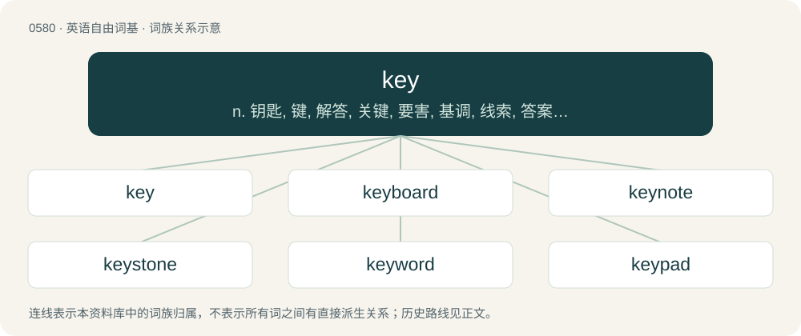

# 0651 · key — n. 钥匙, 键, 解答, 关键, 要害, 基调, 线索, 答案, 暗礁；vt. 调音, 锁上, 提供线索；vi. 使用钥匙

[总目录](../00_总目录_按常用程度.md)

**类型**：英语自由词基　｜　**来源语言**：见词源记录

## 核心含义与来源

- 核心含义：n. 钥匙, 键, 解答, 关键, 要害, 基调, 线索, 答案, 暗礁；vt. 调音, 锁上, 提供线索；vi. 使用钥匙
- 英文含义：An object designed to open and close a lock or to activate or deactivate something, especially a length of metal inserted into a narrow opening on the lock to which it is matched (keyed).
- 词形：key

**多个词源／构词路径**：同一拼写可能有不同来源；以下按词性和含义分别列出。

**来源记录 1**（名词；An object designed to open and close a lock or to activate or deactivate something, especially a length of metal inserted into a narrow opening on the lock to which it is matched (keyed).）

From Middle English keye, kaye, keiȝe, from Old English cǣġ (“key, solution, experiment”) (whence also Scots key and kay (“key”)), from Anglo-Frisian Proto-West Germanic \*kaiju, of uncertain origin. The only sure cognates are Saterland Frisian Koai (“key”), West Frisian kaai (“key”), and North Frisian kai, koie (“key”). Possibly from Proto-Germanic \*kēgaz, \*kēguz (“stake, post, pole”), from Proto-Indo-European \*ǵogʰ-, \*ǵegʰ-, \*ǵegʰn- (“branch, stake, bush”), which would make it cognate with Middle Low German kāk (“whipping post, pillory”), and perhaps to Middle Dutch keige (“javelin, spear”) and Middle Low German keie, keige (“spear”). For the semantic development, note that medieval keys were simply long poles (ending in a hook) with which a crossbar obstructing a door from the inside could be removed from the outside, by lifting it through a hole in the door. Liberman has noted, however, "The original meaning of \*kaig-jo- was presumably '\*pin with a twisted end.' Words with the root \*kai- followed by a consonant meaning 'crooked, bent; twisted' are common only in the North Germanic languages."

**来源记录 2**（名词；One of a string of small islands.）

Variant of cay, from Spanish cayo, from Taíno cayo (“small island”)

**来源记录 3**（名词；A kilogram, especially of a recreational drug.）

Clipping of kilogram or kilo.

**来源记录 4**（名词；A key position player (a tall forward or defender).）

Clipping of key position.

## 词族图

## 单词速览（常用到不常用）

| 单词 | 音标 | 释义 |
|---|---|---|
| [key](#w-1) | 英 /kiː/；美 /ki/ | n. 钥匙, 键, 解答, 关键, 要害, 基调, 线索, 答案, 暗礁；vt. 调音, 锁上, 提供线索；vi. 使用钥匙 |
| [keyboard](#w-2) | 英 /ˈkiːbɔːd/；美 /ˈki.bɔɹd/ | n. 键盘；\[计\] 键盘 |
| [keynote](#w-3) | 美 /ˈkiːˌnoʊt/ | n. 主调音, 基音, 基调；vt. 说明基本政策, 定基调 |
| [keystone](#w-4) | /ˈkiː.stəʊn/ | n. 拱顶石, 楔石, 重点 |
| [keyword](#w-5) | 英 /ˈkiː.wɜːd/；美 /ˈki.wɝd/ | \[计\] 关键字 |
| [keypad](#w-6) | /ˈkiːpæd/ | n. 键区；\[计\] 键区 |
| [keyhole](#w-7) | 美 /ˈkiˌhoʊ̯l/ | n. 键孔, 栓孔, 锁眼；a. 显示内情的 |
| [keychain](#w-8) | /ˈkiːˌt͡ʃeɪn/ | n. 钥匙链 |
| [turnkey](#w-9) | /ˈtɜː(ɹ)nˌkiː/ | n. 监狱看守, 狱吏；\[计\] 总控钥匙 |
| [keyless](#w-10) | /ˈkiːlis/ | a. 无键的, 不用钥匙上发条的 |
| [keystroke](#w-11) | /ˈkiːstrəuk/ | n. 键击；\[计\] 按键, 击键 |
| [keyring](#w-12) | Australia /ˈkiːɹɪŋ/ | n. 钥匙圈 |

## 逐词详解

### 1. key

**词性**：名词　｜　**音标**：英 /kiː/；美 /ki/

**中文释义**：n. 钥匙, 键, 解答, 关键, 要害, 基调, 线索, 答案, 暗礁；vt. 调音, 锁上, 提供线索；vi. 使用钥匙

**英文义项**：An object designed to open and close a lock or to activate or deactivate something, especially a length of metal inserted into a narrow opening on the lock to which it is matched (keyed). / A card or fob that electronically signals a lock to open.

**词源与演化**：

From Middle English keye, kaye, keiȝe, from Old English cǣġ (“key, solution, experiment”) (whence also Scots key and kay (“key”)), from Anglo-Frisian Proto-West Germanic \*kaiju, of uncertain origin. The only sure cognates are Saterland Frisian Koai (“key”), West Frisian kaai (“key”), and North Frisian kai, koie (“key”). Possibly from Proto-Germanic \*kēgaz, \*kēguz (“stake, post, pole”), from Proto-Indo-European \*ǵogʰ-, \*ǵegʰ-, \*ǵegʰn- (“branch, stake, bush”), which would make it cognate with Middle Low German kāk (“whipping post, pillory”), and perhaps to Middle Dutch keige (“javelin, spear”) and Middle Low German keie, keige (“spear”). For the semantic development, note that medieval keys were simply long poles (ending in a hook) with which a crossbar obstructing a door from the inside could be removed from the outside, by lifting it through a hole in the door. Liberman has noted, however, "The original meaning of \*kaig-jo- was presumably '\*pin with a twisted end.' Words with the root \*kai- followed by a consonant meaning 'crooked, bent; twisted' are common only in the North Germanic languages."

**例句**：

> The key to his proposal is that he thinks this company is dying and needs radical change.

该用例对应义项：An idea, theory or observation that explains, justifies or renders (something) comprehensible.

### 2. keyboard

**词性**：动词　｜　**音标**：英 /ˈkiːbɔːd/；美 /ˈki.bɔɹd/

**中文释义**：n. 键盘；\[计\] 键盘

**英文义项**：To type on a computer keyboard.

**构词拆分**：key + board

**词源与演化**：

From key + board.

**例句**：

> Keyboarding is the part of this job I hate the most.

该用例对应义项：To type on a computer keyboard.

### 3. keynote

**词性**：名词　｜　**音标**：美 /ˈkiːˌnoʊt/

**中文释义**：n. 主调音, 基音, 基调；vt. 说明基本政策, 定基调

**英文义项**：A speech that sets the main theme of a conference or other gathering; a keynote speech or keynote address. / The main theme of a speech, a written work, or a conference.

**构词拆分**：key + note

**词源与演化**：

From key + note.

**例句**：

> Innovation was the keynote of the company’s presentation.

该用例对应义项：A speech that sets the main theme of a conference or other gathering; a keynote speech or keynote address.

### 4. keystone

**词性**：名词　｜　**音标**：/ˈkiː.stəʊn/

**中文释义**：n. 拱顶石, 楔石, 重点

**英文义项**：The top stone of an arch. / Something on which other things depend for support.

**构词拆分**：key + stone

**词源与演化**：

From key + stone. Definition 4 (retail) possibly originated in the jewelry industry in the magazine called "Jewelers' Circular-Keystone".

**例句**：

> The keystone of campaign reform was the ban on soft money.

该用例对应义项：a central cohesive source of support and stability

### 5. keyword

**词性**：名词　｜　**音标**：英 /ˈkiː.wɜːd/；美 /ˈki.wɝd/

**中文释义**：\[计\] 关键字

**英文义项**：Any word used as the key to a code. / Any word used in a reference work to link to other words or other information.

**构词拆分**：key + word

**词源与演化**：

From key + word.

**例句**：

> You can use a keyword to help you remember complicated topics.

### 6. keypad

**词性**：名词　｜　**音标**：/ˈkiːpæd/

**中文释义**：n. 键区；\[计\] 键区

**英文义项**：A small board with keys primarily used for tactile input into a machine.

**构词拆分**：key + pad

**词源与演化**：

From key + pad.

**例句**：

> Many laptop computers have special function keys which turn part of the alphabetical keyboard into a numeric keypad.

该用例对应义项：A small board with keys primarily used for tactile input into a machine.

### 7. keyhole

**词性**：名词　｜　**音标**：美 /ˈkiˌhoʊ̯l/

**中文释义**：n. 键孔, 栓孔, 锁眼；a. 显示内情的

**英文义项**：The hole in a lock where the key is inserted and turns. / Any small opening resembling the hole for a key in shape or function; especially, one that gives a vista of, or access to, a space beyond.

**构词拆分**：key + hole

**词源与演化**：

From key + hole.

**用法示例／搭配（非完整句）**：

> laser keyhole welding

该用例对应义项：A transient column of vapor or plasma formed when using high energy beams, such as lasers, for welding or cutting.

### 8. keychain

**词性**：名词　｜　**音标**：/ˈkiːˌt͡ʃeɪn/

**中文释义**：n. 钥匙链

**英文义项**：A chain or ring to which a key may be attached. / An ornamental piece holding such a chain or ring.

**构词拆分**：key + chain

**词源与演化**：

From key + chain.

**例句**：

> Tom keeps multiple 20-sided dice on his keychain.

### 9. turnkey

**词性**：形容词　｜　**音标**：/ˈtɜː(ɹ)nˌkiː/

**中文释义**：n. 监狱看守, 狱吏；\[计\] 总控钥匙

**英文义项**：Ready to use without further assembly or test; supplied in a state that is ready to turn on and operate (typically refers to an assembly that is outsourced for manufacture).

**构词拆分**：turn + key

**词源与演化**：

From turn + key. (jailer): Compare typologically Russian вертуха́й (vertuxáj) (akin to верте́ть (vertétʹ)).

**例句**：

> They wanted a turnkey solution for the entire system, but we could only provide the enclosure.

该用例对应义项：Ready to use without further assembly or test; supplied in a state that is ready to turn on and operate (typically refers to an assembly that is outsourced for manufacture).

### 10. keyless

**词性**：形容词　｜　**音标**：/ˈkiːlis/

**中文释义**：a. 无键的, 不用钥匙上发条的

**英文义项**：Lacking or not requiring a key.

**构词拆分**：key + -less

**词源与演化**：

From key + -less.

**例句**：

> A keyless lock operated by a series of pushbuttons.

该用例对应义项：lacking or not requiring a key

### 11. keystroke

**词性**：名词　｜　**音标**：/ˈkiːstrəuk/

**中文释义**：n. 键击；\[计\] 按键, 击键

**英文义项**：The act of pressing an input key on a computer keyboard, typewriter, or similar input device. / A keyboard shortcut.

**构词拆分**：key + stroke

**词源与演化**：

From key + stroke.

### 12. keyring

**词性**：名词　｜　**音标**：Australia /ˈkiːɹɪŋ/

**中文释义**：n. 钥匙圈

**英文义项**：A ring, normally of metal or plastic, for holding keys together. / A set of data holding linked encryption keys.

**构词拆分**：key + ring

**词源与演化**：

From key + ring.

**例句**：

> I have a keyring with a snap hook with a dynamo lamp.
