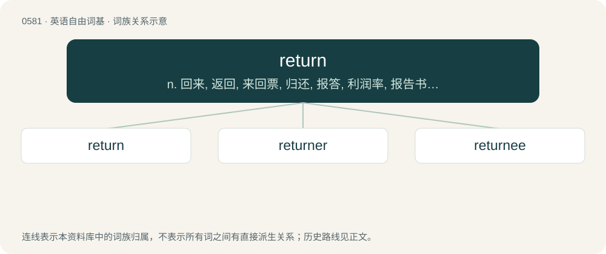

# 0652 · return — n. 回来, 返回, 来回票, 归还, 报答, 利润率, 报告书；a. 返回的, 回程的, 报答的, 反向的, 重现的, 复原的；vi. 返回, 归还, 回来

[总目录](../00_总目录_按常用程度.md)

**类型**：英语自由词基　｜　**来源语言**：见词源记录

## 核心含义与来源

- 核心含义：n. 回来, 返回, 来回票, 归还, 报答, 利润率, 报告书；a. 返回的, 回程的, 报答的, 反向的, 重现的, 复原的；vi. 返回, 归还, 回来
- 英文含义：To come or go back (to a place or person).
- 词形：return

**来源记录 1**（动词；To come or go back (to a place or person).）

From Middle English returnen, retornen, from Anglo-Norman returner, from Old French retourner, retorner, from Medieval Latin retornare (“to turn back”), from re- + tornare (“to turn”). By surface analysis, re- + turn. Compare beturn. Displaced native Old English eftċierran, literally "eft-char".

## 词族图

## 单词速览（常用到不常用）

| 单词 | 音标 | 释义 |
|---|---|---|
| [return](#w-1) | 英 /ɹɪˈtɜːn/；美 /ɹɪˈtɝn/ | n. 回来, 返回, 来回票, 归还, 报答, 利润率, 报告书；a. 返回的, 回程的, 报答的, 反向的, 重现的, 复原的；vi. 返回, 归还, 回来 |
| [returner](#w-2) | /riˈtəːnə/ | n. 离职生养小孩一段时间后复职的妇女；回击者 |
| [returnee](#w-3) | 英 /ɹɪˌtɜːˈniː/；美 /ɹɪˌtɝˈniː/ | n. 回国人员, 返回者 |

## 逐词详解

### 1. return

**词性**：动词　｜　**音标**：英 /ɹɪˈtɜːn/；美 /ɹɪˈtɝn/

**中文释义**：n. 回来, 返回, 来回票, 归还, 报答, 利润率, 报告书；a. 返回的, 回程的, 报答的, 反向的, 重现的, 复原的；vi. 返回, 归还, 回来

**英文义项**：To come or go back (to a place or person). / To go back in thought, narration, or argument.

**词源与演化**：

From Middle English returnen, retornen, from Anglo-Norman returner, from Old French retourner, retorner, from Medieval Latin retornare (“to turn back”), from re- + tornare (“to turn”). By surface analysis, re- + turn. Compare beturn. Displaced native Old English eftċierran, literally "eft-char".

**例句**：

> Although the birds fly north for the summer, they return here in winter.

该用例对应义项：To come or go back (to a place or person).

### 2. returner

**词性**：名词　｜　**音标**：/riˈtəːnə/

**中文释义**：n. 离职生养小孩一段时间后复职的妇女；回击者

**英文义项**：One who returns from another place. / One who returns something, such as defective goods.

**构词拆分**：From return + -er.

**词源与演化**：

From return + -er.

### 3. returnee

**词性**：名词　｜　**音标**：英 /ɹɪˌtɜːˈniː/；美 /ɹɪˌtɝˈniː/

**中文释义**：n. 回国人员, 返回者

**英文义项**：Someone who comes back or returns, especially to their own country or region. / A person who sends something back.

**构词拆分**：From return + -ee.

**词源与演化**：

From return + -ee.
