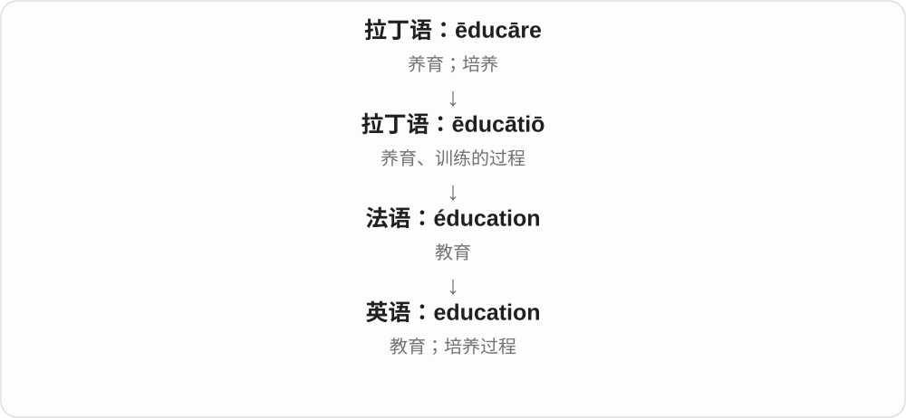
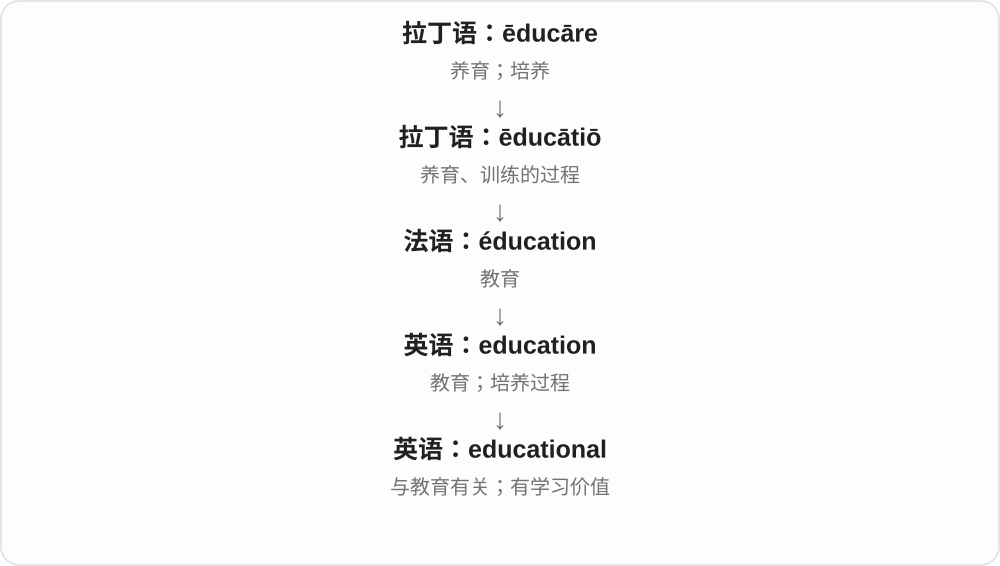

# 0653 · education — 教育；教育相关；再教育

[逐词精讲目录](../00_逐词精讲目录.md) · [总目录](../00_总目录_按常用程度.md)

## 核心词根与来源

education 接拉丁语 ēducātiō，来自 ēducāre 养育、训练。更远与引导词族相关，不等于所有现代含义都能逐字从带出来推导。

**EDUCATION：学习、培养的过程，再看用途与重复**

education 是过程、体系或培养经验；educational 说教育相关或能让人学到东西，reeducation 则再来一轮。

- **过程与教育作用**：education · educational
- **再次教育、训练**：reeducation

## 词形与演化规律

education → educational；re- + education → reeducation。

## 单词速览（按词族由简到繁）

同一基础词的相关扩展放在一起，先读基础形式，再读扩展；各组之间优先读常用的。具体词源关系见各词讲解。

| 单词 | 音标 | 核心意思 |
|---|---|---|
| [education](#w-1) | 英 /ˌedʒʊˈkeɪʃən/；美 /ˌedʒəˈkeɪʃən/ | 教育；受教育的经历或过程 |
| [educational](#w-2) | 英 /ˌedʒʊˈkeɪʃənəl/；美 /ˌedʒəˈkeɪʃənəl/ | 教育的；能学到东西的 |
| [reeducation](#w-3) | 英 /ˌriːedʒʊˈkeɪʃən/；美 /ˌriːedʒəˈkeɪʃən/ | 再教育；重新训练；某些语境中的思想改造 |

## 逐词讲解

### 1. education — 教育；受教育的经历或过程

**音标**：英 /ˌedʒʊˈkeɪʃən/；美 /ˌedʒəˈkeɪʃən/

**先抓住这个画面**

education 是一个人被培养、不断学会理解和做事的过程。学校教育是其中一部分，也可以谈职业训练和终身学习。

**怎么拆**

来自拉丁语 ēducātiō“养育、训练”，经法语等路线进入英语；现代与 educate 对照理解。

**怎么变成今天的意思**

它从培养、养育发展到系统教学，也能指某人的教育背景。an education 可指某一段或某一种教育经历；泛指教育常不可数。

**常见搭配与例句**

higher education（高等教育）；access to education（受教育机会）；a good education（良好教育）。

> Everyone should have access to a good education.

每个人都应有机会接受良好教育。

> His education continued long after he left school.

离开学校很久以后，他仍在不断学习。

**别混淆**

education 是教育过程和经历；qualification 是取得的资历或资格。受过教育不等于一定持有某张证书。

### 2. educational — 教育的；能学到东西的

**音标**：英 /ˌedʒʊˈkeɪʃənəl/；美 /ˌedʒəˈkeɪʃənəl/

**先抓住这个画面**

educational 既能说一件事属于教育领域，也能说它让你学到了东西。参观工厂觉得长见识，就是 an educational visit。

**怎么拆**

education + -al，把名词“教育”变成形容词。

**怎么变成今天的意思**

educational policy 是教育政策；educational game 则强调游戏有学习用途。前者是领域关系，后者是实际作用。

**常见搭配与例句**

educational resources（教育资源）；an educational visit（有教育意义的参观）；educational opportunities（教育机会）。

> The website offers free educational resources.

这个网站提供免费的教育资源。

> Our visit to the workshop was surprisingly educational.

这次参观车间出乎意料地让我们学到了很多。

**别混淆**

educational 形容活动或材料有教育性质；educated 形容人受过教育，不能互换。

### 3. reeducation — 再教育；重新训练；某些语境中的思想改造

**音标**：英 /ˌriːedʒʊˈkeɪʃən/；美 /ˌriːedʒəˈkeɪʃən/

**先抓住这个画面**

把已经学过、形成习惯的人，再放进一轮学习或训练；语气可中性，也可能带强制色彩。

**怎么拆**

re- 再、重新 + education 教育。education 来自拉丁语养育、训练词族，不能仅凭带出这个更远构词关系就宣称教育最初一定等于释放潜能。

**怎么变成今天的意思**

**拉丁语 ēducāre → ēducātus、ēducātiō 词族**  
养育、训练、教育；相应分词和活动名词

↓

**英语 educate、education 及其派生**  
教育、培养；教育活动、过程

↓

**re- + education → reeducation**  
再一次教育、训练；具体语境也可指强制思想改造

a reeducation programme 再教育、再训练项目。政治历史中也会指强迫改变观念的安排，不能只看 re- 就当成普通自愿进修。

**常见搭配与例句**

a reeducation programme；political reeducation；a process of reeducation。

> The new system required a period of reeducation for experienced staff.

新系统要求有经验的员工也重新接受一段培训。

> The historian examines the political language of reeducation.

历史研究者考察再教育这一说法的政治语言背景。

**别混淆**

reeducation 重新训练、教育；retraining 在职业技能更新中往往更直接。它们是否自愿、具体教什么，要看上下文。

## 这一组要分清什么

教育词族的更远来源不能替代现代具体用法；reeducation 可能中性再训练，也可能带强制改造语境。

## 串起来练习

The book discusses education as an ongoing process rather than a single event.

书中把教育视为持续过程，而不是一次性事件。
