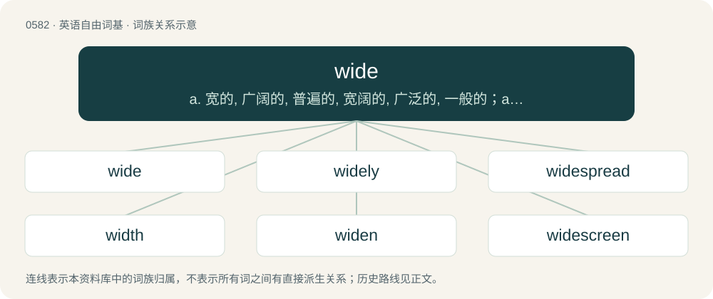

# 0654 · wide — a. 宽的, 广阔的, 普遍的, 宽阔的, 广泛的, 一般的；adv. 广阔地, 遍及各处地, 广泛地；n. 大千世界

[总目录](../00_总目录_按常用程度.md)

**类型**：英语自由词基　｜　**来源语言**：见词源记录

## 核心含义与来源

- 核心含义：a. 宽的, 广阔的, 普遍的, 宽阔的, 广泛的, 一般的；adv. 广阔地, 遍及各处地, 广泛地；n. 大千世界
- 英文含义：Having a large physical extent from side to side.
- 词形：wide

**来源记录 1**（形容词；Having a large physical extent from side to side.）

From Middle English wid, wyd, from Old English wīd (“wide, vast, broad, long; distant, far”), from Proto-Germanic \*wīdaz, from Proto-Indo-European \*h₁weydʰh₁- (“to divide, separate”), a dissimilated univerbation from \*dwi- (“apart, asunder, in two”) + \*dʰeh₁- (“to do, put, place”). Cognates Cognate with North Frisian widj (“wide”), Saterland Frisian wied (“wide”), West Frisian wiid (“broad; wide”), Central Franconian weck, weit, wick, wiet (“distant, far, wide”), Dutch wijd (“wide; large; broad”), German weit (“far; wide; broad”), Luxembourgish weit (“wide”), wäit (“far”), Yiddish ווײַט (vayt, “distant, far”), Danish, Norwegian Bokmål, Norwegian Nynorsk, and Swedish vid (“wide”), Faroese and Icelandic víður (“wide”); also Breton gwez (“trees”), Cornish gwedh, gwëdh, gwydh, gwÿdh (“trees”), Irish and Scottish Gaelic fiodh (“timber, wood”), Manx fuygh (“timber, wood”), Welsh gwŷdd (“trees”), Latin dīvidō (“to divide, separate”), Latgalian vyds (“middle”), Latvian vidus (“center, middle”), Lithuanian vidùs (“interior, inside; inward”), Tocharian A and Tocharian B wätk- (“to distinguish, separate”). Related to widow.

## 词族图

## 单词速览（常用到不常用）

| 单词 | 音标 | 释义 |
|---|---|---|
| [wide](#w-1) | 英 /waɪd/ | a. 宽的, 广阔的, 普遍的, 宽阔的, 广泛的, 一般的；adv. 广阔地, 遍及各处地, 广泛地；n. 大千世界 |
| [widely](#w-2) | /ˈwaɪdli/ | adv. 广泛地 |
| [widespread](#w-3) | /ˌwaɪdˈspɹɛd/ | a. 充分伸展的, 广布的, 普及的, 流传广的 |
| [width](#w-4) | /ˈwɪtθ/ | n. 宽度, 宽广, 广博；\[医\] 宽度 |
| [widen](#w-5) | /ˈwaɪdn̩/ | vt. 弄宽, 加宽, 扩大；vi. 变宽, 扩大 |
| [widescreen](#w-6) | /ˈwaɪdˌskɹin/ | n. 宽银幕；a. 宽银幕的 |
| [wideband](#w-7) | /ˈwaidˈbænd/ | \[计\] 宽带 |
| [wideout](#w-8) |  | 【英文】A wide receiver. |

## 逐词详解

### 1. wide

**词性**：形容词　｜　**音标**：英 /waɪd/

**中文释义**：a. 宽的, 广阔的, 普遍的, 宽阔的, 广泛的, 一般的；adv. 广阔地, 遍及各处地, 广泛地；n. 大千世界

**英文义项**：Having a large physical extent from side to side. / Large in scope.

**词源与演化**：

From Middle English wid, wyd, from Old English wīd (“wide, vast, broad, long; distant, far”), from Proto-Germanic \*wīdaz, from Proto-Indo-European \*h₁weydʰh₁- (“to divide, separate”), a dissimilated univerbation from \*dwi- (“apart, asunder, in two”) + \*dʰeh₁- (“to do, put, place”). Cognates Cognate with North Frisian widj (“wide”), Saterland Frisian wied (“wide”), West Frisian wiid (“broad; wide”), Central Franconian weck, weit, wick, wiet (“distant, far, wide”), Dutch wijd (“wide; large; broad”), German weit (“far; wide; broad”), Luxembourgish weit (“wide”), wäit (“far”), Yiddish ווײַט (vayt, “distant, far”), Danish, Norwegian Bokmål, Norwegian Nynorsk, and Swedish vid (“wide”), Faroese and Icelandic víður (“wide”); also Breton gwez (“trees”), Cornish gwedh, gwëdh, gwydh, gwÿdh (“trees”), Irish and Scottish Gaelic fiodh (“timber, wood”), Manx fuygh (“timber, wood”), Welsh gwŷdd (“trees”), Latin dīvidō (“to divide, separate”), Latgalian vyds (“middle”), Latvian vidus (“center, middle”), Lithuanian vidùs (“interior, inside; inward”), Tocharian A and Tocharian B wätk- (“to distinguish, separate”). Related to widow.

**例句**：

> Too bad! That was a great passing-shot, but it's wide.

该用例对应义项：On one side or the other of the mark; too far sideways from the mark, the wicket, the batsman, etc.

### 2. widely

**词性**：副词　｜　**音标**：/ˈwaɪdli/

**中文释义**：adv. 广泛地

**英文义项**：In a wide manner; across a wide area. / Commonly; generally; to a great degree.

**构词拆分**：wide + -ly

**词源与演化**：

From Middle English wijdly, equivalent to wide + -ly.

**用法示例／搭配（非完整句）**：

> I'm widely travelled.

该用例对应义项：In a wide manner; across a wide area.

### 3. widespread

**词性**：形容词　｜　**音标**：/ˌwaɪdˈspɹɛd/

**中文释义**：a. 充分伸展的, 广布的, 普及的, 流传广的

**英文义项**：Affecting, or found throughout, a large area (e.g. the entire land or body); broad in extent; widely diffused. / Spread far apart.

**构词拆分**：wide + spread

**词源与演化**：

From wide + spread.

**例句**：

> There was widespread support for the proposal.

该用例对应义项：Affecting, or found throughout, a large area (e.g. the entire land or body); broad in extent; widely diffused.

### 4. width

**词性**：名词　｜　**音标**：/ˈwɪtθ/

**中文释义**：n. 宽度, 宽广, 广博；\[医\] 宽度

**英文义项**：The state of being wide. / The measurement of the extent of something from side to side.

**构词拆分**：wide + -th (abstract nominal suffix)

**词源与演化**：

From wide + -th (abstract nominal suffix), possibly by analogy with Old Norse vídd (“width”), though this is unlikely, as the word is not attested before the end of the 16th century and was historically unknown in Scots and the traditional dialect of Northern England, where one would expect Old Norse influence to be the strongest (these varieties traditionally employed wideness instead). Replaced Middle English wide, wyde (“width”).

**例句**：

> Manchester United like to play with width.

该用例对应义项：The use of all the width of the pitch, from one side to the other.

### 5. widen

**词性**：动词　｜　**音标**：/ˈwaɪdn̩/

**中文释义**：vt. 弄宽, 加宽, 扩大；vi. 变宽, 扩大

**英文义项**：To become wide or wider. / To make wide or wider.

**构词拆分**：wide + -en (verbal suffix)

**词源与演化**：

From wide + -en (verbal suffix).

**例句**：

> His eyes widened as her negligee fell to the floor.

该用例对应义项：To become wide or wider.

### 6. widescreen

**词性**：名词　｜　**音标**：/ˈwaɪdˌskɹin/

**中文释义**：n. 宽银幕；a. 宽银幕的

**英文义项**：A screen with a wider aspect ratio than the ordinary 35-millimeter frame, making more effective use of the human field of view and producing a more immersive view experience.

**构词拆分**：wide + screen

**词源与演化**：

From wide + screen.

**例句**：

> Local protestors showed gruesome abattoir footage on widescreen TVs.

### 7. wideband

**词性**：名词　｜　**音标**：/ˈwaidˈbænd/

**中文释义**：\[计\] 宽带

**英文义项**：A communications transmission rate between that of narrowband and broadband.

**构词拆分**：wide + band

**词源与演化**：

From wide + band.

### 8. wideout

**词性**：名词

**英文义项**：A wide receiver.

**构词拆分**：wide + out

**词源与演化**：

From wide + out.
