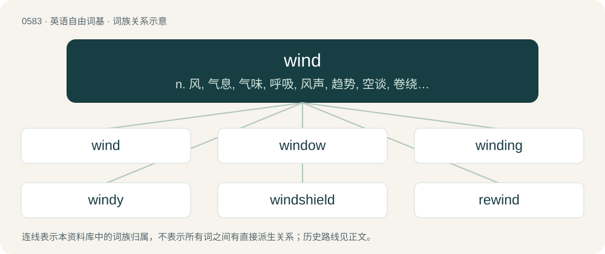

# 0655 · wind — n. 风, 气息, 气味, 呼吸, 风声, 趋势, 空谈, 卷绕, 弯曲；vt. 使通风, 嗅出, 使喘气, 吹号角, 上发条, 缠绕, 包, 绞起, 吊起, 使弯曲, 使迂回；vi. 嗅出猎物, 吹响号角, 卷曲, 蜿蜒, 迂回, 缠绕

[总目录](../00_总目录_按常用程度.md)

**类型**：英语自由词基　｜　**来源语言**：见词源记录

## 核心含义与来源

- 核心含义：n. 风, 气息, 气味, 呼吸, 风声, 趋势, 空谈, 卷绕, 弯曲；vt. 使通风, 嗅出, 使喘气, 吹号角, 上发条, 缠绕, 包, 绞起, 吊起, 使弯曲, 使迂回；vi. 嗅出猎物, 吹响号角, 卷曲, 蜿蜒, 迂回, 缠绕
- 英文含义：Real or perceived movement of atmospheric air usually caused by convection or differences in air pressure.
- 词形：wind

**多个词源／构词路径**：同一拼写可能有不同来源；以下按词性和含义分别列出。

**来源记录 1**（名词；Real or perceived movement of atmospheric air usually caused by convection or differences in air pressure.）

From Middle English wynd, wind, from Old English wind (“wind”), from Proto-West Germanic \*wind, from Proto-Germanic \*windaz, from Proto-Indo-European \*h₂wéh₁n̥tos (“wind”), from earlier \*h₂wéh₁n̥ts (“wind”), derived from the present participle of \*h₂weh₁- (“to blow”). Cognates Cognate with Yola weend, wyeene (“wind”), North Frisian win, winj (“wind”), Saterland Frisian Wíend (“wind”), West Frisian wyn (“wind”), Alemannic German wend, wind, winn, wénn (“wind”), Bavarian bint, Wind (“wind”), Cimbrian and Mòcheno bint (“wind”), Dutch wind (“wind”), German and German Low German Wind (“wind”), Luxembourgish Wand (“wind”), Yiddish ווינט (vint, “wind”), Danish, Norwegian Bokmål, Norwegian Nynorsk, and Swedish vind (“wind”), Faroese and Icelandic vindur (“wind”), Gothic 𐍅𐌹𐌽𐌳𐍃 (winds, “wind”), Latin ventus (“wind”), Welsh gwynt (“wind”), Sanskrit वात (vā́ta, “wind”), Russian ве́тер (véter, “wind”), perhaps Albanian bundë (“strong damp wind”). Doublet of athlete, vent, weather and nirvana.

**来源记录 2**（动词；To turn coils (of a cord or something similar) around something.）

From Middle English wynden, from Old English windan, from Proto-Germanic \*windaną. Compare West Frisian wine, Low German winden, Dutch winden, German winden, Danish vinde, Walloon windea. See also the related term wend.

## 词族图

## 单词速览（常用到不常用）

| 单词 | 音标 | 释义 |
|---|---|---|
| [wind](#w-1) | 英 /ˈwɪnd/ | n. 风, 气息, 气味, 呼吸, 风声, 趋势, 空谈, 卷绕, 弯曲；vt. 使通风, 嗅出, 使喘气, 吹号角, 上发条, 缠绕, 包, 绞起, 吊起, 使弯曲, 使迂回；vi. 嗅出猎物, 吹响号角, 卷曲, 蜿蜒, 迂回, 缠绕 |
| [window](#w-2) | 英 /ˈwɪndəʊ/；美 /ˈwɪndoʊ/ | n. 窗户, 窗子, 窗口；vt. 给...开窗；\[计\] 窗口 |
| [winding](#w-3) | 英 /ˈwɪndɪŋ/ | n. 绕, 卷, 弯曲, 线圈；a. 蜿蜒的, 卷绕的, 弯曲的 |
| [windy](#w-4) | /ˈwɪn.di/ | a. 多风的, 风强的, 腹胀的, 吹牛的 |
| [windshield](#w-5) | /wɪnˈʃiːld/ | n. 挡风玻璃；\[电\] 风遮蔽 |
| [rewind](#w-6) | 英 /ɹiːˈwaɪnd/ | vt. 重绕；n. 重绕；\[计\] 反绕 |
| [whirlwind](#w-7) | 英 /ˈwɜːlwɪnd/；美 /ˈ(h)wɝlwɪnd/ | n. 旋风 |
| [windmill](#w-8) | 英 /ˈwɪn(d).mɪl/ | n. 风车 |
| [unwind](#w-9) | /ʌnˈwaɪnd/ | vt. 展开；\[化\] 拆卷; 开卷 |
| [windfall](#w-10) | 英 /ˈwɪnd.fɔːl/；/ˈwɪnd.fɔl/ | n. 被风吹落的果子, 横财；\[经\] 意外损失 |
| [windscreen](#w-11) | /ˈwɪn(d).skɹiːn/ | n. 汽车的挡风玻璃 |
| [windward](#w-12) | /ˈwɪndwə(ɹ)d/ | adv. 向风, 上风；a. 向风的, 上风的；n. 上风面 |
| [downwind](#w-13) | Canada /ˌdaʊnˈwɪnd/ | a. 顺风的；adv. 顺风 |
| [winder](#w-14) | 美 /ˈwaɪndɚ/ | n. 络纱工, 络筒机, 络纱机, 开发条的钥匙；\[计\] 卷线机, 绕线机 |
| [windsurfing](#w-15) | /ˈwind.səːfiŋ/ | n. \[体\]帆板运动 |
| [woodwind](#w-16) | /ˈwʊdwɪnd/ | n. 木管乐器 |
| [windswept](#w-17) | /ˈwindswept/ | a. 风刮的, 被风吹扫的, 暴露在风中的 |
| [windpipe](#w-18) | /ˈwɪndpaɪp/ | n. 气管；\[医\] 气管 |
| [upwind](#w-19) | /ʌpˈwɪnd/ | a. 迎风的, 顶风的；adv. 迎风地, 顶风地 |
| [tailwind](#w-20) | /ˈteɪlwɪnd/ | n. （从后面吹来的）顺风 |
| [windstorm](#w-21) | /ˈwɪndstɔː(ɹ)m/ | n. 暴风 |
| [headwind](#w-22) | /ˈhɛdˌwɪnd/ | n. 逆风, 顶风 |
| [windbreaker](#w-23) | /ˈwɪndbɹeɪkə(ɹ)/ | n. 防风林, 防风茄克衫, 风衣 |
| [crosswind](#w-24) | 美 /ˈkɹɑːs.wɪnd/ | n. 侧风 |
| [windage](#w-25) | /ˈwɪndɪd͡ʒ/ | n. 风力影响, 游隙, 风力修正量；\[医\] 气压伤 |

## 逐词详解

### 1. wind

**词性**：名词　｜　**音标**：英 /ˈwɪnd/

**中文释义**：n. 风, 气息, 气味, 呼吸, 风声, 趋势, 空谈, 卷绕, 弯曲；vt. 使通风, 嗅出, 使喘气, 吹号角, 上发条, 缠绕, 包, 绞起, 吊起, 使弯曲, 使迂回；vi. 嗅出猎物, 吹响号角, 卷曲, 蜿蜒, 迂回, 缠绕

**英文义项**：Real or perceived movement of atmospheric air usually caused by convection or differences in air pressure. / Air artificially put in motion by any force or action.

**词源与演化**：

From Middle English wynd, wind, from Old English wind (“wind”), from Proto-West Germanic \*wind, from Proto-Germanic \*windaz, from Proto-Indo-European \*h₂wéh₁n̥tos (“wind”), from earlier \*h₂wéh₁n̥ts (“wind”), derived from the present participle of \*h₂weh₁- (“to blow”). Cognates Cognate with Yola weend, wyeene (“wind”), North Frisian win, winj (“wind”), Saterland Frisian Wíend (“wind”), West Frisian wyn (“wind”), Alemannic German wend, wind, winn, wénn (“wind”), Bavarian bint, Wind (“wind”), Cimbrian and Mòcheno bint (“wind”), Dutch wind (“wind”), German and German Low German Wind (“wind”), Luxembourgish Wand (“wind”), Yiddish ווינט (vint, “wind”), Danish, Norwegian Bokmål, Norwegian Nynorsk, and Swedish vind (“wind”), Faroese and Icelandic vindur (“wind”), Gothic 𐍅𐌹𐌽𐌳𐍃 (winds, “wind”), Latin ventus (“wind”), Welsh gwynt (“wind”), Sanskrit वात (vā́ta, “wind”), Russian ве́тер (véter, “wind”), perhaps Albanian bundë (“strong damp wind”). Doublet of athlete, vent, weather and nirvana.

**例句**：

> As they accelerated onto the motorway, the wind tore the plywood off the car's roof-rack.

该用例对应义项：Real or perceived movement of atmospheric air usually caused by convection or differences in air pressure.

### 2. window

**词性**：名词　｜　**音标**：英 /ˈwɪndəʊ/；美 /ˈwɪndoʊ/

**中文释义**：n. 窗户, 窗子, 窗口；vt. 给...开窗；\[计\] 窗口

**英文义项**：An opening, usually covered by one or more panes of clear glass, to allow light and air from outside to enter a building or vehicle. / An opening, usually covered by glass, in a shop which allows people to view the shop and its products from outside; a shop window.

**构词拆分**：wind + eye

**词源与演化**：

From Middle English wyndowe, wyndown, from Old Norse vindauga (“window”, literally “wind-eye; wind-hole”), equivalent to wind + eye. Cognate with Scots windae and windock, Faroese vindeyga, Norwegian Bokmål vindu, Norwegian Nynorsk vindauge, Danish vindue, archaic Swedish vindöga, Elfdalian windog. Displaced native Old English ēagþȳrel (literally “eye hole”) (the rare direct descendant is eyethurl (“window, pupil, etc.”)). The “windows” among early Germanic peoples were just unglazed holes (eyes) in the wall or roof that permitted wind to pass through .

**例句**：

> You have a two-hour window of clear weather to finish working on the lawn.

该用例对应义项：A period of time when something is available or possible; a limited opportunity.

### 3. winding

**词性**：名词　｜　**音标**：英 /ˈwɪndɪŋ/

**中文释义**：n. 绕, 卷, 弯曲, 线圈；a. 蜿蜒的, 卷绕的, 弯曲的

**英文义项**：The act of winnowing (“subjecting food grain to a current of air to separate the grain from the chaff”). / The act of blowing air through a wind instrument or (chiefly) a horn to make a sound.

**构词拆分**：wind (“to blow air through (a wind instrument or horn) to make a sound; to cause (someone) to become breathless; to winnow (food grain), etc.”) + -ing (suffix forming present participial adjectives and verbs, and nouns denoting an action or the embodiment of an action)

**词源与演化**：

The noun is derived from Middle English winding, windinge, wyndynge (“act of exposing something to the wind, airing, ventilating; act of winnowing (?)”), from winden, wynden (“to expose (something) to the air or wind, ventilate; to cause (someone) to be out of breath; to winnow (wheat); of an animal: to catch the scent of (someone or something)”) + -ing, -inge (suffix forming gerund nouns, and the present participle forms of verbs). The adjective is derived from the verb. The English word is analysable as wind (“to blow air through (a wind instrument or horn) to make a sound; to cause (someone) to become breathless; to winnow (food grain), etc.”) + -ing (suffix forming present participial adjectives and verbs, and nouns denoting an action or the embodiment of an action).

**例句**：

> Sleep is to a man what winding up is to a clock.

### 4. windy

**词性**：形容词　｜　**音标**：/ˈwɪn.di/

**中文释义**：a. 多风的, 风强的, 腹胀的, 吹牛的

**英文义项**：Accompanied by wind. / Unsheltered and open to the wind.

**构词拆分**：wind + -y

**词源与演化**：

From Middle English windy, from Old English windiġ (“windy”), from Proto-Germanic \*windigaz (“windy”), equivalent to wind + -y. Cognate with Saterland Frisian wiendich (“windy”), West Frisian winich (“windy”), Dutch winderig (“windy”), German Low German windig (“windy”), German windig (“windy”), Swedish vindig (“windy”), Icelandic vindugur (“windy”). The “frightened” sense probably derives from the phrase have the wind up.

**例句**：

> The Tex-Mex meal had made them somewhat windy.

该用例对应义项：Flatulent.

### 5. windshield

**词性**：名词　｜　**音标**：/wɪnˈʃiːld/

**中文释义**：n. 挡风玻璃；\[电\] 风遮蔽

**英文义项**：A transparent screen made of glass, located at the front and back of a vehicle in front of its occupants to protect them from the wind force generated by the vehicle's speed and inclement weather. / A cover for a microphone to exclude airy noises such as wind and breathing.

**构词拆分**：wind + shield

**词源与演化**：

From wind + shield.

**例句**：

> The freezing rain covered our windshield with ice and we couldn't see a thing.

该用例对应义项：A transparent screen made of glass, located at the front and back of a vehicle in front of its occupants to protect them from the wind force generated by the vehicle's speed and inclement weather.

### 6. rewind

**词性**：动词　｜　**音标**：英 /ɹiːˈwaɪnd/

**中文释义**：vt. 重绕；n. 重绕；\[计\] 反绕

**英文义项**：To wind (something) again. / To wind back, of something clocklike or recordlike, like a cassette, tape, film; especially to then replay or relive.

**构词拆分**：re- + wind

**词源与演化**：

From re- + wind.

**例句**：

> Let's rewind the clock to an earlier time.

该用例对应义项：To wind back, of something clocklike or recordlike, like a cassette, tape, film; especially to then replay or relive.

### 7. whirlwind

**词性**：名词　｜　**音标**：英 /ˈwɜːlwɪnd/；美 /ˈ(h)wɝlwɪnd/

**中文释义**：n. 旋风

**英文义项**：A windstorm of limited extent, such as a tornado, dust devil, or waterspout, characterized by an inward spiral motion of the air with an upward current in the center; a vortex of air. / A person or body of objects or events sweeping violently onward.

**构词拆分**：whirl + wind

**词源与演化**：

From Middle English whirlewind, whirlewynde, equivalent to whirl + wind. Compare Middle Dutch wervelwint, Old Norse hvirfilvindr.

**例句**：

> The weeks leading up to the convention were a whirlwind of preparation and hurried activity.

该用例对应义项：A person or body of objects or events sweeping violently onward.

### 8. windmill

**词性**：名词　｜　**音标**：英 /ˈwɪn(d).mɪl/

**中文释义**：n. 风车

**英文义项**：A machine which translates linear motion of wind to rotational motion by means of adjustable vanes called sails. / The building or structure containing such machinery.

**构词拆分**：wind + mill

**词源与演化**：

From Middle English wyndmylne, wyndmylle, equivalent to wind + mill. Cognate with Scots wyndmyln, wyndmyl, Saterland Frisian Wíendmäälne, West Frisian wynmûne, Dutch windmolen, Afrikaans windmeul, Dutch Low Saxon windmölle (Achterhooks), wiendmeule (Drents, Veluws), German Low German Windmöhl, German Windmühle, Danish vindmølle, Norwegian Bokmål vindmølle, Norwegian Nynorsk vindmølle, vindmylne, Swedish vindmölla, Icelandic vindmylla. (imaginary enemy): A reference to Don Quixote tilting at windmills.

**用法示例／搭配（非完整句）**：

> to fight windmills

该用例对应义项：An imaginary enemy, but presented as real.

### 9. unwind

**词性**：动词　｜　**音标**：/ʌnˈwaɪnd/

**中文释义**：vt. 展开；\[化\] 拆卷; 开卷

**英文义项**：To separate (something that is wound up) / To relax; to chill out; to rest and become relieved of stress

**构词拆分**：un- + wind (“to coil”)

**词源与演化**：

From Middle English unwinden, from Old English unwindan (“to unwind; unwrap”), from Proto-Germanic \*andawindaną (“to unwind”); equivalent to un- + wind (“to coil”). Cognate with Dutch ontwinden (“to unwind”).

**例句**：

> After work, I like to unwind by smoking a pipe while reading the paper.

该用例对应义项：To relax; to chill out; to rest and become relieved of stress

### 10. windfall

**词性**：名词　｜　**音标**：英 /ˈwɪnd.fɔːl/；/ˈwɪnd.fɔl/

**中文释义**：n. 被风吹落的果子, 横财；\[经\] 意外损失

**英文义项**：Something that has been blown down by the wind. / The act of something being blown down by wind.

**构词拆分**：wind + fall

**词源与演化**：

From Middle English windfal, wyndfall, equivalent to wind + fall. Cognate with Middle High German wintval, wintfal, German Windfall.

**例句**：

> They couldn't reach the branches, so they ate the windfalls.

该用例对应义项：A fruit that has fallen from a tree naturally, as from wind.

### 11. windscreen

**词性**：名词　｜　**音标**：/ˈwɪn(d).skɹiːn/

**中文释义**：n. 汽车的挡风玻璃

**英文义项**：A transparent screen made of glass, located at the front of a vehicle in order to protect its occupants from the wind and weather. / A cover for a microphone to exclude airy noises such as wind and breathing.

**构词拆分**：wind + screen

**词源与演化**：

From wind + screen.

**例句**：

> Oh no! A vandal has just smashed our windscreen! Susan, can you go and call the insurance company?

该用例对应义项：A transparent screen made of glass, located at the front of a vehicle in order to protect its occupants from the wind and weather.

### 12. windward

**词性**：形容词　｜　**音标**：/ˈwɪndwə(ɹ)d/

**中文释义**：adv. 向风, 上风；a. 向风的, 上风的；n. 上风面

**英文义项**：Towards the wind, or the direction from which the wind is blowing. / On the side exposed to the wind.

**构词拆分**：wind + -ward

**词源与演化**：

From wind + -ward.

**例句**：

> The windward boat must give way to the leeward boat.

该用例对应义项：Towards the wind, or the direction from which the wind is blowing.

### 13. downwind

**词性**：副词　｜　**音标**：Canada /ˌdaʊnˈwɪnd/

**中文释义**：a. 顺风的；adv. 顺风

**英文义项**：in the same direction as the wind is blowing / positioned relative to something in such a way that it can be smelled in the wind

**构词拆分**：down- + wind

**词源与演化**：

From down- + wind.

**例句**：

> I don't want to live downwind from a pig farm.

该用例对应义项：positioned relative to something in such a way that it can be smelled in the wind

### 14. winder

**词性**：名词　｜　**音标**：美 /ˈwaɪndɚ/

**中文释义**：n. 络纱工, 络筒机, 络纱机, 开发条的钥匙；\[计\] 卷线机, 绕线机

**英文义项**：A winding plant. / An engine that raises and lowers the cages in a mine.

**构词拆分**：wind + -er

**词源与演化**：

From Middle English wynder; equivalent to wind + -er.

### 15. windsurfing

**词性**：名词　｜　**音标**：/ˈwind.səːfiŋ/

**中文释义**：n. \[体\]帆板运动

**英文义项**：A marine sport in which one stands on a floating board (typically 2 - 3 meters in length) to which a sail is attached. The board is steered by tilting the sail or banking the board. Some windsurfers use large waves to perform jumps and other stunts.

**构词拆分**：wind + surfing

**词源与演化**：

From wind + surfing.

**例句**：

> If you really want a challenge, you should try windsurfing.

### 16. woodwind

**词性**：名词　｜　**音标**：/ˈwʊdwɪnd/

**中文释义**：n. 木管乐器

**英文义项**：Any (typically wooden) musical instrument that produces sound by the player blowing into it, through a reed, or across an opening. Woodwind instruments include the recorder, flute, piccolo, clarinet, oboe, cor anglais and bassoon.

**构词拆分**：wood + wind

**词源与演化**：

From wood + wind.

**例句**：

> Tom can play several brass instruments, but he can't play any woodwind instruments.

### 17. windswept

**词性**：形容词　｜　**音标**：/ˈwindswept/

**中文释义**：a. 风刮的, 被风吹扫的, 暴露在风中的

**英文义项**：Exposed to the winds.

**构词拆分**：wind + swept

**词源与演化**：

From wind + swept.

**例句**：

> We struggled over the windswept moorland.

该用例对应义项：Exposed to the winds.

### 18. windpipe

**词性**：名词　｜　**音标**：/ˈwɪndpaɪp/

**中文释义**：n. 气管；\[医\] 气管

**英文义项**：The trachea. / Any duct for air or other gas.

**构词拆分**：wind + pipe

**词源与演化**：

From wind + pipe. First attested in the 1520s.

**例句**：

> If you talk while eating, food may go down your windpipe instead of your esophagus.

### 19. upwind

**词性**：形容词　｜　**音标**：/ʌpˈwɪnd/

**中文释义**：a. 迎风的, 顶风的；adv. 迎风地, 顶风地

**英文义项**：Exposed to the wind.

**构词拆分**：up- + wind

**词源与演化**：

From up- + wind.

### 20. tailwind

**词性**：名词　｜　**音标**：/ˈteɪlwɪnd/

**中文释义**：n. （从后面吹来的）顺风

**英文义项**：A wind that blows in the same direction as the course taken by an aircraft, sailing ship, bird, etc.; a following wind. / A force that accelerates progress.

**构词拆分**：tail + wind

**词源与演化**：

From tail + wind.

**例句**：

> One of his election promises was more tailwind on bicycle paths.

### 21. windstorm

**词性**：名词　｜　**音标**：/ˈwɪndstɔː(ɹ)m/

**中文释义**：n. 暴风

**英文义项**：A storm in which there are strong, violent winds but no precipitation.

**构词拆分**：wind + storm

**词源与演化**：

From wind + storm.

**例句**：

> My stream of consciousness is more like a waterfall in a windstorm.

### 22. headwind

**词性**：名词　｜　**音标**：/ˈhɛdˌwɪnd/

**中文释义**：n. 逆风, 顶风

**英文义项**：A wind that blows directly against the course of a vehicle, like an aircraft, train, or ship. / A strong force that impedes or reverses progress.

**构词拆分**：head + wind

**词源与演化**：

From Middle English \*hedwind, from Old English hēafodwind, equivalent to head + wind. Cognate with Old Norse höfuðvindr.

**例句**：

> Today, Tatoeba is slower than a tired snail facing headwind.

### 23. windbreaker

**词性**：名词　｜　**音标**：/ˈwɪndbɹeɪkə(ɹ)/

**中文释义**：n. 防风林, 防风茄克衫, 风衣

**英文义项**：A thin jacket designed to resist wind chill and light rain.

**构词拆分**：wind + breaker

**词源与演化**：

From wind + breaker, from a trademark of the John Rissman company.

**例句**：

> The windbreaker protected Adriano from the cold wind.

### 24. crosswind

**词性**：名词　｜　**音标**：美 /ˈkɹɑːs.wɪnd/

**中文释义**：n. 侧风

**英文义项**：A wind blowing across a line of travel, especially perpendicularly.

**构词拆分**：cross- + wind

**词源与演化**：

From cross- + wind.

**例句**：

> Crosswind landings require coordinated rudder and aileron input to maintain alignment to the runway.

### 25. windage

**词性**：名词　｜　**音标**：/ˈwɪndɪd͡ʒ/

**中文释义**：n. 风力影响, 游隙, 风力修正量；\[医\] 气压伤

**英文义项**：Drag on the crankshaft caused by oil splashing out of the sump when rotating at high speeds. / The difference in diameter between the bore of a firearm and the shot.

**构词拆分**：wind + -age

**词源与演化**：

From wind + -age.
