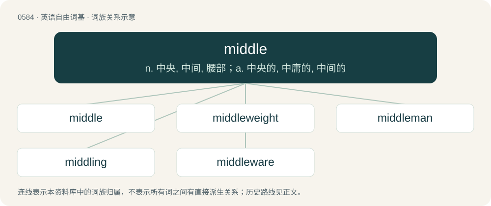

# 0656 · middle — n. 中央, 中间, 腰部；a. 中央的, 中庸的, 中间的

[总目录](../00_总目录_按常用程度.md)

**类型**：英语自由词基　｜　**来源语言**：见词源记录

## 核心含义与来源

- 核心含义：n. 中央, 中间, 腰部；a. 中央的, 中庸的, 中间的
- 英文含义：A centre, midpoint.
- 词形：middle

**来源记录 1**（名词；A centre, midpoint.）

From Middle English myddel, middel, from Old English middel (“middle, centre, waist”), from Proto-Germanic \*midlą, \*midilą, \*medalą (“middle”), a diminutive of Proto-Germanic \*midjō (“middle, midst”) (compare \*midjaz (“mid, middle”, adjective)), from Proto-Indo-European \*médʰyos (“between, in the middle, middle”). Cognates Cognate with Saterland Frisian Middel (“middle”), West Frisian mul (“middle”), Dutch middel (“means; medicine, cure”), German mittel (“middle”, adjective), Mittel (“means; medicament, remedy”, noun), Luxembourgish Mëttel (“means, method; medicament”), Vilamovian mytuł (“middle”), Yiddish מיטל (mitl, “middle”), Danish, Norwegian Bokmål and Norwegian Nynorsk middel (“means”), Icelandic meðal (“average; means, medicine”), Swedish medel (“average, mean, middle”). See also mid.

## 词族图

## 单词速览（常用到不常用）

| 单词 | 音标 | 释义 |
|---|---|---|
| [middle](#w-1) | 英 /ˈmɪdl̩/；美 /ˈmɪdl̩/ | n. 中央, 中间, 腰部；a. 中央的, 中庸的, 中间的 |
| [middleweight](#w-2) | /ˈmid(ə)lweit/ | n. 中量级拳击选手 |
| [middleman](#w-3) | /ˈmidlmæn/ | n. 中间人；\[法\] 调解人, 中间人, 中人 |
| [middling](#w-4) | 英 /ˈmɪdlɪŋ/；美 /ˈmɪd(ə)lɪŋ/ | a. 中等的, 普通的, 平凡的；adv. 中等 |
| [middleware](#w-5) | /ˈmidlweə(r)/ | n. \[计\]中间设备,中间件 |

## 逐词详解

### 1. middle

**词性**：名词　｜　**音标**：英 /ˈmɪdl̩/；美 /ˈmɪdl̩/

**中文释义**：n. 中央, 中间, 腰部；a. 中央的, 中庸的, 中间的

**英文义项**：A centre, midpoint. / The part between the beginning and the end.

**词源与演化**：

From Middle English myddel, middel, from Old English middel (“middle, centre, waist”), from Proto-Germanic \*midlą, \*midilą, \*medalą (“middle”), a diminutive of Proto-Germanic \*midjō (“middle, midst”) (compare \*midjaz (“mid, middle”, adjective)), from Proto-Indo-European \*médʰyos (“between, in the middle, middle”). Cognates Cognate with Saterland Frisian Middel (“middle”), West Frisian mul (“middle”), Dutch middel (“means; medicine, cure”), German mittel (“middle”, adjective), Mittel (“means; medicament, remedy”, noun), Luxembourgish Mëttel (“means, method; medicament”), Vilamovian mytuł (“middle”), Yiddish מיטל (mitl, “middle”), Danish, Norwegian Bokmål and Norwegian Nynorsk middel (“means”), Icelandic meðal (“average; means, medicine”), Swedish medel (“average, mean, middle”). See also mid.

**例句**：

> The middle of a circle is the point which has the same distance to every point of circle.

该用例对应义项：A centre, midpoint.

### 2. middleweight

**词性**：名词　｜　**音标**：/ˈmid(ə)lweit/

**中文释义**：n. 中量级拳击选手

**英文义项**：A weight class in professional boxing between light middleweight or welterweight and super middleweight or cruiserweight; a similar division in wrestling and other sports / A boxer who fights in this division; a similar wrestler etc

**构词拆分**：middle + weight

**词源与演化**：

From middle + weight.

### 3. middleman

**词性**：名词　｜　**音标**：/ˈmidlmæn/

**中文释义**：n. 中间人；\[法\] 调解人, 中间人, 中人

**英文义项**：An intermediary, agent between two (or more) parties. / An intermediate dealer between the manufacturer and the retailer or customer.

**构词拆分**：middle + man

**词源与演化**：

From Middle English myddil man, equivalent to middle + man.

**例句**：

> The farmer sold his produce directly to stores without a middleman.

该用例对应义项：An intermediate dealer between the manufacturer and the retailer or customer.

### 4. middling

**词性**：形容词　｜　**音标**：英 /ˈmɪdlɪŋ/；美 /ˈmɪd(ə)lɪŋ/

**中文释义**：a. 中等的, 普通的, 平凡的；adv. 中等

**英文义项**：Of intermediate or average size, position, or quality; mediocre. / In fairly good health.

**构词拆分**：middle (noun) + -ing

**词源与演化**：

The noun is probably from middle (noun) + -ing; the adjective is most likely derived from the noun, and the adverb from the adjective.

**例句**：

> The football team is never the worst or best in its league; its position is always middling.

该用例对应义项：Of intermediate or average size, position, or quality; mediocre.

### 5. middleware

**词性**：名词　｜　**音标**：/ˈmidlweə(r)/

**中文释义**：n. \[计\]中间设备,中间件

**英文义项**：Software that functions at an intermediate layer between applications and operating system or database management system, or between client and server. / Networking software or hardware that is deployed in the middle of, as opposed to serviced by, a packet network to enhance or provide some network function, such as caching, filtering, or firewall functionality.

**构词拆分**：middle + -ware

**词源与演化**：

From middle + -ware.
