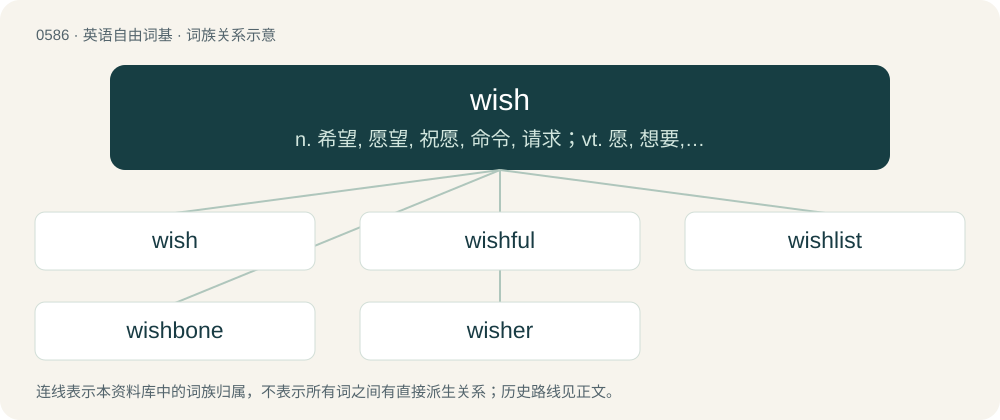

# 0657 · wish — n. 希望, 愿望, 祝愿, 命令, 请求；vt. 愿, 想要, 希望, 祝愿；vi. 希望

[总目录](../00_总目录_按常用程度.md)

**类型**：英语自由词基　｜　**来源语言**：见词源记录

## 核心含义与来源

- 核心含义：n. 希望, 愿望, 祝愿, 命令, 请求；vt. 愿, 想要, 希望, 祝愿；vi. 希望
- 英文含义：A desire, hope, or longing for something or for something to happen.
- 词形：wish

**来源记录 1**（名词；A desire, hope, or longing for something or for something to happen.）

From Middle English wisshen, wischen, wüschen, from Old English wȳsċan (“to wish”), from Proto-West Germanic \*wunskijan, from Proto-Germanic \*wunskijaną (“to wish”), from Proto-Indo-European \*wenh₁- (“to wish, love”). Cognate with Scots wis (“to wish”), Saterland Frisian wonskje (“to wish”), West Frisian winskje (“to wish”), Dutch wensen (“to wish”), German wünschen (“to wish”), Luxembourgish wënschen (“to wish”), Yiddish ווינטשן (vintshn, “to wish”), Danish and Norwegian Bokmål ønske (“to wish”), Faroese ynskja (“to wish, to desire”), Icelandic æskja, óska (“to wish”), Norwegian Nynorsk ønskja, ønskje, ønska, ønske, ynskja, ynskje (“to wish, to desire”), Swedish önska (“to wish”). Via PIE cognate with Latin Venus, veneror (“venerate, honour, love”), English wonder.

## 词族图

## 单词速览（常用到不常用）

| 单词 | 音标 | 释义 |
|---|---|---|
| [wish](#w-1) | /ˈwɪʃ/ | n. 希望, 愿望, 祝愿, 命令, 请求；vt. 愿, 想要, 希望, 祝愿；vi. 希望 |
| [wishful](#w-2) | 英 /ˈwɪʃfəl/ | a. 愿望的, 渴望的, 一厢情愿的 |
| [wishlist](#w-3) | 美 /ˈwɪʃ.lɪst/ | n. 意愿清单 |
| [wishbone](#w-4) | 美 /ˈwɪʃˌboʊn/ | n. 叉骨 |
| [wisher](#w-5) |  | n. 祝愿者, 希望者 |

## 逐词详解

### 1. wish

**词性**：名词　｜　**音标**：/ˈwɪʃ/

**中文释义**：n. 希望, 愿望, 祝愿, 命令, 请求；vt. 愿, 想要, 希望, 祝愿；vi. 希望

**英文义项**：A desire, hope, or longing for something or for something to happen. / An expression of such a desire, often connected with ideas of magic and supernatural power.

**词源与演化**：

From Middle English wisshen, wischen, wüschen, from Old English wȳsċan (“to wish”), from Proto-West Germanic \*wunskijan, from Proto-Germanic \*wunskijaną (“to wish”), from Proto-Indo-European \*wenh₁- (“to wish, love”). Cognate with Scots wis (“to wish”), Saterland Frisian wonskje (“to wish”), West Frisian winskje (“to wish”), Dutch wensen (“to wish”), German wünschen (“to wish”), Luxembourgish wënschen (“to wish”), Yiddish ווינטשן (vintshn, “to wish”), Danish and Norwegian Bokmål ønske (“to wish”), Faroese ynskja (“to wish, to desire”), Icelandic æskja, óska (“to wish”), Norwegian Nynorsk ønskja, ønskje, ønska, ønske, ynskja, ynskje (“to wish, to desire”), Swedish önska (“to wish”). Via PIE cognate with Latin Venus, veneror (“venerate, honour, love”), English wonder.

**例句**：

> My dearest wish is to see them happily married.

该用例对应义项：The thing desired or longed for.

### 2. wishful

**词性**：形容词　｜　**音标**：英 /ˈwɪʃfəl/

**中文释义**：a. 愿望的, 渴望的, 一厢情愿的

**英文义项**：Expressing a wish or longing for something. / Aspiring, or seeking advancement.

**构词拆分**：wish + -ful

**词源与演化**：

From wish + -ful.

**例句**：

> Investors must distinguish between genuine value creation and wishful thinking.

### 3. wishlist

**词性**：动词　｜　**音标**：美 /ˈwɪʃ.lɪst/

**中文释义**：n. 意愿清单

**英文义项**：To include on a wishlist.

**构词拆分**：wish + list

**词源与演化**：

From wish + list.

**例句**：

> One of the items on your wishlist is on sale.

### 4. wishbone

**词性**：名词　｜　**音标**：美 /ˈwɪʃˌboʊn/

**中文释义**：n. 叉骨

**英文义项**：A forked bone between the neck and breast of a bird consisting chiefly of the two clavicles fused at their median or lower end, regarded as a lucky charm in some countries. / A spar in two parts, between which a sail is hoisted, the wishbone extending its clew.

**构词拆分**：wish + bone

**词源与演化**：

From wish + bone.

**例句**：

> Just pull the wishbone apart while making a wish.

### 5. wisher

**词性**：名词

**中文释义**：n. 祝愿者, 希望者

**英文义项**：Someone who makes a wish

**构词拆分**：wish + -er

**词源与演化**：

From Middle English wyssher, wisscher, wyshere, equivalent to wish + -er.
