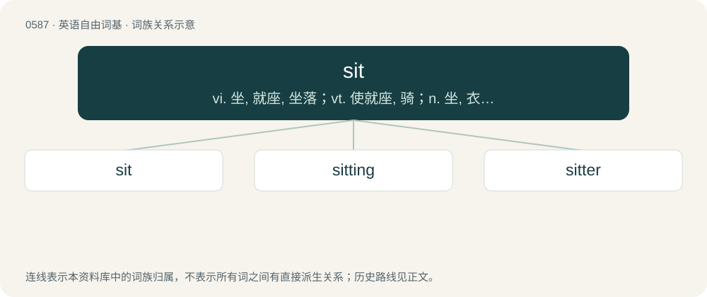

# 0659 · sit — vi. 坐, 就座, 坐落；vt. 使就座, 骑；n. 坐, 衣服合身

[总目录](../00_总目录_按常用程度.md)

**类型**：英语自由词基　｜　**来源语言**：见词源记录

## 核心含义与来源

- 核心含义：vi. 坐, 就座, 坐落；vt. 使就座, 骑；n. 坐, 衣服合身
- 英文含义：To be in a position in which the upper body is upright and supported by the buttocks.
- 词形：sit

**来源记录 1**（动词；To be in a position in which the upper body is upright and supported by the buttocks.）

From Middle English sitten, from Old English sittan, from Proto-West Germanic \*sittjan, from Proto-Germanic \*sitjaną, from Proto-Indo-European \*sed- (“sit”). Cognates Cognate with West Frisian sitte, Low German sitten, Dutch zitten, German sitzen, Swedish sitta, Norwegian Bokmål sitte, Norwegian Nynorsk sitja, Danish sidde, Faroese sita, Icelandic sitja; and with Irish suigh, Latin sedeo, Russian сиде́ть (sidétʹ).

## 词族图

## 单词速览（常用到不常用）

| 单词 | 音标 | 释义 |
|---|---|---|
| [sit](#w-1) | /sɪt/ | vi. 坐, 就座, 坐落；vt. 使就座, 骑；n. 坐, 衣服合身 |
| [sitting](#w-2) | /ˈsɪtɪŋ/ | n. 入席, 就坐, 开庭, 孵卵；a. 坐着的, 就座的, 在职的, 在孵卵中的, 易被击中的 |
| [sitter](#w-3) | 英 /ˈsɪtə/；美 /ˈsɪtɚ/ | n. 坐着的人, 坐着被画像的人 |

## 逐词详解

### 1. sit

**词性**：动词　｜　**音标**：/sɪt/

**中文释义**：vi. 坐, 就座, 坐落；vt. 使就座, 骑；n. 坐, 衣服合身

**英文义项**：To be in a position in which the upper body is upright and supported by the buttocks. / To move oneself into such a position.

**词源与演化**：

From Middle English sitten, from Old English sittan, from Proto-West Germanic \*sittjan, from Proto-Germanic \*sitjaną, from Proto-Indo-European \*sed- (“sit”). Cognates Cognate with West Frisian sitte, Low German sitten, Dutch zitten, German sitzen, Swedish sitta, Norwegian Bokmål sitte, Norwegian Nynorsk sitja, Danish sidde, Faroese sita, Icelandic sitja; and with Irish suigh, Latin sedeo, Russian сиде́ть (sidétʹ).

**例句**：

> The violence in these video games sits awkwardly with their stated aim of educating children.

该用例对应义项：To be accepted or acceptable; to work.

### 2. sitting

**词性**：名词　｜　**音标**：/ˈsɪtɪŋ/

**中文释义**：n. 入席, 就坐, 开庭, 孵卵；a. 坐着的, 就座的, 在职的, 在孵卵中的, 易被击中的

**英文义项**：A period during which one is seated for a specific purpose. / A seance or other session with a medium or fortuneteller.

**构词拆分**：sit + -ing

**词源与演化**：

From Middle English sittyng, sittynge, equivalent to sit + -ing. Cognate with Dutch zitting (“a sitting, session”), German Sitzung (“a sitting, session”), Swedish sittning (“a sitting, session”).

**例句**：

> Due to the sheer volume of guests, we had to have two sittings for the meal.

该用例对应义项：A period during which one is seated for a specific purpose.

### 3. sitter

**词性**：名词　｜　**音标**：英 /ˈsɪtə/；美 /ˈsɪtɚ/

**中文释义**：n. 坐着的人, 坐着被画像的人

**英文义项**：Someone who sits, e.g. for a portrait. / One employed to watch or tend something; a babysitter, housesitter, petsitter, etc.

**构词拆分**：sit + -er

**词源与演化**：

From Middle English sitter, sittere, syttare, equivalent to sit + -er.

**例句**：

> It's always such a pain to get a sitter on short notice.

该用例对应义项：One employed to watch or tend something; a babysitter, housesitter, petsitter, etc.
