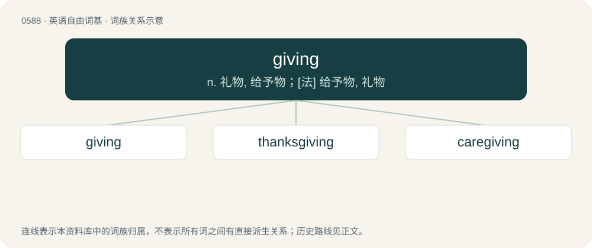

# 0660 · giving — n. 礼物, 给予物；\[法\] 给予物, 礼物

[总目录](../00_总目录_按常用程度.md)

**类型**：英语自由词基　｜　**来源语言**：见词源记录

## 核心含义与来源

- 核心含义：n. 礼物, 给予物；\[法\] 给予物, 礼物
- 英文含义：Having the tendency to give; generous.
- 词形：giving

**来源记录 1**（形容词；Having the tendency to give; generous.）

By surface analysis, give + -ing.

## 词族图

## 单词速览（常用到不常用）

| 单词 | 音标 | 释义 |
|---|---|---|
| [giving](#w-1) | /ˈɡɪvɪŋ/ | n. 礼物, 给予物；\[法\] 给予物, 礼物 |
| [thanksgiving](#w-2) | 美 /ˌθeɪ̯ŋksˈɡɪv.ɪŋ/；/ˌθæŋksˈɡɪv.ɪŋ/ | n. 感谢 |
| [caregiving](#w-3) | 英 /ˈkeəɡɪvɪŋ/ | 【英文】The provision of care such as assistance with activities of daily living (e.g., feeding, bathing, dressing, transportation, household administration), usually by someone who is not a health care professional, especia |

## 逐词详解

### 1. giving

**词性**：形容词　｜　**音标**：/ˈɡɪvɪŋ/

**中文释义**：n. 礼物, 给予物；\[法\] 给予物, 礼物

**英文义项**：Having the tendency to give; generous. / Awesome, outstanding, radiating, stunning; exceeding expectations. (Probably derived from earlier transitive use of give (“give off \[a certain vibe or appearance\]”), as in this outfit gives ‘college girl’, that one is giving ‘old Hollywood’.)

**词源与演化**：

By surface analysis, give + -ing.

**例句**：

> Your outfit is giving!

该用例对应义项：Awesome, outstanding, radiating, stunning; exceeding expectations. (Probably derived from earlier transitive use of give (“give off \[a certain vibe or appearance\]”), as in this outfit gives ‘college girl’, that one is giving ‘old Hollywood’.)

### 2. thanksgiving

**词性**：名词　｜　**音标**：美 /ˌθeɪ̯ŋksˈɡɪv.ɪŋ/；/ˌθæŋksˈɡɪv.ɪŋ/

**中文释义**：n. 感谢

**英文义项**：The expression of gratitude. / A short prayer said at meals; grace, a benediction.

**构词拆分**：thanks + giving

**词源与演化**：

From thanks + giving.

**例句**：

> After Madison, no U.S. president issued a Thanksgiving proclamation until Abraham Lincoln.

### 3. caregiving

**词性**：名词　｜　**音标**：英 /ˈkeəɡɪvɪŋ/

**英文义项**：The provision of care such as assistance with activities of daily living (e.g., feeding, bathing, dressing, transportation, household administration), usually by someone who is not a health care professional, especially by a family member as unpaid labor. / The provision of health care services as a paid occupation.

**构词拆分**：care + giving

**词源与演化**：

From care + giving.

**例句**：

> The macho society discourages men from engaging in nurturing and caregiving roles.
