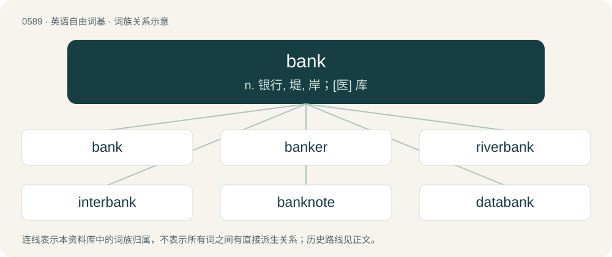

# 0661 · bank — n. 银行, 堤, 岸；\[医\] 库

[总目录](../00_总目录_按常用程度.md)

**类型**：英语自由词基　｜　**来源语言**：见词源记录

## 核心含义与来源

- 核心含义：n. 银行, 堤, 岸；\[医\] 库
- 英文含义：An institution where one can place and borrow money and take care of financial affairs.
- 词形：bank

**多个词源／构词路径**：同一拼写可能有不同来源；以下按词性和含义分别列出。

**来源记录 1**（名词；An institution where one can place and borrow money and take care of financial affairs.）

Inherited from Middle English banke, from Middle French banque, from Italian banca (“counter, moneychanger's bench or table”), from Lombardic bank (“bench, counter”), from Proto-West Germanic \*banki, from Proto-Germanic \*bankiz (“bench, counter”), from Proto-Indo-European \*bʰeg- (“to turn, curve, bend, bow”). Doublet of bench, banc, and banco. For the bench-bank relation, compare typologically Russian ла́вка (lávka), прила́вок (prilávok).

**来源记录 2**（名词；An edge of river, lake, or other watercourse.）

From Middle English bank, banke, from Old English \*banca (“bench”) (attested in Old English hōbanca (“couch”) and Old English banc (“bank, hillock, embankment”), from Proto-West Germanic \*bankō, from Proto-Germanic \*bankô. Akin to Old Norse bakki (“elevation, hill”), Norwegian bakke (“slope, hill”).

**来源记录 3**（名词；A row or panel of items stored or grouped together.）

From Middle English bank, banke, from Old French banc (“bench”), from Frankish \*banki, from Proto-Germanic \*bankiz (“bench”). Akin to Old English benċ (“bench”).

**来源记录 4**（名词；A bench, as for rowers in a galley; also, a tier of oars.）

Probably from French banc. Of Germanic origin, and akin to English bench.

## 词族图

## 单词速览（常用到不常用）

| 单词 | 音标 | 释义 |
|---|---|---|
| [bank](#w-1) | 英 /ˈbæŋk/；美 /ˈbeɪ̯ŋk/ | n. 银行, 堤, 岸；\[医\] 库 |
| [banker](#w-2) | 英 /ˈbæŋkəː/；/ˈbæŋkɚ/ | n. 银行家, 庄家；\[经\] 银行业者, 银行家 |
| [riverbank](#w-3) | 英 /ˈɹɪv.əˌbæŋk/；美 /ˈɹɪv.ɚˌbæŋk/ | n. 河堤, 河岸 |
| [interbank](#w-4) | /,intəˈbæŋk/ | 管排间的, 管束间的 |
| [banknote](#w-5) | 英 /ˈbæŋknəʊ̯t/；美 /ˈbæŋkˌnoʊ̯t/ | n. 钞票 |
| [databank](#w-6) | /ˈdeɪ̯.tə.bæŋk/ | n. \[计\]数据库 |
| [bankable](#w-7) | /ˈbæŋkəbəl/ | a. 银行能接受的；\[法\] 银行肯承兑的, 银行肯担保的 |
| [sandbank](#w-8) | /ˈsændˌbæŋk/ | n. 沙洲, 沙滩, 沙坝 |
| [bankside](#w-9) |  | 【英文】The land by a riverbank. |
| [banky](#w-10) | /ˈbæŋ.ki/ | 【英文】Hilly; sloping. |

## 逐词详解

### 1. bank

**词性**：名词　｜　**音标**：英 /ˈbæŋk/；美 /ˈbeɪ̯ŋk/

**中文释义**：n. 银行, 堤, 岸；\[医\] 库

**英文义项**：An institution where one can place and borrow money and take care of financial affairs. / A branch office of such an institution.

**词源与演化**：

Inherited from Middle English banke, from Middle French banque, from Italian banca (“counter, moneychanger's bench or table”), from Lombardic bank (“bench, counter”), from Proto-West Germanic \*banki, from Proto-Germanic \*bankiz (“bench, counter”), from Proto-Indo-European \*bʰeg- (“to turn, curve, bend, bow”). Doublet of bench, banc, and banco. For the bench-bank relation, compare typologically Russian ла́вка (lávka), прила́вок (prilávok).

**例句**：

> If you want to buy a bicycle, you need to put the money in your piggy bank.

该用例对应义项：A device used to store coins or currency.

### 2. banker

**词性**：名词　｜　**音标**：英 /ˈbæŋkəː/；/ˈbæŋkɚ/

**中文释义**：n. 银行家, 庄家；\[经\] 银行业者, 银行家

**英文义项**：One who conducts the business of banking; one who, individually, or as a member of a company, keeps an establishment for the deposit or loan of money, or for traffic in money, bills of exchange, etc. / The dealer in a casino, or one who keeps the bank in a banking game.

**构词拆分**：bank + -er

**词源与演化**：

From bank + -er, after French banquier.

**例句**：

> The actress said that she was engaged to a banker.

### 3. riverbank

**词性**：名词　｜　**音标**：英 /ˈɹɪv.əˌbæŋk/；美 /ˈɹɪv.ɚˌbæŋk/

**中文释义**：n. 河堤, 河岸

**英文义项**：A sloped side of a river acting as a barrier between the water and level ground to either side.

**构词拆分**：From river + bank.

**词源与演化**：

From river + bank.

**例句**：

> Two men arrived and prepared themselves a comfortable seat on the riverbank.

### 4. interbank

**词性**：形容词　｜　**音标**：/,intəˈbæŋk/

**中文释义**：管排间的, 管束间的

**英文义项**：Of, pertaining to, or taking place between two or more banks (financial institutions).

**构词拆分**：inter- + bank

**词源与演化**：

From inter- + bank.

**例句**：

> Libor is the London Interbank Offered Rate.

### 5. banknote

**词性**：名词　｜　**音标**：英 /ˈbæŋknəʊ̯t/；美 /ˈbæŋkˌnoʊ̯t/

**中文释义**：n. 钞票

**英文义项**：A piece of currency made of paper or polymer.

**构词拆分**：bank + note

**词源与演化**：

From bank + note.

**例句**：

> The animal shown printed on the five-real banknote is a heron.

### 6. databank

**词性**：名词　｜　**音标**：/ˈdeɪ̯.tə.bæŋk/

**中文释义**：n. \[计\]数据库

**英文义项**：A database (collection of organized information in a regular structure). / An organization dedicated to maintaining a database.

**词源与演化**：

From data + bank.

### 7. bankable

**词性**：形容词　｜　**音标**：/ˈbæŋkəbəl/

**中文释义**：a. 银行能接受的；\[法\] 银行肯承兑的, 银行肯担保的

**英文义项**：Acceptable to a bank. / Certain to bring profit and success, especially in the entertainment industry.

**构词拆分**：bank + -able

**词源与演化**：

From bank + -able.

**用法示例／搭配（非完整句）**：

> a bankable film star

该用例对应义项：Certain to bring profit and success, especially in the entertainment industry.

### 8. sandbank

**词性**：名词　｜　**音标**：/ˈsændˌbæŋk/

**中文释义**：n. 沙洲, 沙滩, 沙坝

**英文义项**：A ridge of sand along a shore that is partially or totally submerged and thus a hazard to shipping.

**构词拆分**：sand + bank

**词源与演化**：

From sand + bank. Compare Dutch zandbank (“sandbank, shoal”), German Sandbank (“sandbank, sandbar, shoal”), Swedish sandbank (“sandbank, bar”).

**例句**：

> The ship has run into a sandbank offshore.

### 9. bankside

**词性**：名词

**英文义项**：The land by a riverbank.

**构词拆分**：bank + side

**词源与演化**：

From bank + side.

### 10. banky

**词性**：形容词　｜　**音标**：/ˈbæŋ.ki/

**英文义项**：Hilly; sloping.

**构词拆分**：bank + -y

**词源与演化**：

From bank + -y.
