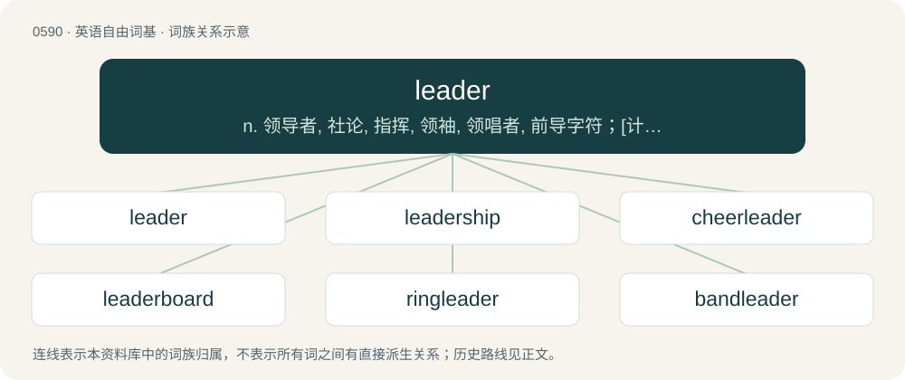

# 0662 · leader — n. 领导者, 社论, 指挥, 领袖, 领唱者, 前导字符；\[计\] 前导字符

[总目录](../00_总目录_按常用程度.md)

**类型**：英语自由词基　｜　**来源语言**：见词源记录

## 核心含义与来源

- 核心含义：n. 领导者, 社论, 指挥, 领袖, 领唱者, 前导字符；\[计\] 前导字符
- 英文含义：Any person who leads or directs.
- 词形：leader

**来源记录 1**（名词；Any person who leads or directs.）

Inherited from Middle English ledere, from Old English lǣdere, from Proto-West Germanic \*laidijārī, from \*laidī (“leading, leadership”) + \*-ārī, or from \*laid (“leading”) + \*-ārī. By surface analysis, lead + -er. Cognate with Scots leader (“leader”), West Frisian lieder (“leader”), Dutch leider (“leader”), German Leiter (“leader, conductor, manager”), Danish leder (“leader, manager”), Swedish ledare (“leader, conductor, director”), Icelandic leiðari (“leader, conductor”).

## 词族图

## 单词速览（常用到不常用）

| 单词 | 音标 | 释义 |
|---|---|---|
| [leader](#w-1) | 英 /ˈliː.də(ɹ)/；美 /ˈli.dɚ/ | n. 领导者, 社论, 指挥, 领袖, 领唱者, 前导字符；\[计\] 前导字符 |
| [leadership](#w-2) | /ˈliːdə(ɹ)ʃɪp/ | n. 领导能力, 领导阶层 |
| [cheerleader](#w-3) | /ˈtʃɪə(ɹ)ˌliːdə(ɹ)/ | n. 啦啦队长 |
| [leaderboard](#w-4) | /ˈliːdərbɔːd/ | n. （尤指高尔夫锦标赛的）选手积分榜 |
| [ringleader](#w-5) | /ˈɹɪŋˌliːdəɹ/ | n. 魁首, 头目；\[法\] 头目, 魁首, 叛国头子 |
| [bandleader](#w-6) | /ˈbænd,liːdə(r)/ | n. 伴舞乐队的指挥 |
| [leaderless](#w-7) |  | a. 无领袖的, 无领导的 |

## 逐词详解

### 1. leader

**词性**：名词　｜　**音标**：英 /ˈliː.də(ɹ)/；美 /ˈli.dɚ/

**中文释义**：n. 领导者, 社论, 指挥, 领袖, 领唱者, 前导字符；\[计\] 前导字符

**英文义项**：Any person who leads or directs. / One who goes first.

**词源与演化**：

Inherited from Middle English ledere, from Old English lǣdere, from Proto-West Germanic \*laidijārī, from \*laidī (“leading, leadership”) + \*-ārī, or from \*laid (“leading”) + \*-ārī. By surface analysis, lead + -er. Cognate with Scots leader (“leader”), West Frisian lieder (“leader”), Dutch leider (“leader”), German Leiter (“leader, conductor, manager”), Danish leder (“leader, manager”), Swedish ledare (“leader, conductor, director”), Icelandic leiðari (“leader, conductor”).

**例句**：

> The company is the leader in home remodeling in the county.

该用例对应义项：A person or organization that leads in a certain field in terms of excellence, success, etc.

### 2. leadership

**词性**：名词　｜　**音标**：/ˈliːdə(ɹ)ʃɪp/

**中文释义**：n. 领导能力, 领导阶层

**英文义项**：The capacity of someone to lead others. / A group of leaders.

**构词拆分**：leader + -ship

**词源与演化**：

From leader + -ship.

**例句**：

> Wise, determined leadership matters most.

该用例对应义项：The capacity of someone to lead others.

### 3. cheerleader

**词性**：名词　｜　**音标**：/ˈtʃɪə(ɹ)ˌliːdə(ɹ)/

**中文释义**：n. 啦啦队长

**英文义项**：A person, usually a young, attractive female, who encourages applause and cheers at a sports event, and wearing a specially-designed uniform in the official colors of the team he/she cheers for. / A person who rallies support for any cause.

**构词拆分**：cheer + leader

**词源与演化**：

From cheer + leader.

**例句**：

> Do you think Mary is too fat to be a cheerleader?

### 4. leaderboard

**词性**：名词　｜　**音标**：/ˈliːdərbɔːd/

**中文释义**：n. （尤指高尔夫锦标赛的）选手积分榜

**英文义项**：A board showing the ranking of leaders in a competition. / An advertisement on a web page spanning the width of the page and shallow in height.

**构词拆分**：leader + board

**词源与演化**：

From leader + board.

### 5. ringleader

**词性**：名词　｜　**音标**：/ˈɹɪŋˌliːdəɹ/

**中文释义**：n. 魁首, 头目；\[法\] 头目, 魁首, 叛国头子

**英文义项**：A leader of a group of people, especially an unofficial group. / A person who starts and leads a disturbance (such as a riot), a conspiracy, or a criminal gang.

**构词拆分**：ring + leader

**词源与演化**：

From ring + leader.

**例句**：

> The police arrested the ringleaders of the smuggling operation.

该用例对应义项：A person who starts and leads a disturbance (such as a riot), a conspiracy, or a criminal gang.

### 6. bandleader

**词性**：名词　｜　**音标**：/ˈbænd,liːdə(r)/

**中文释义**：n. 伴舞乐队的指挥

**英文义项**：A musician who conducts or leads a band of musicians.

**构词拆分**：band + leader

**词源与演化**：

From band + leader.

### 7. leaderless

**词性**：形容词

**中文释义**：a. 无领袖的, 无领导的

**英文义项**：Without a person providing direction. / Without a thing serving as leader.

**构词拆分**：leader + -less

**词源与演化**：

From leader + -less.
