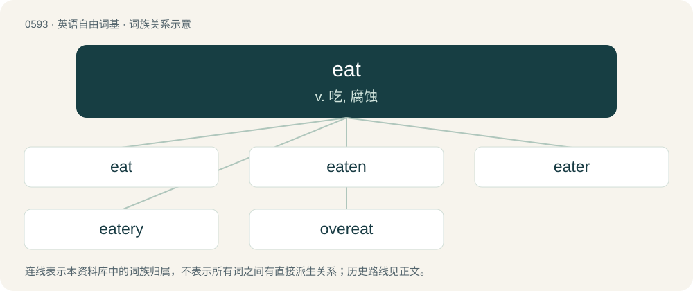

# 0664 · eat — v. 吃, 腐蚀

[总目录](../00_总目录_按常用程度.md)

**类型**：英语自由词基　｜　**来源语言**：见词源记录

## 核心含义与来源

- 核心含义：v. 吃, 腐蚀
- 英文含义：To consume (something solid or semi-solid, usually food) by putting it into the mouth and swallowing it.
- 词形：eat

**多个词源／构词路径**：同一拼写可能有不同来源；以下按词性和含义分别列出。

**来源记录 1**（动词；To consume (something solid or semi-solid, usually food) by putting it into the mouth and swallowing it.）

From Middle English eten, from Old English etan (“to eat”), from Proto-West Germanic \*etan, from Proto-Germanic \*etaną (“to eat”), from Proto-Indo-European \*h₁édti, from \*h₁ed- (“to eat”). Cognates Cognate with Scots ait (“to eat”), Yola ayth, eight (“to eat”), North Frisian iidj, iit, ää'e, ääre, ääse (“to eat”), Saterland Frisian iete, íete (“to eat”), West Frisian ite (“to eat”), Alemannic German asse, assu, essen, ässe, ässä (“to eat”), Bavarian eisn, essn, èssn (“to eat”), Cimbrian èssan, èzzan (“to eat”), Dutch and Low German eten (“to eat”), German essen (“to eat”), Luxembourgish iessen (“to eat”), Mòcheno èssn (“to eat”), Vilamovian aosa (“to eat”), Yiddish עסן (esn, “to eat”), Danish æde (“to eat”), Elfdalian jätå (“to eat”), Faroese eta (“to eat”), Icelandic eta, éta (“to eat”), Norwegian Bokmål ete (“to eat”), Norwegian Nynorsk eta, ete, åtå (“to eat”), Swedish äta (“to eat”), Gothic 𐌹𐍄𐌰𐌽 (itan, “to eat”).

**来源记录 2**（名词；Something to be eaten; a meal; a food item.）

From Middle English ete, ate, æte, from Old English ǣt (“food, eating”), from Proto-West Germanic \*āt, from Proto-Germanic \*ētą (“food, thing to eat”), from Proto-Indo-European \*h₁ed- (“to eat”). Cognate with West Frisian iten (“food”), Saterland Frisian Íeten (“food”), German Aas (“carrion”), Vilamovian aosa (“food”), Icelandic át (“eating; solid food”).

## 词族图

## 单词速览（常用到不常用）

| 单词 | 音标 | 释义 |
|---|---|---|
| [eat](#w-1) | 英 /iːt/；美 /it/ | v. 吃, 腐蚀 |
| [eaten](#w-2) | /ˈiː.tn̩/ | eat的过去分词 |
| [eater](#w-3) | 英 /ˈiː.tə/；美 /ˈiː.tɚ/ | n. 吃...的人, 生吃的水果, 美味的水果 |
| [eatery](#w-4) | /ˈiːtəɹi/ | n. 简便饮食店 |
| [overeat](#w-5) | 英 /ˌəʊvə(ɹ)ˈiːt/；美 /ˌoʊvɚˈit/ | vt. (使)吃过量 |

## 逐词详解

### 1. eat

**词性**：动词　｜　**音标**：英 /iːt/；美 /it/

**中文释义**：v. 吃, 腐蚀

**英文义项**：To consume (something solid or semi-solid, usually food) by putting it into the mouth and swallowing it. / To consume a meal.

**词源与演化**：

From Middle English eten, from Old English etan (“to eat”), from Proto-West Germanic \*etan, from Proto-Germanic \*etaną (“to eat”), from Proto-Indo-European \*h₁édti, from \*h₁ed- (“to eat”). Cognates Cognate with Scots ait (“to eat”), Yola ayth, eight (“to eat”), North Frisian iidj, iit, ää'e, ääre, ääse (“to eat”), Saterland Frisian iete, íete (“to eat”), West Frisian ite (“to eat”), Alemannic German asse, assu, essen, ässe, ässä (“to eat”), Bavarian eisn, essn, èssn (“to eat”), Cimbrian èssan, èzzan (“to eat”), Dutch and Low German eten (“to eat”), German essen (“to eat”), Luxembourgish iessen (“to eat”), Mòcheno èssn (“to eat”), Vilamovian aosa (“to eat”), Yiddish עסן (esn, “to eat”), Danish æde (“to eat”), Elfdalian jätå (“to eat”), Faroese eta (“to eat”), Icelandic eta, éta (“to eat”), Norwegian Bokmål ete (“to eat”), Norwegian Nynorsk eta, ete, åtå (“to eat”), Swedish äta (“to eat”), Gothic 𐌹𐍄𐌰𐌽 (itan, “to eat”).

**例句**：

> The acid rain ate away the statue. The strong acid eats through the metal.

该用例对应义项：To corrode or erode.

### 2. eaten

**词性**：形容词　｜　**音标**：/ˈiː.tn̩/

**中文释义**：eat的过去分词

**英文义项**：Having been consumed by eating.

**构词拆分**：eat + -en

**词源与演化**：

From Middle English eten, from Old English eten, from Proto-West Germanic \*etan, from Proto-Germanic \*etanaz; morphologically eat + -en.

**例句**：

> As a matter of fact, I haven't eaten anything since this morning.

### 3. eater

**词性**：名词　｜　**音标**：英 /ˈiː.tə/；美 /ˈiː.tɚ/

**中文释义**：n. 吃...的人, 生吃的水果, 美味的水果

**英文义项**：A person or animal who eats. / A fruit or other food that is suitable for eating, especially one that is intended to be eaten uncooked.

**构词拆分**：eat + -er (agent noun suffix)

**词源与演化**：

From Middle English eter, etere, etter, from Old English etere; equivalent to eat + -er (agent noun suffix) or + -er (patient suffix) (food suitable for eating).

**用法示例／搭配（非完整句）**：

> a very fussy eater

该用例对应义项：A person or animal who eats.

### 4. eatery

**词性**：名词　｜　**音标**：/ˈiːtəɹi/

**中文释义**：n. 简便饮食店

**英文义项**：A restaurant or café; a place to purchase and eat food.

**构词拆分**：eat + -ery

**词源与演化**：

From eat + -ery.

**例句**：

> They're at the eatery looking at the menu.

### 5. overeat

**词性**：动词　｜　**音标**：英 /ˌəʊvə(ɹ)ˈiːt/；美 /ˌoʊvɚˈit/

**中文释义**：vt. (使)吃过量

**英文义项**：To eat too much. / To eat too much of.

**构词拆分**：over- + eat

**词源与演化**：

From over- + eat.

**例句**：

> I think that as long as I don't overeat, I'll certainly lose weight.
