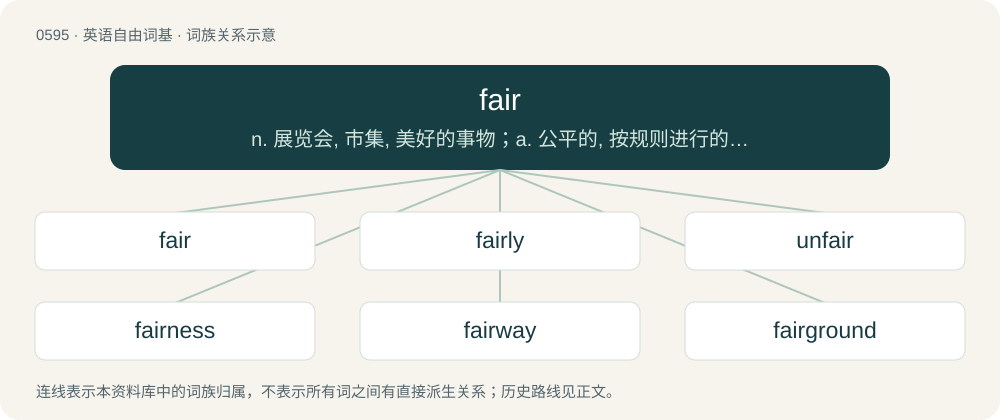

# 0666 · fair — n. 展览会, 市集, 美好的事物；a. 公平的, 按规则进行的, 不好不坏的, 晴朗的, 美丽的；adv. 公平地, 正面地, 有教养地, 清楚地

[总目录](../00_总目录_按常用程度.md)

**类型**：英语自由词基　｜　**来源语言**：见词源记录

## 核心含义与来源

- 核心含义：n. 展览会, 市集, 美好的事物；a. 公平的, 按规则进行的, 不好不坏的, 晴朗的, 美丽的；adv. 公平地, 正面地, 有教养地, 清楚地
- 英文含义：Unblemished (figuratively or literally); clean and pure; innocent.
- 词形：fair

**多个词源／构词路径**：同一拼写可能有不同来源；以下按词性和含义分别列出。

**来源记录 1**（形容词；Unblemished (figuratively or literally); clean and pure; innocent.）

From Middle English fayr, from Old English fæġer (“beautiful”), from Proto-West Germanic \*fagr, from Proto-Germanic \*fagraz (“appropriate, fitting, nice, suitable”), from Proto-Indo-European \*peh₂ḱ- (“to attach, join; agreement, settlement”). Cognates Cognate with Old High German and Old Saxon fagar (“beautiful, fair”), Danish fager, favr (“fair, pretty, wonderful”), Faroese and Icelandic fagur (“beautiful, fair”), Norwegian Bokmål, Norwegian Nynorsk, and Swedish fager (“fair, pretty”), Gothic 𐍆𐌰𐌲𐍂𐍃 (fagrs, “fair, proper”), Estonian vapper (“brave, courageous”), Finnish vauras (“substantial, wealthy”); also Latin pāx (“peace; ease, quiet, rest”), Umbrian pase (“peace”), Belarusian пе́кны (pjékny, “beautiful”), Czech pěkný (“nice; pretty”), Polish piekny, piękny (“beautiful; admirable, praiseworthy”), Slovak pekný (“nice; pretty”), Sanskrit पाश॑ (pā́śa, “bond, cord, noose; nature, outer world; border, edge, selvage”). See also peace.

**来源记录 2**（名词；A community gathering to celebrate and exhibit local achievements.）

From Middle English feyre, from Old French foire, from Latin fēriae.

## 词族图

## 单词速览（常用到不常用）

| 单词 | 音标 | 释义 |
|---|---|---|
| [fair](#w-1) | 英 /ˈfɛə/；美 /ˈfɛɚ/ | n. 展览会, 市集, 美好的事物；a. 公平的, 按规则进行的, 不好不坏的, 晴朗的, 美丽的；adv. 公平地, 正面地, 有教养地, 清楚地 |
| [fairly](#w-2) | 英 /ˈfɛə.li/；美 /ˈfɛɹ.li/ | adv. 美观地, 公平地, 相当地, 清楚地 |
| [unfair](#w-3) | 英 /ʌnˈfɛə(ɹ)/；美 /ʌnˈfɛɚ/ | a. 不公平的, 不正直的, 不正当的；\[法\] 不正直的, 不公平的, 偏颇的 |
| [fairness](#w-4) | 英 /ˈfɛə.nəs/；美 /ˈfɛɚ.nəs/ | n. 晴朗, 光明正大, 美丽；\[经\] 公正, 适当 |
| [fairway](#w-5) | 英 /ˈfɛəweɪ/；美 /ˈfɛɹweɪ/ | n. 航路 |
| [fairground](#w-6) | /ˈfɛə(ɹ)ɡɹaʊnd/ | n. 举行赛会的场所, 露天市场 |
| [funfair](#w-7) |  | n. 游乐园, 游乐场 |

## 逐词详解

### 1. fair

**词性**：形容词　｜　**音标**：英 /ˈfɛə/；美 /ˈfɛɚ/

**中文释义**：n. 展览会, 市集, 美好的事物；a. 公平的, 按规则进行的, 不好不坏的, 晴朗的, 美丽的；adv. 公平地, 正面地, 有教养地, 清楚地

**英文义项**：Unblemished (figuratively or literally); clean and pure; innocent. / Light in color, pale, particularly with regard to skin tone but also referring to blond and red hair.

**词源与演化**：

From Middle English fayr, from Old English fæġer (“beautiful”), from Proto-West Germanic \*fagr, from Proto-Germanic \*fagraz (“appropriate, fitting, nice, suitable”), from Proto-Indo-European \*peh₂ḱ- (“to attach, join; agreement, settlement”). Cognates Cognate with Old High German and Old Saxon fagar (“beautiful, fair”), Danish fager, favr (“fair, pretty, wonderful”), Faroese and Icelandic fagur (“beautiful, fair”), Norwegian Bokmål, Norwegian Nynorsk, and Swedish fager (“fair, pretty”), Gothic 𐍆𐌰𐌲𐍂𐍃 (fagrs, “fair, proper”), Estonian vapper (“brave, courageous”), Finnish vauras (“substantial, wealthy”); also Latin pāx (“peace; ease, quiet, rest”), Umbrian pase (“peace”), Belarusian пе́кны (pjékny, “beautiful”), Czech pěkný (“nice; pretty”), Polish piekny, piękny (“beautiful; admirable, praiseworthy”), Slovak pekný (“nice; pretty”), Sanskrit पाश॑ (pā́śa, “bond, cord, noose; nature, outer world; border, edge, selvage”). See also peace.

**例句**：

> After scratching out and replacing various words in the manuscript, he scribed a fair copy to send to the publisher.

该用例对应义项：Unblemished (figuratively or literally); clean and pure; innocent.

### 2. fairly

**词性**：副词　｜　**音标**：英 /ˈfɛə.li/；美 /ˈfɛɹ.li/

**中文释义**：adv. 美观地, 公平地, 相当地, 清楚地

**英文义项**：In a fair manner; fair; not biased or skewed or favouring a certain party / Favorably; auspiciously; commodiously.

**构词拆分**：fair + -ly

**词源与演化**：

From Middle English fayrly, fayrely, vayrliche, equivalent to fair + -ly.

**例句**：

> A jury is expected to ensure that the accused is fairly judged.

该用例对应义项：In a fair manner; fair; not biased or skewed or favouring a certain party

### 3. unfair

**词性**：形容词　｜　**音标**：英 /ʌnˈfɛə(ɹ)/；美 /ʌnˈfɛɚ/

**中文释义**：a. 不公平的, 不正直的, 不正当的；\[法\] 不正直的, 不公平的, 偏颇的

**英文义项**：Not just.

**构词拆分**：un- + fair

**词源与演化**：

From Middle English unfair (“unattractive, unseemly”), from Old English unfæġer (“ugly”), equivalent to un- + fair.

**例句**：

> It was unfair for the boss to give larger bonuses to his friends.

该用例对应义项：Not just.

### 4. fairness

**词性**：名词　｜　**音标**：英 /ˈfɛə.nəs/；美 /ˈfɛɚ.nəs/

**中文释义**：n. 晴朗, 光明正大, 美丽；\[经\] 公正, 适当

**英文义项**：The property of being fair or equitable.

**构词拆分**：fair + -ness

**词源与演化**：

From Middle English fairness, fæȝernesse, from Old English fæġernes (“fairness; beauty; pleasantness”), equivalent to fair + -ness. Cognate with Old High German fagarnessi (“fairness”).

**例句**：

> Some questioned the fairness of the new laws.

该用例对应义项：The property of being fair or equitable.

### 5. fairway

**词性**：名词　｜　**音标**：英 /ˈfɛəweɪ/；美 /ˈfɛɹweɪ/

**中文释义**：n. 航路

**英文义项**：The area between the tee and the green, where the grass is cut short. / Any tract of land free from obstacles.

**构词拆分**：fair + way

**词源与演化**：

From fair + way.

### 6. fairground

**词性**：名词　｜　**音标**：/ˈfɛə(ɹ)ɡɹaʊnd/

**中文释义**：n. 举行赛会的场所, 露天市场

**英文义项**：An area where a fair (an event for public entertainment) or other public event is held; a showground. / A commercially-operated collection of rides, games and other entertainment attractions; an amusement park.

**构词拆分**：fair + ground

**词源与演化**：

From fair + ground.

**例句**：

> It was raining, so they cancelled their trip to the fairground.

### 7. funfair

**词性**：名词

**中文释义**：n. 游乐园, 游乐场

**英文义项**：A travelling amusement park.

**构词拆分**：fun + fair

**词源与演化**：

From fun + fair.

**例句**：

> We went to the funfair yesterday and had a go on the big wheel.
