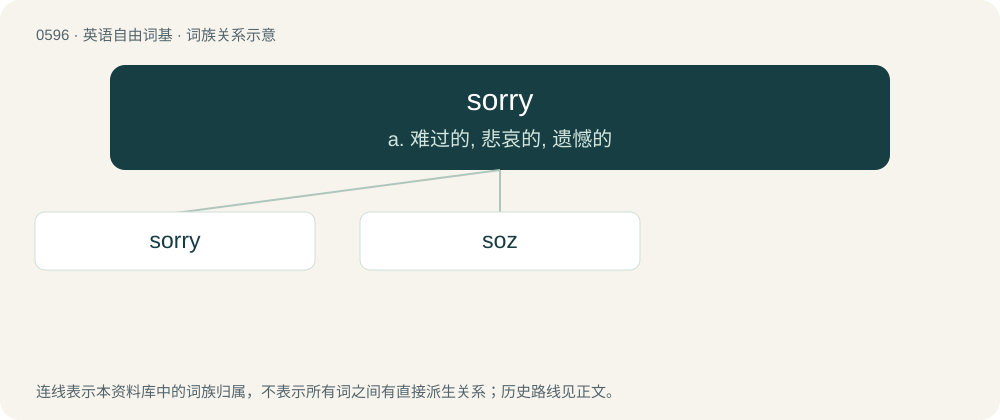

# 0667 · sorry — a. 难过的, 悲哀的, 遗憾的

[总目录](../00_总目录_按常用程度.md)

**类型**：英语自由词基　｜　**来源语言**：见词源记录

## 核心含义与来源

- 核心含义：a. 难过的, 悲哀的, 遗憾的
- 英文含义：Regretful or apologetic for one's actions.
- 词形：sorry

**来源记录 1**（形容词；Regretful or apologetic for one's actions.）

From Middle English sory, from Old English sāriġ (“feeling or expressing grief, sorry, grieved, sorrowful, sad, mournful, bitter”), from Proto-West Germanic \*sairag, from Proto-Germanic \*sairagaz (“sad”), from Proto-Indo-European \*seh₂yro (“hard, rough, painful”). Cognate with Scots sairie (“sad, grieved”), Saterland Frisian seerich (“sore, inflamed”), West Frisian searich (“sad, sorry”), Low German serig (“sick, scabby”), German dialectal sehrig (“sore, sad, painful”), Swedish sårig. By surface analysis, sor(e) + -y. Unrelated to sorrow despite the similarity in form and meaning.

## 词族图

## 单词速览（常用到不常用）

| 单词 | 音标 | 释义 |
|---|---|---|
| [sorry](#w-1) | 英 /ˈsɒɹi/；美 /ˈsɑɹi/ | a. 难过的, 悲哀的, 遗憾的 |
| [soz](#w-2) | 英 /sɒz/ | n. \[热血传奇\]sorry. 对不起。 |

## 逐词详解

### 1. sorry

**词性**：形容词　｜　**音标**：英 /ˈsɒɹi/；美 /ˈsɑɹi/

**中文释义**：a. 难过的, 悲哀的, 遗憾的

**英文义项**：Regretful or apologetic for one's actions. / Grieved or saddened, especially by the loss of something or someone.

**构词拆分**：By surface analysis, sor(e) + -y

**词源与演化**：

From Middle English sory, from Old English sāriġ (“feeling or expressing grief, sorry, grieved, sorrowful, sad, mournful, bitter”), from Proto-West Germanic \*sairag, from Proto-Germanic \*sairagaz (“sad”), from Proto-Indo-European \*seh₂yro (“hard, rough, painful”). Cognate with Scots sairie (“sad, grieved”), Saterland Frisian seerich (“sore, inflamed”), West Frisian searich (“sad, sorry”), Low German serig (“sick, scabby”), German dialectal sehrig (“sore, sad, painful”), Swedish sårig. By surface analysis, sor(e) + -y. Unrelated to sorrow despite the similarity in form and meaning.

**例句**：

> The President was sorry to hear that the Ambassador was leaving.

该用例对应义项：Grieved or saddened, especially by the loss of something or someone.

### 2. soz

**词性**：感叹词　｜　**音标**：英 /sɒz/

**中文释义**：n. \[热血传奇\]sorry. 对不起。

**英文义项**：Synonym of sorry.

**构词拆分**：sorry + -z

**词源与演化**：

Rhotacism of sorry; sorry + -z. Documented since at least 1987. Compare appaz (“apparently”), tomoz (“tomorrow”).
