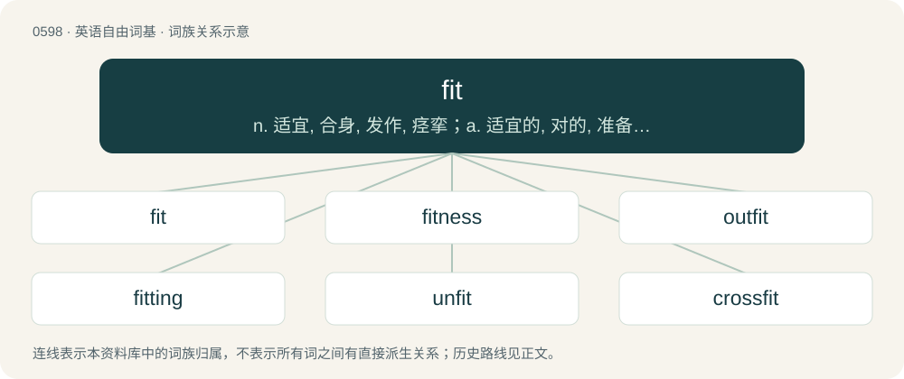

# 0669 · fit — n. 适宜, 合身, 发作, 痉挛；a. 适宜的, 对的, 准备好的；vt. 适合, 安装, 使合身, 使适应, 使合格

[总目录](../00_总目录_按常用程度.md)

**类型**：英语自由词基　｜　**来源语言**：见词源记录

## 核心含义与来源

- 核心含义：n. 适宜, 合身, 发作, 痉挛；a. 适宜的, 对的, 准备好的；vt. 适合, 安装, 使合身, 使适应, 使合格
- 英文含义：Suitable; proper
- 词形：fit

**多个词源／构词路径**：同一拼写可能有不同来源；以下按词性和含义分别列出。

**来源记录 1**（形容词；Suitable; proper）

Possibly from Middle English fit (“an adversary of equal power”), of uncertain further origin. The original sense appears to have been "to marshal or deploy troops", which shifted to "to suit (troops to a certain location" &gt; "suitable", and may be further related to Icelandic fitja (“to web, knit, cast on”).

**来源记录 2**（名词；A seizure or convulsion.）

Unknown. From Middle English fit (“hardship, danger”), possibly from Old English fitt (“conflict”)—a word only attested once. Compare Cornish fit (“game match, bout”); or else, maybe cognate with Italian fitta (“sudden and stabbing pain”) (see further at Latin fīgere).

**来源记录 3**（名词；An outfit, a set of clothing.）

Clipping of outfit.

## 词族图

## 单词速览（常用到不常用）

| 单词 | 音标 | 释义 |
|---|---|---|
| [fit](#w-1) | /fɪt/ | n. 适宜, 合身, 发作, 痉挛；a. 适宜的, 对的, 准备好的；vt. 适合, 安装, 使合身, 使适应, 使合格 |
| [fitness](#w-2) | /ˈfɪt.nəs/ | n. 适合, 合宜, 合理, 恰当, 健康；\[医\] 适合性, 适应性 |
| [outfit](#w-3) | /ˈaʊtfɪt/ | n. 用具, 配备, 机构；vt. 配备, 供应；vi. 得到装备 |
| [fitting](#w-4) | 英 /ˈfɪtɪŋ/；美 /ˈfɪtɪŋ/ | a. 适宜的；n. 试穿, 试衣, 装配, 装置 |
| [unfit](#w-5) | 英 /ʌnˈfɪt/ | a. 不适当的, 不胜任的, 不健康的；vt. 使不相宜, 使不合格 |
| [crossfit](#w-6) |  | 【英文】To participate in a CrossFit exercise regimen. |
| [fitter](#w-7) | 英 /ˈfɪtə/；美 /ˈfɪtəɹ/ | n. 裁剪和试样的服装工人/裁缝, 装配工, 钳工；\[化\] 管工 |
| [retrofit](#w-8) | 英 /ˌɹɛtɹəʊˈfɪt/；美 /ˌɹɛtɹoʊˈfɪt/ | n. 式样翻新；vt.vi. 式样翻新；\[计\] 更新; 改进 |
| [misfit](#w-9) | 英 /ˈmɪs.fɪt/ | n. 不适合, 不适合的东西, 不适应环境的人；vt. (衣着)对...不合身；vi. 不适合 |
| [refit](#w-10) | /ˈɹiːfɪt/ | v. 整修, 改装；n. 整修, 改装 |
| [fitful](#w-11) | 英 /ˈfɪtf(ʊ)l/；美 /ˈfɪtf(ə)l/ | a. 断断续续的, 一阵阵的, 间歇的 |
| [befit](#w-12) | /bɪˈfɪt/ | vt. 适合于, 适宜于 |
| [fitment](#w-13) | /ˈfitmənt/ | n. 家具, 配件, 装置 |

## 逐词详解

### 1. fit

**词性**：形容词　｜　**音标**：/fɪt/

**中文释义**：n. 适宜, 合身, 发作, 痉挛；a. 适宜的, 对的, 准备好的；vt. 适合, 安装, 使合身, 使适应, 使合格

**英文义项**：Suitable; proper / Adapted to a purpose or environment.

**词源与演化**：

Possibly from Middle English fit (“an adversary of equal power”), of uncertain further origin. The original sense appears to have been "to marshal or deploy troops", which shifted to "to suit (troops to a certain location" &gt; "suitable", and may be further related to Icelandic fitja (“to web, knit, cast on”).

**例句**：

> You don't have to be a good climber for Kilimanjaro, but you do have to be fit.

该用例对应义项：In good shape; physically well.

### 2. fitness

**词性**：名词　｜　**音标**：/ˈfɪt.nəs/

**中文释义**：n. 适合, 合宜, 合理, 恰当, 健康；\[医\] 适合性, 适应性

**英文义项**：The condition of being fit, suitable or appropriate. / The cultivation of an attractive and/or healthy physique.

**构词拆分**：fit + -ness

**词源与演化**：

From fit + -ness. First attested in the 16th century, with the physical sense from 1935.

**例句**：

> They had to prove their fitness for the position.

该用例对应义项：the quality of being suitable

### 3. outfit

**词性**：名词　｜　**音标**：/ˈaʊtfɪt/

**中文释义**：n. 用具, 配备, 机构；vt. 配备, 供应；vi. 得到装备

**英文义项**：A set of clothing (with accessories). / Gear consisting of a set of articles or tools for a specified purpose.

**构词拆分**：out- + fit

**词源与演化**：

Variant of earlier out-fit, from fit out. Equivalent to out- + fit.

**例句**：

> Should we buy it here, or do you think the outfit across town will have a better deal?

该用例对应义项：A business or firm.

### 4. fitting

**词性**：形容词　｜　**音标**：英 /ˈfɪtɪŋ/；美 /ˈfɪtɪŋ/

**中文释义**：a. 适宜的；n. 试穿, 试衣, 装配, 装置

**英文义项**：Chiefly preceded by a descriptive adverb or noun: that fits in some manner (often closely) to the shape or size of something. / Appropriate, suitable, proper.

**构词拆分**：fit (“to conform to in shape or size; to be suitable for”, verb) + -ing (suffix forming present participles of verbs, and gerunds and nouns denoting the act of doing something or the embodiment of an action)

**词源与演化**：

From fit (“to conform to in shape or size; to be suitable for”, verb) + -ing (suffix forming present participles of verbs, and gerunds and nouns denoting the act of doing something or the embodiment of an action).

**用法示例／搭配（非完整句）**：

> close-fitting form-fitting ill-fitting

该用例对应义项：Chiefly preceded by a descriptive adverb or noun: that fits in some manner (often closely) to the shape or size of something.

### 5. unfit

**词性**：形容词　｜　**音标**：英 /ʌnˈfɪt/

**中文释义**：a. 不适当的, 不胜任的, 不健康的；vt. 使不相宜, 使不合格

**英文义项**：Not fit; not having the correct requirements. / Not fit, not having a good physical demeanor.

**构词拆分**：un- + fit

**词源与演化**：

From un- + fit.

**例句**：

> Jack cannot run, making him unfit for the track team.

该用例对应义项：Not fit; not having the correct requirements.

### 6. crossfit

**词性**：动词

**英文义项**：To participate in a CrossFit exercise regimen.

**构词拆分**：cross- + fit

**词源与演化**：

From cross-discipline fitness. Equivalent to cross- + fit.

### 7. fitter

**词性**：名词　｜　**音标**：英 /ˈfɪtə/；美 /ˈfɪtəɹ/

**中文释义**：n. 裁剪和试样的服装工人/裁缝, 装配工, 钳工；\[化\] 管工

**英文义项**：A person who fits or assembles something. / An epileptic.

**构词拆分**：fit + -er

**词源与演化**：

From fit (verb) + -er.

**用法示例／搭配（非完整句）**：

> a fitter of clothing, or of machinery

该用例对应义项：A person who fits or assembles something.

### 8. retrofit

**词性**：动词　｜　**音标**：英 /ˌɹɛtɹəʊˈfɪt/；美 /ˌɹɛtɹoʊˈfɪt/

**中文释义**：n. 式样翻新；vt.vi. 式样翻新；\[计\] 更新; 改进

**英文义项**：To supply (a device, structure, etc.) with new components or parts that were not previously available or installed; to modernize. / To add or substitute (new components or parts) that were not previously available for or installed in a device, structure, etc.

**构词拆分**：retro- (prefix meaning ‘back; backward’) + fit (“to equip, supply”)；retro- + fit (“act of fitting; conformity of elements one to another”)

**词源与演化**：

The verb is derived from retro- (prefix meaning ‘back; backward’) + fit (“to equip, supply”). The noun, which is first attested later than the verb, is either derived: \* from the verb (see above); or \* from retro- + fit (“act of fitting; conformity of elements one to another”).

**例句**：

> The bug was so bad that we had to retrofit our patch to the last three releases, as well as the newest release.

该用例对应义项：Synonym of backport (“to retroactively supply a fix or feature to a previous version of a software product at the same time or after supplying it to the current version.”).

### 9. misfit

**词性**：名词　｜　**音标**：英 /ˈmɪs.fɪt/

**中文释义**：n. 不适合, 不适合的东西, 不适应环境的人；vt. (衣着)对...不合身；vi. 不适合

**英文义项**：A failure to fit well; unsuitability, disparity. / A badly adjusted person; someone unsuitable or set apart because of their habits, behaviour etc.

**构词拆分**：mis- + fit

**词源与演化**：

From mis- + fit.

**例句**：

> The MBA was a misfit when stuck in a meeting with the programmers.

该用例对应义项：A badly adjusted person; someone unsuitable or set apart because of their habits, behaviour etc.

### 10. refit

**词性**：名词　｜　**音标**：/ˈɹiːfɪt/

**中文释义**：v. 整修, 改装；n. 整修, 改装

**英文义项**：The process of having something fitted again, repaired or restored.

**构词拆分**：re- + fit

**词源与演化**：

From re- + fit.

**例句**：

> The ship required a refit before setting out again.

该用例对应义项：The process of having something fitted again, repaired or restored.

### 11. fitful

**词性**：形容词　｜　**音标**：英 /ˈfɪtf(ʊ)l/；美 /ˈfɪtf(ə)l/

**中文释义**：a. 断断续续的, 一阵阵的, 间歇的

**英文义项**：Characterized by sudden bursts of activity with periods of inactivity in between; intermittent, irregular, unsteady.

**构词拆分**：fit (“convulsion, seizure; sudden burst of activity”) + -ful (suffix forming adjectives from nouns, with the sense of being full of, tending to, or thoroughly possessing the quality expressed by the noun)

**词源与演化**：

From fit (“convulsion, seizure; sudden burst of activity”) + -ful (suffix forming adjectives from nouns, with the sense of being full of, tending to, or thoroughly possessing the quality expressed by the noun).

**例句**：

> Troubled by her unfinished work, she fell into a fitful sleep.

该用例对应义项：Characterized by sudden bursts of activity with periods of inactivity in between; intermittent, irregular, unsteady.

### 12. befit

**词性**：动词　｜　**音标**：/bɪˈfɪt/

**中文释义**：vt. 适合于, 适宜于

**英文义项**：to be fit for

**构词拆分**：be- + fit

**词源与演化**：

From be- + fit.

**例句**：

> Anger does not befit a philosopher.

### 13. fitment

**词性**：名词　｜　**音标**：/ˈfitmənt/

**中文释义**：n. 家具, 配件, 装置

**英文义项**：A thing fitted to another in order to accomplish a specific purpose. / An item of permanent furniture or equipment.

**构词拆分**：fit + -ment

**词源与演化**：

From fit + -ment.
