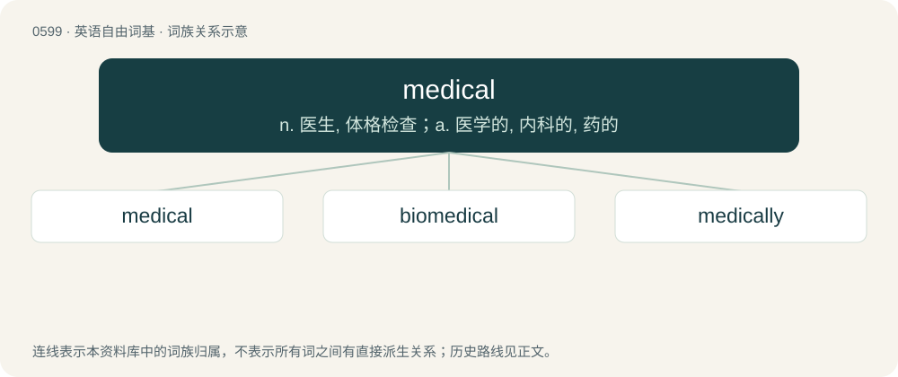

# 0671 · medical — n. 医生, 体格检查；a. 医学的, 内科的, 药的

[总目录](../00_总目录_按常用程度.md)

**类型**：英语自由词基　｜　**来源语言**：见词源记录

## 核心含义与来源

- 核心含义：n. 医生, 体格检查；a. 医学的, 内科的, 药的
- 英文含义：Of or pertaining to the practice of medicine.
- 词形：medical

**来源记录 1**（形容词；Of or pertaining to the practice of medicine.）

Borrowed from French médical, from Medieval Latin medicālis, from Latin medicus. Replaced Old English lǣċe (“doctor (physician)”), which is cognate with Icelandic læknir (“doctor”).

## 词族图

## 单词速览（常用到不常用）

| 单词 | 音标 | 释义 |
|---|---|---|
| [medical](#w-1) | /ˈmɛdɪkl̩/ | n. 医生, 体格检查；a. 医学的, 内科的, 药的 |
| [biomedical](#w-2) | 英 /ˌbaɪəʊˈmɛdɪk(ə)l/；美 /ˌbaɪoʊˈmɛdɪk(ə)l/ | a. 生物医学 |
| [medically](#w-3) | 英 /ˈmɛd.ɪ.kli/ | adv. 医学, 医疗, 医术, 内科, 医药 |

## 逐词详解

### 1. medical

**词性**：形容词　｜　**音标**：/ˈmɛdɪkl̩/

**中文释义**：n. 医生, 体格检查；a. 医学的, 内科的, 药的

**英文义项**：Of or pertaining to the practice of medicine. / Intended to have a therapeutic effect; medicinal.

**词源与演化**：

Borrowed from French médical, from Medieval Latin medicālis, from Latin medicus. Replaced Old English lǣċe (“doctor (physician)”), which is cognate with Icelandic læknir (“doctor”).

**例句**：

> A costly medical condition can bankrupt you if it doesn't kill you first.

该用例对应义项：Requiring medical treatment.

### 2. biomedical

**词性**：形容词　｜　**音标**：英 /ˌbaɪəʊˈmɛdɪk(ə)l/；美 /ˌbaɪoʊˈmɛdɪk(ə)l/

**中文释义**：a. 生物医学

**英文义项**：Of or pertaining to biomedicine.

**构词拆分**：bio- + medical

**词源与演化**：

From bio- + medical.

**例句**：

> I'm going to give a paper at this year's conference on biomedical ethics.

### 3. medically

**词性**：副词　｜　**音标**：英 /ˈmɛd.ɪ.kli/

**中文释义**：adv. 医学, 医疗, 医术, 内科, 医药

**英文义项**：For medical purposes. / In a medical manner or context.

**构词拆分**：medical + -ly

**词源与演化**：

From medical + -ly.

**例句**：

> This drug should be used medically rather than recreationally.

该用例对应义项：For medical purposes.
