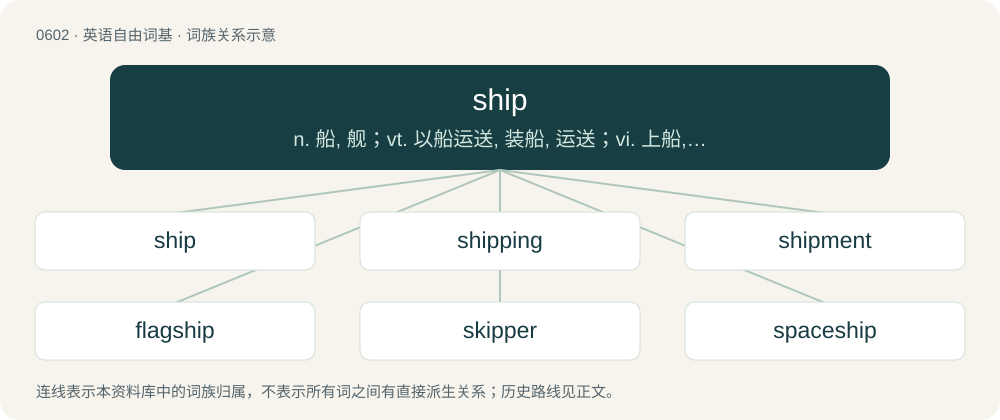

# 0672 · ship — n. 船, 舰；vt. 以船运送, 装船, 运送；vi. 上船, 乘船

[总目录](../00_总目录_按常用程度.md)

**类型**：英语自由词基　｜　**来源语言**：见词源记录

## 核心含义与来源

- 核心含义：n. 船, 舰；vt. 以船运送, 装船, 运送；vi. 上船, 乘船
- 英文含义：A water-borne vessel generally larger than a boat.
- 词形：ship

**多个词源／构词路径**：同一拼写可能有不同来源；以下按词性和含义分别列出。

**来源记录 1**（名词；A water-borne vessel generally larger than a boat.）

From Middle English chip, schepe, schip, schup, scip, scippe, ship, shup, ssip, from Old English sċip, sċyp, from Proto-West Germanic \*skip, from Proto-Germanic \*skipą (“ship; tub, vessel”), possibly from Proto-Indo-European \*skey- (“to split”). More at shift. Cognates Cognate with North Frisian schap, skap, Skep (“ship”), Saterland Frisian Schip, Skip (“ship”), West Frisian skip (“ship”), Central Franconian Scheff (“ship”), Dutch schip (“ship”), German Schiff (“ship”), Low German Schipp (“ship”), Luxembourgish Schëff (“ship”), Vilamovian śejf, siejft (“ship”), Yiddish שיף (shif, “ship”), Danish skib (“ship”), Faroese, Icelandic, Norwegian Bokmål, and Norwegian Nynorsk skip (“ship”), Swedish skepp (“ship”), Gothic 𐍃𐌺𐌹𐍀 (skip, “ship”). Compare typologically boat, from Proto-Indo-European \*bʰeyd-.

**来源记录 2**（动词；To send by water-borne transport.）

From Middle English schippen, schipen, from Old English sċipian, from Proto-West Germanic \*skipōn, from Proto-Germanic \*skipōną, from Proto-Germanic \*skipą (“ship”). Doublet of equip.

**来源记录 3**（名词；A romantic pairing of two or more characters or real people, especially one imagined by fans.）

Clipping of relationship.

## 词族图

## 单词速览（常用到不常用）

| 单词 | 音标 | 释义 |
|---|---|---|
| [ship](#w-1) | /ˈʃɪp/ | n. 船, 舰；vt. 以船运送, 装船, 运送；vi. 上船, 乘船 |
| [shipping](#w-2) | /ˈʃɪpɪŋ/ | n. 装运, 航行, 船舶, 船舶吨数；\[经\] 装运, 运送, 海运 |
| [shipment](#w-3) | 美 /ˈʃɪpmənt/ | n. 装船, 出货；\[经\] 运送, 运送(寄出)货物, 装载 |
| [flagship](#w-4) | /ˈflæɡʃɪp/ | n. 旗舰 |
| [skipper](#w-5) | 英 /ˈskɪp.ə/；美 /ˈskɪp.ɚ/ | n. 船长, 机长, 队长 |
| [spaceship](#w-6) | /ˈspeisʃip/ | n. 宇宙飞船 |
| [shipbuilding](#w-7) | /ˈʃipbildiŋ/ | n. 造船 |
| [shipyard](#w-8) | 美 /ˈʃɪpˌjɑɹd/ | n. 造船厂；\[经\] 船坞, 造船厂, 修船厂 |
| [starship](#w-9) | /stɑɹʃɪp/ | 恒星飞船 |
| [battleship](#w-10) | 美 /ˈbætəlˌʃɪp/ | n. 战列舰, 主力舰 |
| [warship](#w-11) | 英 /ˈwɔːˌʃɪp/；美 /ˈwɔɹˌʃɪp/ | n. 军舰, 战船 |
| [shipwreck](#w-12) | /ˈʃɪpɹɛk/ | n. 遇难船, 海难；vt. 遇海难, 毁灭, 使失事 |
| [steamship](#w-13) | 美 /ˈstimˌʃɪp/ | n. 汽船, 轮船 |
| [shipper](#w-14) | 英 /ˈʃɪp.ə/；美 /ˈʃɪp.ɚ/ | n. 托运人, 发货人；\[经\] 货主, 运货者, 装货人 |
| [airship](#w-15) | /ˈєəʃip/ | n. 飞艇, 飞船 |
| [gunship](#w-16) | /ˈɡʌnʃɪp/ | n. 武装直升机 |
| [shipman](#w-17) | /ˈʃipmən/ | n. 船员, 水手, 船长 |
| [shipboard](#w-18) | /ˈʃipbɒːd/ | n. 舷侧, 船；a. 船用的 |
| [shipbuilder](#w-19) | /ˈʃipbildə/ | n. 造船专家, 造船工程师 |
| [dropship](#w-20) | /ˈdɹɒpˌʃɪp/ | 【英文】A flying transport that drops troops or equipment onto a planet, etc. |
| [shipowner](#w-21) | /ˈʃipəunə/ | n. 船主 |
| [shipmate](#w-22) | /ˈʃɪpˌmeɪt/ | n. 同船水手 |

## 逐词详解

### 1. ship

**词性**：名词　｜　**音标**：/ˈʃɪp/

**中文释义**：n. 船, 舰；vt. 以船运送, 装船, 运送；vi. 上船, 乘船

**英文义项**：A water-borne vessel generally larger than a boat. / A vessel which travels through any medium other than across land, such as an airship or spaceship.

**词源与演化**：

From Middle English chip, schepe, schip, schup, scip, scippe, ship, shup, ssip, from Old English sċip, sċyp, from Proto-West Germanic \*skip, from Proto-Germanic \*skipą (“ship; tub, vessel”), possibly from Proto-Indo-European \*skey- (“to split”). More at shift. Cognates Cognate with North Frisian schap, skap, Skep (“ship”), Saterland Frisian Schip, Skip (“ship”), West Frisian skip (“ship”), Central Franconian Scheff (“ship”), Dutch schip (“ship”), German Schiff (“ship”), Low German Schipp (“ship”), Luxembourgish Schëff (“ship”), Vilamovian śejf, siejft (“ship”), Yiddish שיף (shif, “ship”), Danish skib (“ship”), Faroese, Icelandic, Norwegian Bokmål, and Norwegian Nynorsk skip (“ship”), Swedish skepp (“ship”), Gothic 𐍃𐌺𐌹𐍀 (skip, “ship”). Compare typologically boat, from Proto-Indo-European \*bʰeyd-.

**例句**：

> The storm will make it impossible for the ship to leave port.

### 2. shipping

**词性**：名词　｜　**音标**：/ˈʃɪpɪŋ/

**中文释义**：n. 装运, 航行, 船舶, 船舶吨数；\[经\] 装运, 运送, 海运

**英文义项**：The transportation of goods. / The body of ships belonging to one nation, port or industry; ships collectively.

**构词拆分**：ship + -ing

**词源与演化**：

From Middle English schipping, schyppynge, from schippen, schipen (“to take ship, navigate”), from Old English scipian (“to take ship; put in order, equip, man a ship”), equivalent to ship + -ing.

**例句**：

> The shipping is included in the quoted price.

该用例对应义项：The cost of sending an item or package using postal or carrier services.

### 3. shipment

**词性**：名词　｜　**音标**：美 /ˈʃɪpmənt/

**中文释义**：n. 装船, 出货；\[经\] 运送, 运送(寄出)货物, 装载

**英文义项**：A load of goods that is transported by any method (not just by ship). / The act of transporting goods.

**构词拆分**：ship + -ment

**词源与演化**：

From ship + -ment.

**例句**：

> Shipment of hazardous waste on this route is strictly prohibited.

该用例对应义项：The act of transporting goods.

### 4. flagship

**词性**：名词　｜　**音标**：/ˈflæɡʃɪp/

**中文释义**：n. 旗舰

**英文义项**：The ship occupied by the fleet's commander (usually an admiral); it denotes this by flying his flag. / The ship regarded as most important out of a group, e.g. a nation's navy or company's fleet.

**构词拆分**：flag + ship

**词源与演化**：

From flag + ship.

**例句**：

> The retail company's store in London is their flagship.

该用例对应义项：The most important one out of a related group.

### 5. skipper

**词性**：名词　｜　**音标**：英 /ˈskɪp.ə/；美 /ˈskɪp.ɚ/

**中文释义**：n. 船长, 机长, 队长

**英文义项**：The master of a ship. / A coach, director, or other leader.

**构词拆分**：ship + -er

**词源与演化**：

From Middle English skippere, skyppere, scippere, borrowed from Middle Dutch scipper, schipper, from Old Dutch \*skipāri, from Proto-Germanic \*skipārijaz. Piecewise doublet of shipper, from ship + -er.

**例句**：

> The skipper is giving the order to board the ship.

### 6. spaceship

**词性**：名词　｜　**音标**：/ˈspeisʃip/

**中文释义**：n. 宇宙飞船

**英文义项**：A manned vehicle that flies through space. / A finite pattern that reappears after a certain number of generations in the same orientation but in a different position.

**构词拆分**：space + ship

**词源与演化**：

\* space + ship \* (programming operator): From its resemblance to the shape of a flying saucer.

**例句**：

> Look at the earth from a spaceship; you won't notice any borders.

### 7. shipbuilding

**词性**：名词　｜　**音标**：/ˈʃipbildiŋ/

**中文释义**：n. 造船

**英文义项**：The construction of ships. / A construction of a ship.

**构词拆分**：ship + building

**词源与演化**：

From ship + building.

**例句**：

> In 2013, Tom Jackson published a book about the history of shipbuilding.

### 8. shipyard

**词性**：名词　｜　**音标**：美 /ˈʃɪpˌjɑɹd/

**中文释义**：n. 造船厂；\[经\] 船坞, 造船厂, 修船厂

**英文义项**：A place where ships are built and repaired.

**构词拆分**：ship + yard

**词源与演化**：

From ship + yard.

**例句**：

> The shipyard has about 20,000 workers. Three-thousand of them attended the apprentice school.

### 9. starship

**词性**：名词　｜　**音标**：/stɑɹʃɪp/

**中文释义**：恒星飞船

**英文义项**：A type of spacecraft capable of traveling to the solar systems of other stars.

**构词拆分**：star + ship

**词源与演化**：

From star + ship.

**例句**：

> I flew a starship to the other side of the galaxy.

### 10. battleship

**词性**：名词　｜　**音标**：美 /ˈbætəlˌʃɪp/

**中文释义**：n. 战列舰, 主力舰

**英文义项**：A large capital warship displacing thousands to tens of thousands of tons, heavily armoured and armed with large-caliber guns; now obsolescent and replaced by smaller vessels with guided missiles. / A starship of comparable role.

**构词拆分**：battle + ship

**词源与演化**：

From battle + ship; shortened from line-of-battle ship, attested 1794.

**例句**：

> The battleship did not dare come within range of the coastal batteries.

### 11. warship

**词性**：名词　｜　**音标**：英 /ˈwɔːˌʃɪp/；美 /ˈwɔɹˌʃɪp/

**中文释义**：n. 军舰, 战船

**英文义项**：Any ship built or armed for naval combat. / A spacecraft built or armed for space warfare.

**构词拆分**：war + ship

**词源与演化**：

From war + ship.

**例句**：

> That warship armed with eight cannons is a "Queen Elizabeth" class.

### 12. shipwreck

**词性**：名词　｜　**音标**：/ˈʃɪpɹɛk/

**中文释义**：n. 遇难船, 海难；vt. 遇海难, 毁灭, 使失事

**英文义项**：A ship that has sunk or run aground so that it is no longer seaworthy; a ruined vessel or its remains. / An event where a ship sinks or runs aground.

**构词拆分**：ship + wrack

**词源与演化**：

From Middle English schipwrak, from Old English sċipwræc (“jetsam”), equivalent to ship + wrack. Cognate with Scots schip-wrak (“to shipwreck”, verb), Dutch scheepswrak (“shipwreck”), German Schiffswrack (“shipwreck”), Swedish skeppsvrak (“shipwreck”), Danish skibsvrag (“shipwreck”). Modern form is due to influence from wreck.

**例句**：

> That was the shipwreck of their romance.

该用例对应义项：an irretrievable loss

### 13. steamship

**词性**：名词　｜　**音标**：美 /ˈstimˌʃɪp/

**中文释义**：n. 汽船, 轮船

**英文义项**：A ship or vessel propelled by steam power.

**构词拆分**：steam + ship

**词源与演化**：

From steam + ship.

**例句**：

> A steamship is, without a doubt, a city in itself.

### 14. shipper

**词性**：名词　｜　**音标**：英 /ˈʃɪp.ə/；美 /ˈʃɪp.ɚ/

**中文释义**：n. 托运人, 发货人；\[经\] 货主, 运货者, 装货人

**英文义项**：The person or organization that ships (sends) something. / A box for shipping something fragile, such as bottled beer or wine.

**构词拆分**：ship + -er

**词源与演化**：

Either formed anew from ship + -er or borrowed from Middle Low German schipper; compare skipper and Old English sċipere (“sailor”). Piecewise doublet of skipper (“captain, sailor”).

**例句**：

> The shipper should have paid for insurance on the package, because it was damaged when it arrived.

该用例对应义项：The person or organization that ships (sends) something.

### 15. airship

**词性**：名词　｜　**音标**：/ˈєəʃip/

**中文释义**：n. 飞艇, 飞船

**英文义项**：A lighter-than-air aircraft that can be propelled forward through the air as well as steered. / A police air unit, a police helicopter.

**构词拆分**：air + ship

**词源与演化**：

From air + ship. \* (jocular British sense): is in imitation of worship "form of address for magistrates et al., possibly also an oblique reference to Colonel Blimp.

**例句**：

> On weekends, I liked to spend my time at the airport watching the various airships take off and land.

该用例对应义项：Any aircraft.

### 16. gunship

**词性**：名词　｜　**音标**：/ˈɡʌnʃɪp/

**中文释义**：n. 武装直升机

**英文义项**：A ship equipped with heavy artillery. / An armed helicopter tasked to attack the enemy.

**构词拆分**：gun + ship

**词源与演化**：

From gun + ship.

### 17. shipman

**词性**：名词　｜　**音标**：/ˈʃipmən/

**中文释义**：n. 船员, 水手, 船长

**英文义项**：Synonym of sailor. / A labourer on a ship.

**构词拆分**：ship + -man

**词源与演化**：

From Middle English schipman, from Old English scipmann (“shipman, mariner, sailor, rower; one who goes on trading voyages; pirate”). Cognate with Icelandic skipmaður, skipamaður (“shipman”). Equivalent to ship + -man. Compare English boatman.

### 18. shipboard

**词性**：形容词　｜　**音标**：/ˈʃipbɒːd/

**中文释义**：n. 舷侧, 船；a. 船用的

**英文义项**：Occurring or existing on board a ship. / casual or ephemeral (e.g. a shipboard romance)

**构词拆分**：ship + board

**词源与演化**：

Inherited from Middle English schip bord; equivalent to ship + board.

### 19. shipbuilder

**词性**：名词　｜　**音标**：/ˈʃipbildə/

**中文释义**：n. 造船专家, 造船工程师

**英文义项**：A person who builds vessels such as ships and boats. / A firm that specializes in building ships.

**构词拆分**：ship + builder

**词源与演化**：

From ship + builder.

### 20. dropship

**词性**：名词　｜　**音标**：/ˈdɹɒpˌʃɪp/

**英文义项**：A flying transport that drops troops or equipment onto a planet, etc.

**构词拆分**：drop + ship

**词源与演化**：

From drop + ship.

### 21. shipowner

**词性**：名词　｜　**音标**：/ˈʃipəunə/

**中文释义**：n. 船主

**英文义项**：Someone who owns a ship.

**构词拆分**：ship + owner

**词源与演化**：

From ship + owner.

**例句**：

> The shipowner invested in two new vessels.

### 22. shipmate

**词性**：名词　｜　**音标**：/ˈʃɪpˌmeɪt/

**中文释义**：n. 同船水手

**英文义项**：A fellow sailor serving on the same ship as another. / Any sailor (when used as a form of address by a sailor).

**构词拆分**：ship + -mate

**词源与演化**：

From ship + -mate.

**例句**：

> On his way home he met an old shipmate, and took a long walk with him.
