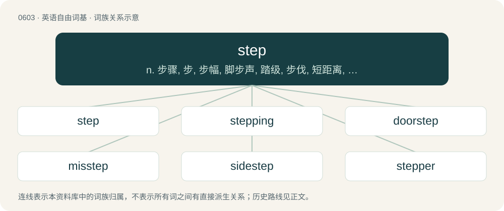

# 0673 · step — n. 步骤, 步, 步幅, 脚步声, 踏级, 步伐, 短距离, 步态, 手段, 等级；vt. 踏, 以步测量, 跨步, 使成阶梯状；vi. 跨步, 轻快地走, 跳舞, 踩, 踏上, 行走

[总目录](../00_总目录_按常用程度.md)

**类型**：英语自由词基　｜　**来源语言**：见词源记录

## 核心含义与来源

- 核心含义：n. 步骤, 步, 步幅, 脚步声, 踏级, 步伐, 短距离, 步态, 手段, 等级；vt. 踏, 以步测量, 跨步, 使成阶梯状；vi. 跨步, 轻快地走, 跳舞, 踩, 踏上, 行走
- 英文含义：An advance or movement made from one foot to the other; a pace.
- 词形：step

**多个词源／构词路径**：同一拼写可能有不同来源；以下按词性和含义分别列出。

**来源记录 1**（名词；An advance or movement made from one foot to the other; a pace.）

From Middle English steppen, from Old English steppan (“to step, go, proceed, advance”), stepe (“step”), from Proto-West Germanic \*stappjan, from Proto-Germanic \*stapjaną (“to step”), \*stapiz (“step”), from Proto-Indo-European \*stebʰ- (“to support, stomp, curse, be amazed”). Cognate with West Frisian stappe (“to step”), North Frisian stape (“to walk, trudge”), Dutch stappen (“to step, walk”), Walloon steper (“to walk away, leave”), German stapfen (“to trudge, stomp, plod”) and further to Slavic Polish stąpać (“to stomp, stamp, step, tread”), Russian ступать (stupatʹ) and Polish stopień (“step, stair, rung, degree”), Russian степень (stepenʹ). Related to stamp, stomp.

**来源记录 2**（名词；A stepchild.）

Clipping of stepchild and stepsibling.

## 词族图

## 单词速览（常用到不常用）

| 单词 | 音标 | 释义 |
|---|---|---|
| [step](#w-1) | 英 /stɛp/ | n. 步骤, 步, 步幅, 脚步声, 踏级, 步伐, 短距离, 步态, 手段, 等级；vt. 踏, 以步测量, 跨步, 使成阶梯状；vi. 跨步, 轻快地走, 跳舞, 踩, 踏上, 行走 |
| [stepping](#w-2) | /ˈstɛpɪŋ/ | \[计\] 步进式, 改变 |
| [doorstep](#w-3) | /ˈdɔː(ɹ)stɛp/ | n. 门阶 |
| [misstep](#w-4) | /ˈmɪs.stɛp/ | n. 踏错, 错误, 失策；\[法\] 失足, 过失, 失策 |
| [sidestep](#w-5) | /ˈsaɪdˌstɛp/ | n. 横跨的一步, 台阶；vt. 横跨一步躲避, 回避；vi. 回避问题, 躲避打击 |
| [stepper](#w-6) | /ˈstɛ.pə(ɹ)/ | n. 快马, 跳舞者, (美)(非正式)花很多时间参加社交活动的学生；\[计\] 步进 |
| [overstep](#w-7) | 英 /ˌəʊvəˈstɛp/；美 /ˌoʊvɚˈstɛp/ | vt. 踏过, 逾越, 超出...的限度；\[法\] 违犯, 逾越 |
| [lockstep](#w-8) | 英 /ˈlɒkstɛp/ | n. 紧密行进步伐, 因循守旧 |
| [footstep](#w-9) | /ˈfʊtstɛp/ | n. 脚步, 脚步声, 足迹 |
| [stepwise](#w-10) | /ˈstepwaiz/ | a. 楼梯式的, 逐步的 |
| [quickstep](#w-11) | /ˈkwikstep/ | n. 齐步, 快步进行曲, 快狐步舞 |
| [instep](#w-12) | 美 /ˈɪnˌstɛp/ | n. 脚背, 背部, 脚背形的东西；\[医\] 足背, 足弓 |

## 逐词详解

### 1. step

**词性**：名词　｜　**音标**：英 /stɛp/

**中文释义**：n. 步骤, 步, 步幅, 脚步声, 踏级, 步伐, 短距离, 步态, 手段, 等级；vt. 踏, 以步测量, 跨步, 使成阶梯状；vi. 跨步, 轻快地走, 跳舞, 踩, 踏上, 行走

**英文义项**：An advance or movement made from one foot to the other; a pace. / A rest, or one of a set of rests, for the foot in ascending or descending, as a stair, or a rung of a ladder.

**词源与演化**：

From Middle English steppen, from Old English steppan (“to step, go, proceed, advance”), stepe (“step”), from Proto-West Germanic \*stappjan, from Proto-Germanic \*stapjaną (“to step”), \*stapiz (“step”), from Proto-Indo-European \*stebʰ- (“to support, stomp, curse, be amazed”). Cognate with West Frisian stappe (“to step”), North Frisian stape (“to walk, trudge”), Dutch stappen (“to step, walk”), Walloon steper (“to walk away, leave”), German stapfen (“to trudge, stomp, plod”) and further to Slavic Polish stąpać (“to stomp, stamp, step, tread”), Russian ступать (stupatʹ) and Polish stopień (“step, stair, rung, degree”), Russian степень (stepenʹ). Related to stamp, stomp.

**例句**：

> The driver must have a clear view of the step in order to prevent accidents.

该用例对应义项：A running board where passengers step to get on and off the bus.

### 2. stepping

**词性**：名词　｜　**音标**：/ˈstɛpɪŋ/

**中文释义**：\[计\] 步进式, 改变

**英文义项**：The act of taking a step. / A specific iteration of a model of central processing unit, often distinguished by the addition or removal of features compared to earlier examples of the same processor, or the presence, or lack thereof, of specific bugs.

**构词拆分**：step + -ing

**词源与演化**：

From Middle English steppynge; equivalent to step + -ing.

**例句**：

> The 80386's early steppings have quite a lot of bugs, so some software specifically tests to make sure that the processor isn't one of those old versions.

该用例对应义项：A specific iteration of a model of central processing unit, often distinguished by the addition or removal of features compared to earlier examples of the same processor, or the presence, or lack thereof, of specific bugs.

### 3. doorstep

**词性**：名词　｜　**音标**：/ˈdɔː(ɹ)stɛp/

**中文释义**：n. 门阶

**英文义项**：An outside step leading up to the door of a building, usually a home. / One's immediate neighborhood or locality.

**构词拆分**：door + step

**词源与演化**：

From door + step.

**例句**：

> They want to build the prison right on our doorstep; it will only be half a mile away and being that close scares me.

该用例对应义项：One's immediate neighborhood or locality.

### 4. misstep

**词性**：名词　｜　**音标**：/ˈmɪs.stɛp/

**中文释义**：n. 踏错, 错误, 失策；\[法\] 失足, 过失, 失策

**英文义项**：A step that is wrong, a false step. / An error or mistake.

**构词拆分**：mis- + step

**词源与演化**：

From mis- + step.

**例句**：

> His comment was a misstep that could cost him dearly.

该用例对应义项：An error or mistake.

### 5. sidestep

**词性**：动词　｜　**音标**：/ˈsaɪdˌstɛp/

**中文释义**：n. 横跨的一步, 台阶；vt. 横跨一步躲避, 回避；vi. 回避问题, 躲避打击

**英文义项**：To step to the side. / To avoid or dodge.

**构词拆分**：side + step

**词源与演化**：

From side + step.

**例句**：

> I managed to sidestep every pitfall.

### 6. stepper

**词性**：名词　｜　**音标**：/ˈstɛ.pə(ɹ)/

**中文释义**：n. 快马, 跳舞者, (美)(非正式)花很多时间参加社交活动的学生；\[计\] 步进

**英文义项**：A person or animal that steps, especially energetically or high. / A dancer.

**构词拆分**：step + -er

**词源与演化**：

From step + -er.

### 7. overstep

**词性**：动词　｜　**音标**：英 /ˌəʊvəˈstɛp/；美 /ˌoʊvɚˈstɛp/

**中文释义**：vt. 踏过, 逾越, 超出...的限度；\[法\] 违犯, 逾越

**英文义项**：To go too far beyond (a limit); especially, to cross boundaries or exceed norms or conventions. / To take a step in which the foot touches ground too far forward.

**构词拆分**：By surface analysis, over- + step

**词源与演化**：

From Middle English \*oversteppen, from Old English ofersteppan, from Proto-Germanic \*uberstapjaną (“to step over; overstep”). Cognate with Dutch overstappen, German Low German överstappen, German überstapfen, überstepfen. Cf. transgress. By surface analysis, over- + step.

**例句**：

> That color scheme really oversteps the bounds of good taste.

该用例对应义项：To go too far beyond (a limit); especially, to cross boundaries or exceed norms or conventions.

### 8. lockstep

**词性**：名词　｜　**音标**：英 /ˈlɒkstɛp/

**中文释义**：n. 紧密行进步伐, 因循守旧

**英文义项**：A step whereby the toe of one man is brought very close to the heel of the man in front. / Close connection, unison, rigid synchronization.

**构词拆分**：lock + step

**词源与演化**：

From lock + step.

**例句**：

> How politically realistic are the climate action goals that European governments are setting in lockstep with the United States?

### 9. footstep

**词性**：名词　｜　**音标**：/ˈfʊtstɛp/

**中文释义**：n. 脚步, 脚步声, 足迹

**英文义项**：The mark or impression left by a foot; a track. / The indications or waypoints of a course or direction taken.

**构词拆分**：foot + step

**词源与演化**：

From Middle English fotstep, fotstappe, from Old English \*fōtstepe, \*fōtstæpe (attested only in derivative fōtstappel (“footstep”)), equivalent to foot + step. Cognate with Saterland Frisian Foutstappe (“footstep”), West Frisian fuotstap (“footstep”), Dutch voetstap (“footstep”).

**例句**：

> To walk the footsteps of greatness requires that you start at the bottom of a long stair.

该用例对应义项：The indications or waypoints of a course or direction taken.

### 10. stepwise

**词性**：形容词　｜　**音标**：/ˈstepwaiz/

**中文释义**：a. 楼梯式的, 逐步的

**英文义项**：One (small) step or stage at a time; gradual; piecemeal

**构词拆分**：step + -wise

**词源与演化**：

From step + -wise.

### 11. quickstep

**词性**：名词　｜　**音标**：/ˈkwikstep/

**中文释义**：n. 齐步, 快步进行曲, 快狐步舞

**英文义项**：A fast foxtrot noted for its complex and intricate footwork.

**构词拆分**：quick + step

**词源与演化**：

From quick + step.

### 12. instep

**词性**：名词　｜　**音标**：美 /ˈɪnˌstɛp/

**中文释义**：n. 脚背, 背部, 脚背形的东西；\[医\] 足背, 足弓

**英文义项**：The arched part of the top of the foot between the toes and the ankle. / A section of any footwear covering that part of the foot.

**构词拆分**：in- + step

**词源与演化**：

From in- + step.

**例句**：

> The boot pressed uncomfortably against his instep.

该用例对应义项：The arched part of the top of the foot between the toes and the ankle.
