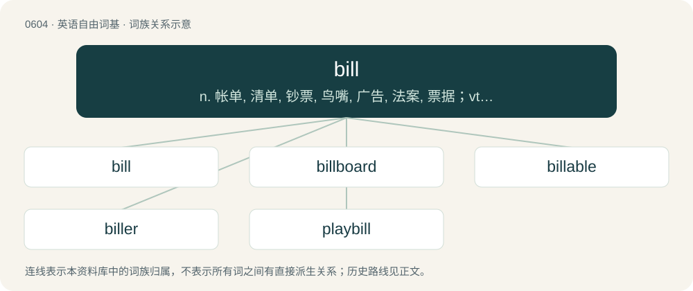

# 0674 · bill — n. 帐单, 清单, 钞票, 鸟嘴, 广告, 法案, 票据；vt. 开帐单, (用招贴)宣布

[总目录](../00_总目录_按常用程度.md)

**类型**：英语自由词基　｜　**来源语言**：见词源记录

## 核心含义与来源

- 核心含义：n. 帐单, 清单, 钞票, 鸟嘴, 广告, 法案, 票据；vt. 开帐单, (用招贴)宣布
- 英文含义：A written list or inventory. (Now obsolete except in specific senses or set phrases; bill of lading, bill of goods, etc.)
- 词形：bill

**多个词源／构词路径**：同一拼写可能有不同来源；以下按词性和含义分别列出。

**来源记录 1**（名词；A written list or inventory. (Now obsolete except in specific senses or set phrases; bill of lading, bill of goods, etc.)）

From Middle English bille, from Anglo-Norman bille, from Old French bulle, from Medieval Latin bulla (“seal, sealed document”). Doublet of bull (“papal bull; bubble”) and bulla.

**来源记录 2**（名词；The beak of a bird, especially when small or flattish; sometimes also used with reference to a platypus, turtle, or other animal.）

From Middle English bill, bil, bille, bile, from Old English bile (“beak (of a bird); trunk (of an elephant)”), of unknown origin. Perhaps from a special use of Old English bil, bill (“hook; sword”) (see below).

**来源记录 3**（名词；Any of various bladed or pointed hand weapons, originally designating an Anglo-Saxon sword, and later a weapon of infantry, especially in the 14th and 15th centuries, commonly consisting of a broad, heavy, double-edged, hook-shaped blade, with a short pike at the back and another at the top, attached to the end of a long staff.）

From Middle English bill, bille, bil, from Old English bil, bill (“a hooked point; curved weapon; two-edged sword”), from Proto-Germanic \*bilją (“axe; sword; blade”), from Proto-Indo-European \*bʰeyH- (“to strike; beat”). Cognate with West Frisian bile (“axe”), Dutch bijl (“axe”), German Bille (“axe”).

**来源记录 4**（名词；The bell, or boom, of the bittern.）

Onomatopoeic.

**来源记录 5**（动词；To roll up a marijuana cigarette.）

Pronunciation spelling of build.

## 词族图

## 单词速览（常用到不常用）

| 单词 | 音标 | 释义 |
|---|---|---|
| [bill](#w-1) | /ˈbɪl/ | n. 帐单, 清单, 钞票, 鸟嘴, 广告, 法案, 票据；vt. 开帐单, (用招贴)宣布 |
| [billboard](#w-2) | 美 /ˈbɪlˌboɹd/ | n. 广告牌, 布告板；vt. 宣传 |
| [billable](#w-3) | /ˈbɪləbəl/ | a. bill的变形 |
| [biller](#w-4) | /ˈbilə/ | \[经\] 记帐员, 开发票机, 发票登帐机 |
| [playbill](#w-5) | /ˈpleɪˌbɪl/ | n. 戏单, 演出海报, 节目单 |

## 逐词详解

### 1. bill

**词性**：名词　｜　**音标**：/ˈbɪl/

**中文释义**：n. 帐单, 清单, 钞票, 鸟嘴, 广告, 法案, 票据；vt. 开帐单, (用招贴)宣布

**英文义项**：A written list or inventory. (Now obsolete except in specific senses or set phrases; bill of lading, bill of goods, etc.) / A document, originally sealed; a formal statement or official memorandum. (Now obsolete except with certain qualifying words; bill of health, bill of sale etc.)

**词源与演化**：

From Middle English bille, from Anglo-Norman bille, from Old French bulle, from Medieval Latin bulla (“seal, sealed document”). Doublet of bull (“papal bull; bubble”) and bulla.

**例句**：

> We've got a brilliant new comedian on the bill tonight.

该用例对应义项：A set of items presented together.

### 2. billboard

**词性**：动词　｜　**音标**：美 /ˈbɪlˌboɹd/

**中文释义**：n. 广告牌, 布告板；vt. 宣传

**英文义项**：To advertise on a billboard.

**构词拆分**：bill + board

**词源与演化**：

From bill + board.

**例句**：

> The upcoming concert was billboarded all over the city.

该用例对应义项：To advertise on a billboard.

### 3. billable

**词性**：形容词　｜　**音标**：/ˈbɪləbəl/

**中文释义**：a. bill的变形

**英文义项**：Capable of being billed for.

**构词拆分**：bill + -able

**词源与演化**：

From bill + -able.

### 4. biller

**词性**：名词　｜　**音标**：/ˈbilə/

**中文释义**：\[经\] 记帐员, 开发票机, 发票登帐机

**英文义项**：An issuer of a bill. / One who bills (caresses in fondness), in the context of billing and cooing.

**构词拆分**：bill + -er

**词源与演化**：

From bill + -er.

### 5. playbill

**词性**：名词　｜　**音标**：/ˈpleɪˌbɪl/

**中文释义**：n. 戏单, 演出海报, 节目单

**英文义项**：A poster advertising a theatrical performance. / A program/programme/pamphlet for a theatrical performance.

**构词拆分**：play + bill

**词源与演化**：

From play + bill.

**例句**：

> He couldn't find her name on the playbill.

该用例对应义项：a theatrical program
