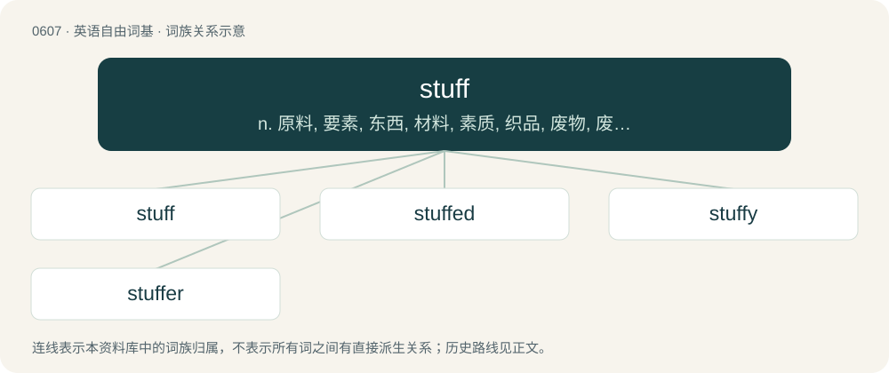

# 0678 · stuff — n. 原料, 要素, 东西, 材料, 素质, 织品, 废物, 废话；vt. 装填；vi. 狼吞虎咽

[总目录](../00_总目录_按常用程度.md)

**类型**：英语自由词基　｜　**来源语言**：见词源记录

## 核心含义与来源

- 核心含义：n. 原料, 要素, 东西, 材料, 素质, 织品, 废物, 废话；vt. 装填；vi. 狼吞虎咽
- 英文含义：Miscellaneous items or objects; (with possessive) personal effects.
- 词形：stuff

**多个词源／构词路径**：同一拼写可能有不同来源；以下按词性和含义分别列出。

**来源记录 1**（名词；Miscellaneous items or objects; (with possessive) personal effects.）

From Middle English stuf, stuffe, from Anglo-Latin stuffa and its etymon Old French estofe, estoffe, estuf, estuffe, stoffe, from estoffer, estofer (“to provide what is necessary, equip, stuff”), borrowed from Old High German stoffōn, from Proto-West Germanic \*stoppōn (“to clog up, block, fill”). More at stop.

**来源记录 2**（动词；To fill by packing or crowding something into; to cram with something; to load to excess.）

From Middle English stuffen (“to equip, furnish”), borrowed from Old French estoffer, estofer (“to provide what is necessary, equip, stuff”), borrowed from Old High German stoffōn, from Proto-West Germanic \*stoppōn (“to clog up, block, fill”). More at stop.

## 词族图

## 单词速览（常用到不常用）

| 单词 | 音标 | 释义 |
|---|---|---|
| [stuff](#w-1) | 英 /stʌf/ | n. 原料, 要素, 东西, 材料, 素质, 织品, 废物, 废话；vt. 装填；vi. 狼吞虎咽 |
| [stuffed](#w-2) | 英 /stʌft/ | 已经喂饱了的；塞满了的 |
| [stuffy](#w-3) | /ˈstʌfi/ | a. 闷热的, 窒息的, 乏味的, 固步自封的, 自以为是的 |
| [stuffer](#w-4) | 英 /ˈstʌfə/；美 /ˈstʌfɚ/ | n. 填塞工人, (非正式)贩卖假货的人；\[计\] 填充器 |

## 逐词详解

### 1. stuff

**词性**：名词　｜　**音标**：英 /stʌf/

**中文释义**：n. 原料, 要素, 东西, 材料, 素质, 织品, 废物, 废话；vt. 装填；vi. 狼吞虎咽

**英文义项**：Miscellaneous items or objects; (with possessive) personal effects. / Unspecified things or matters.

**词源与演化**：

From Middle English stuf, stuffe, from Anglo-Latin stuffa and its etymon Old French estofe, estoffe, estuf, estuffe, stoffe, from estoffer, estofer (“to provide what is necessary, equip, stuff”), borrowed from Old High German stoffōn, from Proto-West Germanic \*stoppōn (“to clog up, block, fill”). More at stop.

**例句**：

> Can I have some of that stuff on my ice-cream sundae?

该用例对应义项：Used as placeholder, usually for material of unknown type or name.

### 2. stuffed

**词性**：形容词　｜　**音标**：英 /stʌft/

**中文释义**：已经喂饱了的；塞满了的

**英文义项**：Full or packed (with some material or substance). / Filled with a filling and seasoning.

**构词拆分**：From stuff + -ed.

**词源与演化**：

From stuff + -ed.

**例句**：

> The turkey is stuffed with a stuffing made of bread and herbs.

该用例对应义项：Filled with a filling and seasoning.

### 3. stuffy

**词性**：形容词　｜　**音标**：/ˈstʌfi/

**中文释义**：a. 闷热的, 窒息的, 乏味的, 固步自封的, 自以为是的

**英文义项**：Poorly ventilated; partially plugged. / Uncomfortably warm without sufficient air circulation.

**构词拆分**：stuff + -y

**词源与演化**：

From stuff + -y.

**例句**：

> The stuffy professor droned on as the class lost interest.

该用例对应义项：Boring, old-fashioned, uninteresting, over-formal, pompous, very conventional.

### 4. stuffer

**词性**：名词　｜　**音标**：英 /ˈstʌfə/；美 /ˈstʌfɚ/

**中文释义**：n. 填塞工人, (非正式)贩卖假货的人；\[计\] 填充器

**英文义项**：One who, or that which, stuffs. / A taxidermist.

**构词拆分**：From stuff + -er.

**词源与演化**：

From stuff + -er.
