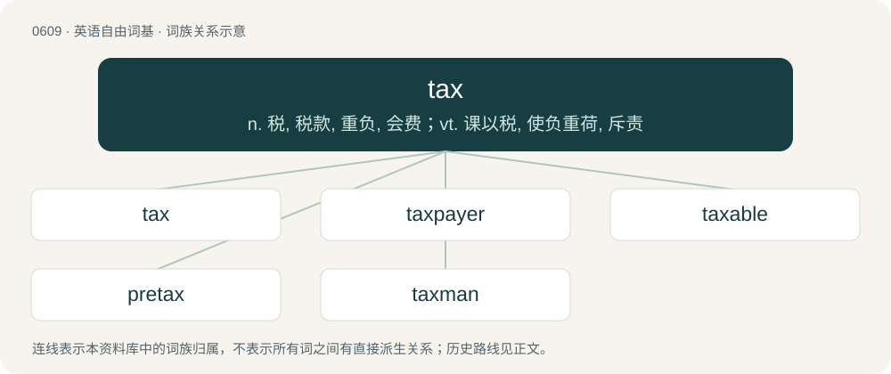

# 0679 · tax — n. 税, 税款, 重负, 会费；vt. 课以税, 使负重荷, 斥责

[总目录](../00_总目录_按常用程度.md)

**类型**：英语自由词基　｜　**来源语言**：见词源记录

## 核心含义与来源

- 核心含义：n. 税, 税款, 重负, 会费；vt. 课以税, 使负重荷, 斥责
- 英文含义：Money or goods collected by a government (or an entity to whom the government has delegated this power, e.g. in tax farming) to fund itself and its services, for example by levying a charge on income, purchases (sales), property or harvest, other than that money which is collected by the government in exchange for specific goods (e.g. the purchase of surplus vehicles).
- 词形：tax

**多个词源／构词路径**：同一拼写可能有不同来源；以下按词性和含义分别列出。

**来源记录 1**（名词；Money or goods collected by a government (or an entity to whom the government has delegated this power, e.g. in tax farming) to fund itself and its services, for example by levying a charge on income, purchases (sales), property or harvest, other than that money which is collected by the government in exchange for specific goods (e.g. the purchase of surplus vehicles).）

From Middle English taxe, from Middle French taxe, from Medieval Latin taxa, from Latin taxō (“to appraise, value, estimate; (medieval) to tax”). Doublet of task. Displaced native Old English gafol, which was also the word for “tribute” and “rent”.

**来源记录 2**（动词；To impose and collect a tax from (a person or company).）

From Middle English taxen, from Anglo-Norman taxer (“to impose a tax”), from Latin taxāre (“to handle, to censure, to appraise, to compute”).

## 词族图

## 单词速览（常用到不常用）

| 单词 | 音标 | 释义 |
|---|---|---|
| [tax](#w-1) | /tæks/ | n. 税, 税款, 重负, 会费；vt. 课以税, 使负重荷, 斥责 |
| [taxpayer](#w-2) | /ˈtakspeɪə/ | n. 纳税人；\[法\] 纳税人, 纳税义务人 |
| [taxable](#w-3) | /ˈtæksəbəl/ | a. 可征税的, 应征税的；\[经\] 可征税的, 应纳税的 |
| [pretax](#w-4) | /ˈpriːˈtæks/ | a. 税前的 |
| [taxman](#w-5) | 英 /ˈtæksmæn/ | 收税员,税收检查员 |

## 逐词详解

### 1. tax

**词性**：名词　｜　**音标**：/tæks/

**中文释义**：n. 税, 税款, 重负, 会费；vt. 课以税, 使负重荷, 斥责

**英文义项**：Money or goods collected by a government (or an entity to whom the government has delegated this power, e.g. in tax farming) to fund itself and its services, for example by levying a charge on income, purchases (sales), property or harvest, other than that money which is collected by the government in exchange for specific goods (e.g. the purchase of surplus vehicles). / A charge (of money, food, labor, etc) collected by a person, organization, etc; something required (exacted) from someone who is (really or notionally) under the control of the taxer, such as a contribution or service.

**词源与演化**：

From Middle English taxe, from Middle French taxe, from Medieval Latin taxa, from Latin taxō (“to appraise, value, estimate; (medieval) to tax”). Doublet of task. Displaced native Old English gafol, which was also the word for “tribute” and “rent”.

**用法示例／搭配（非完整句）**：

> a heavy tax on time or health

该用例对应义项：A burdensome demand

### 2. taxpayer

**词性**：名词　｜　**音标**：/ˈtakspeɪə/

**中文释义**：n. 纳税人；\[法\] 纳税人, 纳税义务人

**英文义项**：A person who is subject to, liable for, or pays tax.

**构词拆分**：tax + payer

**词源与演化**：

From tax + payer.

**例句**：

> The bank was bailed out by the taxpayer.

该用例对应义项：A person who is subject to, liable for, or pays tax.

### 3. taxable

**词性**：形容词　｜　**音标**：/ˈtæksəbəl/

**中文释义**：a. 可征税的, 应征税的；\[经\] 可征税的, 应纳税的

**英文义项**：That can be taxed. / Subject to taxation.

**构词拆分**：tax + -able

**词源与演化**：

From tax + -able

**例句**：

> All economic problems would be solved, if they made complacency taxable.

### 4. pretax

**词性**：形容词　｜　**音标**：/ˈpriːˈtæks/

**中文释义**：a. 税前的

**英文义项**：Before the payment of taxes.

**构词拆分**：pre- + tax

**词源与演化**：

From pre- + tax.

### 5. taxman

**词性**：名词　｜　**音标**：英 /ˈtæksmæn/

**中文释义**：收税员,税收检查员

**英文义项**：A tax collector. / A tax-collecting organ, personified.

**构词拆分**：tax + man

**词源与演化**：

From tax + man.
