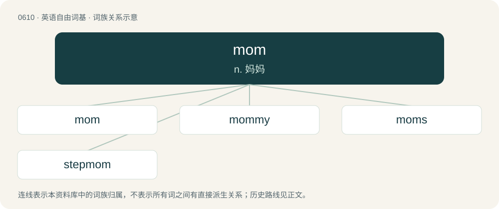

# 0680 · mom — n. 妈妈

[总目录](../00_总目录_按常用程度.md)

**类型**：英语自由词基　｜　**来源语言**：见词源记录

## 核心含义与来源

- 核心含义：n. 妈妈
- 英文含义：Mother.
- 词形：mom

**来源记录 1**（名词；Mother.）

Clipping of momma.

## 词族图

## 单词速览（常用到不常用）

| 单词 | 音标 | 释义 |
|---|---|---|
| [mom](#w-1) | 英 /mɒm/；美 /mɑm/ | n. 妈妈 |
| [mommy](#w-2) | 英 /ˈmɒm.i/ | n. 妈咪 |
| [moms](#w-3) | 英 /mɒmz/ | abbr. 密西根数学系统（Michigan's Own Mathematical System） |
| [stepmom](#w-4) |  | 继母 |

## 逐词详解

### 1. mom

**词性**：名词　｜　**音标**：英 /mɒm/；美 /mɑm/

**中文释义**：n. 妈妈

**英文义项**：Mother. / used as a term of address for one's wife

**词源与演化**：

Clipping of momma.

**例句**：

> Mom was at a loss about what to do with the mess.

### 2. mommy

**词性**：名词　｜　**音标**：英 /ˈmɒm.i/

**中文释义**：n. 妈咪

**英文义项**：Mother. / A sexually attractive mother.

**构词拆分**：mom + -y

**词源与演化**：

From mom + -y (diminutive suffix).

**例句**：

> My girlfriend loves it when I call her mommy.

该用例对应义项：A dominant female partner, often used as a term of address.

### 3. moms

**词性**：名词　｜　**音标**：英 /mɒmz/

**中文释义**：abbr. 密西根数学系统（Michigan's Own Mathematical System）

**英文义项**：Affectionate term of address for one's mother.

**构词拆分**：mom + -s

**词源与演化**：

From mom + -s (hypocoristic suffix).

**例句**：

> Yanni's mom is Jewish and Jewish moms are no fool.

### 4. stepmom

**词性**：名词

**中文释义**：继母

**英文义项**：Stepmother.

**构词拆分**：step- + mom

**词源与演化**：

From step- + mom.

**例句**：

> Ziri used Photoshop to cut his stepmom out of all his pictures.
