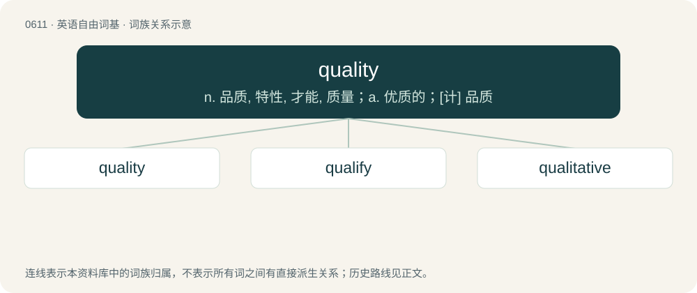

# 0681 · quality — n. 品质, 特性, 才能, 质量；a. 优质的；\[计\] 品质

[总目录](../00_总目录_按常用程度.md)

**类型**：英语自由词基　｜　**来源语言**：见词源记录

## 核心含义与来源

- 核心含义：n. 品质, 特性, 才能, 质量；a. 优质的；\[计\] 品质
- 英文含义：The kind, condition, and/or the set of characteristics of something, as opposed to the quantity of something.
- 词形：quality

**来源记录 1**（名词；The kind, condition, and/or the set of characteristics of something, as opposed to the quantity of something.）

From Middle English qualite, from Old French qualité, from Latin quālitās, quālitātem, from quālis (“of what kind”), from Proto-Indo-European \*kʷo- (“who, how”). Cicero coined qualitas as a calque to translate the Ancient Greek word ποιότης (poiótēs, “quality”), coined by Plato from ποῖος (poîos, “of what nature, of what kind”).

## 词族图

## 单词速览（常用到不常用）

| 单词 | 音标 | 释义 |
|---|---|---|
| [quality](#w-1) | 英 /ˈkwɒlɪti/；美 /ˈkwɑləti/ | n. 品质, 特性, 才能, 质量；a. 优质的；\[计\] 品质 |
| [qualify](#w-2) | 英 /ˈkwɒl.ɪ.faɪ/；美 /ˈkwɑ.lɪ.faɪ/ | vi. 取得资格, 有资格；vt. 使有资格, 使合格, 限定, 限制, 准予 |
| [qualitative](#w-3) | 英 /ˈkwɒl.ɪ.tə.tɪv/；美 /ˈkwɑ.ləˌteɪ.tɪv/ | a. 性质的, 质的, 定性的 |

## 逐词详解

### 1. quality

**词性**：名词　｜　**音标**：英 /ˈkwɒlɪti/；美 /ˈkwɑləti/

**中文释义**：n. 品质, 特性, 才能, 质量；a. 优质的；\[计\] 品质

**英文义项**：The kind, condition, and/or the set of characteristics of something, as opposed to the quantity of something. / A single trait.

**词源与演化**：

From Middle English qualite, from Old French qualité, from Latin quālitās, quālitātem, from quālis (“of what kind”), from Proto-Indo-European \*kʷo- (“who, how”). Cicero coined qualitas as a calque to translate the Ancient Greek word ποιότης (poiótēs, “quality”), coined by Plato from ποῖος (poîos, “of what nature, of what kind”).

**例句**：

> For this building project we need to use quality materials that will last for many decades.

该用例对应义项：Good worth, good make.

### 2. qualify

**词性**：动词　｜　**音标**：英 /ˈkwɒl.ɪ.faɪ/；美 /ˈkwɑ.lɪ.faɪ/

**中文释义**：vi. 取得资格, 有资格；vt. 使有资格, 使合格, 限定, 限制, 准予

**英文义项**：To describe or characterize something by listing its qualities. / To successfully fall under some category or description by meeting requisite conditions.

**构词拆分**：quality + -fy

**词源与演化**：

Borrowed from Middle French qualifier (“to qualify”). Equivalent to quality + -fy.

**用法示例／搭配（非完整句）**：

> to qualify seven balls you need at least fourteen catches

该用例对应义项：To throw and catch each object at least twice.

### 3. qualitative

**词性**：形容词　｜　**音标**：英 /ˈkwɒl.ɪ.tə.tɪv/；美 /ˈkwɑ.ləˌteɪ.tɪv/

**中文释义**：a. 性质的, 质的, 定性的

**英文义项**：Of descriptions or distinctions based on some quality rather than on some quantity. / Of a form of analysis that yields the identity of a compound.

**构词拆分**：quality + -ative

**词源与演化**：

From Late Latin (or Medieval Latin) quālitātīvus. Equivalent to quality + -ative.

**例句**：

> Qualitative analysis determines the chemical constituents of a substance or mixture.

该用例对应义项：involving distinctions based on qualities
