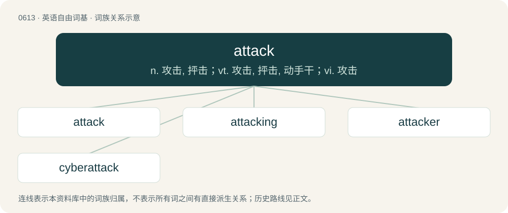

# 0682 · attack — n. 攻击, 抨击；vt. 攻击, 抨击, 动手干；vi. 攻击

[总目录](../00_总目录_按常用程度.md)

**类型**：英语自由词基　｜　**来源语言**：见词源记录

## 核心含义与来源

- 核心含义：n. 攻击, 抨击；vt. 攻击, 抨击, 动手干；vi. 攻击
- 英文含义：An attempt to cause damage, injury to, or death of an opponent or enemy.
- 词形：attack

**来源记录 1**（名词；An attempt to cause damage, injury to, or death of an opponent or enemy.）

Borrowed from French attaque, derived from the verb attaquer, from Italian attaccare (“to join, attach”) (used in attaccare battaglia (“to join battle”)), from Frankish \*stakkijan (“to stick, stick to, attach”). Doublet of attach. Displaced native Middle English onresen, from Old English onrǣsan (“to attack”); and Middle English resinge (“an assault, attack”) (compare Old English onrǣs (“an attack”)).

## 词族图

## 单词速览（常用到不常用）

| 单词 | 音标 | 释义 |
|---|---|---|
| [attack](#w-1) | 英 /əˈtæk/ | n. 攻击, 抨击；vt. 攻击, 抨击, 动手干；vi. 攻击 |
| [attacking](#w-2) | /əˈtækɪŋ/ | v. 进攻；攻击（attack的现在分词）；攻球 |
| [attacker](#w-3) | 美 /əˈtækɚ/ | n. 攻击者 |
| [cyberattack](#w-4) | /ˈsaɪ.bə.ɹəˌtæk/ | 【英文】An attack or intrusion by means of a computer network such as the Internet, often for the purpose of spying. |

## 逐词详解

### 1. attack

**词性**：名词　｜　**音标**：英 /əˈtæk/

**中文释义**：n. 攻击, 抨击；vt. 攻击, 抨击, 动手干；vi. 攻击

**英文义项**：An attempt to cause damage, injury to, or death of an opponent or enemy. / Any of several specific maneuvers, skills, or special abilities that a character can use to inflict damage against opponents.

**词源与演化**：

Borrowed from French attaque, derived from the verb attaquer, from Italian attaccare (“to join, attach”) (used in attaccare battaglia (“to join battle”)), from Frankish \*stakkijan (“to stick, stick to, attach”). Doublet of attach. Displaced native Middle English onresen, from Old English onrǣsan (“to attack”); and Middle English resinge (“an assault, attack”) (compare Old English onrǣs (“an attack”)).

**例句**：

> They claimed the censorship of the article was an attack on free speech.

该用例对应义项：An attempt to detract from the worth or credibility of, a person, position, idea, object, or thing, by physical, verbal, emotional, or other assault.

### 2. attacking

**词性**：形容词　｜　**音标**：/əˈtækɪŋ/

**中文释义**：v. 进攻；攻击（attack的现在分词）；攻球

**英文义项**：Carrying out an attack.

**构词拆分**：attack + -ing

**词源与演化**：

From attack + -ing.

**例句**：

> Like a lion attacking its prey, the kitten jumped on its toy.

### 3. attacker

**词性**：名词　｜　**音标**：美 /əˈtækɚ/

**中文释义**：n. 攻击者

**英文义项**：Someone who attacks. / One of the players on a team in football (soccer) in the row nearest to the opposing team's goal, who are therefore principally responsible for scoring goals.

**构词拆分**：attack + -er

**词源与演化**：

From attack + -er.

**例句**：

> We have information that suggests that Tom may have known his attacker.

### 4. cyberattack

**词性**：名词　｜　**音标**：/ˈsaɪ.bə.ɹəˌtæk/

**英文义项**：An attack or intrusion by means of a computer network such as the Internet, often for the purpose of spying.

**构词拆分**：cyber- + attack

**词源与演化**：

From cyber- + attack.

**例句**：

> The cyberattack affected hospitals, banks and companies around the world this year.
