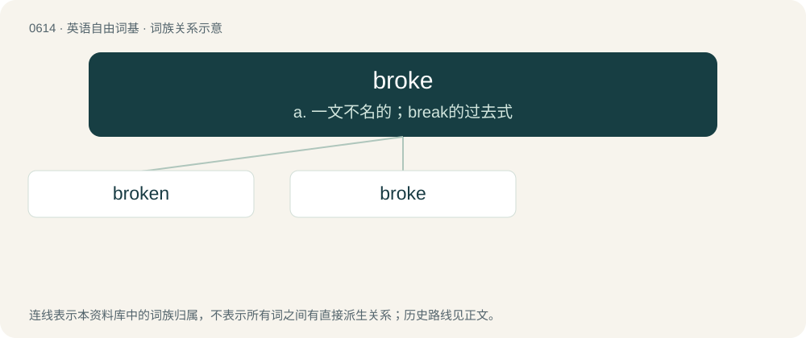

# 0683 · broke — a. 一文不名的；break的过去式

[总目录](../00_总目录_按常用程度.md)

**类型**：英语自由词基　｜　**来源语言**：见词源记录

## 核心含义与来源

- 核心含义：a. 一文不名的；break的过去式
- 英文含义：Financially ruined, bankrupt.
- 词形：broke

**多个词源／构词路径**：同一拼写可能有不同来源；以下按词性和含义分别列出。

**来源记录 1**（形容词；Financially ruined, bankrupt.）

Ablauted form of break.

**来源记录 2**（名词；Paper or board that is discarded and repulped during the manufacturing process.）

From Middle English broce, from Old English gebroc (“fragment”), from brecan (“to break”). Compare broken, past participle of break. Compare also Scots brock (“a scrap of meat or bread”).

**来源记录 3**（动词；To act as a broker; to transact business for another; synonym of broker.）

Back-formation from broker.

**来源记录 4**（形容词；Broke off, rich, wealthy）

Clipping of broke off.

## 词族图

## 单词速览（常用到不常用）

| 单词 | 音标 | 释义 |
|---|---|---|
| [broken](#w-1) | 英 /ˈbɹəʊ.kn̩/；美 /ˈbɹoʊ.kɪn/ | a. 坏掉的, 打破的, 断掉的；break的过去分词 |
| [broke](#w-2) | 英 /ˈbɹəʊ̯k/；美 /ˈbɹoʊ̯k/ | a. 一文不名的；break的过去式 |

## 逐词详解

### 1. broken

**词性**：形容词　｜　**音标**：英 /ˈbɹəʊ.kn̩/；美 /ˈbɹoʊ.kɪn/

**中文释义**：a. 坏掉的, 打破的, 断掉的；break的过去分词

**英文义项**：Fragmented; in separate pieces. / Fractured; having the bone in pieces.

**构词拆分**：broke + -n

**词源与演化**：

From Middle English broken, from Old English brocen, ġebrocen, from Proto-Germanic \*brukanaz, past participle of Proto-Germanic \*brekaną (“to break”). Cognate with Dutch gebroken (“broken”), German Low German broken (“broken”), German gebrochen (“broken”). Morphologically broke + -n.

**例句**：

> The bankruptcy and divorce, together with the death of his son, left him completely broken.

该用例对应义项：Completely defeated and dispirited; shattered; destroyed.

### 2. broke

**词性**：形容词　｜　**音标**：英 /ˈbɹəʊ̯k/；美 /ˈbɹoʊ̯k/

**中文释义**：a. 一文不名的；break的过去式

**英文义项**：Financially ruined, bankrupt. / Without any money, penniless.

**词源与演化**：

Ablauted form of break.

**例句**：

> He was broke and rendered unfit to serve His Majesty at sea.

该用例对应义项：Demoted, deprived of a commission.
