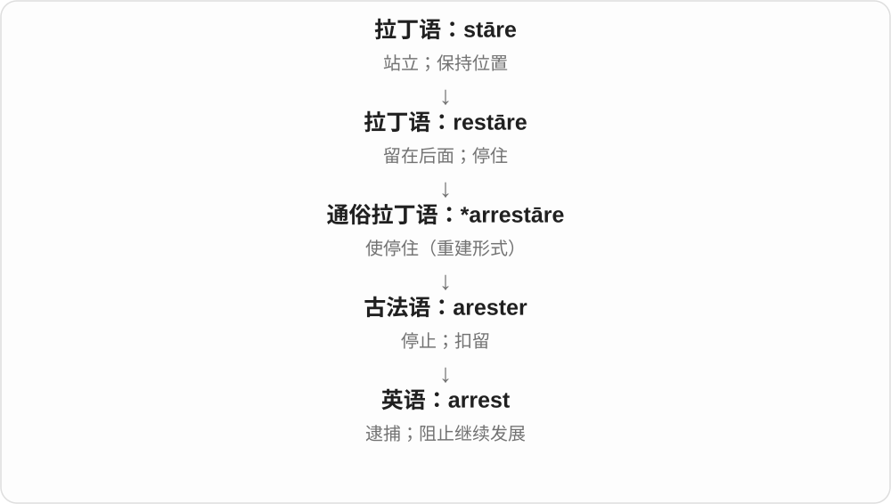

# 0684 · rest — 休息、安宁、支托；另源的剩余

[逐词精讲目录](../00_逐词精讲目录.md) · [总目录](../00_总目录_按常用程度.md)

## 核心词根与来源

休息接旧英语，余下接拉丁语 restāre 经法语。arrest 的旧拉丁语站住、停住背景与后者词族相关，不能直接按英语休息加 ar- 理解。

**REST：休息与剩下分两条来路**

休息、支撑部位及不安是一组；the rest 的剩余来自法语、拉丁语另一支，不把二者编成同一现代派生。

- **休息、宁静与不安**：rest · restful · restless · restlessness · unrest
- **支托与固定设施名**：armrest · headrest · restroom
- **另一条旧拉丁分支的相关词**：arrest
- **rest 休息与剩下分线 → rests**：rests

## 词形与演化规律

rest → restful ↔ restless → restlessness；unrest 群体不安；armrest、headrest、restroom 看固定用途；arrest 单看其拉丁语历史。

休息 rest 承古英语 ræstan 等日耳曼材料；剩下、依归一支经法语 rester、拉丁 restare。现代同形 -s，复数与第三人称按语法辨认。

## 单词速览（按词族由简到繁）

同一基础词的相关扩展放在一起，先读基础形式，再读扩展；各组之间优先读常用的。具体词源关系见各词讲解。

| 单词 | 音标 | 核心意思 |
|---|---|---|
| [rest](#w-1) | /rest/ | 休息；安静、停下；支托；另有剩下的部分义 |
| [rests](#w-10) | 英、美 /rests/ | 休息；倚放；取决于〔第三人称单数〕；休止〔复数〕 |
| [restless](#w-4) | /ˈrestləs/ | 静不下来的；不安的；辗转难眠的 |
| [restlessness](#w-9) | /ˈrestləsnəs/ | 坐立不安；烦躁；渴望变化的不满足 |
| [restroom](#w-5) | /ˈrestruːm/ | 公共卫生间〔尤美式〕 |
| [restful](#w-6) | /ˈrestfəl/ | 宁静的；让人休息、放松的 |
| [arrest](#w-2) | /əˈrest/ | 逮捕；阻止；使停住 |
| [unrest](#w-3) | /ʌnˈrest/ | 动荡；群体不满、社会不安 |
| [headrest](#w-7) | /ˈhedrest/ | 头枕；头部支撑 |
| [armrest](#w-8) | 英 /ˈɑːmrest/；美 /ˈɑːrmrest/ | 扶手；供手臂搁靠的部分 |

## 逐词讲解

### 1. rest — 休息；安静、停下；支托；另有剩下的部分义

**音标**：/rest/

**先抓住这个画面**

休息是一时停住活动；剩余则是拿走一部分后还留着。两条来路分别记，不强编同一故事。

**怎么拆**

休息名词、动词接古英语 ræst、restan；其余、留下义经法语来自拉丁语 restāre。现代部分用法交叠，但 the rest 不能简单解释成睡觉的人。

**怎么变成今天的意思**

**两条来路：古英语 ræst、restan；拉丁语 restāre 经法语 reste、rester**  
前者休息、安静、支撑；后者留下、剩余

↓

**英语同形 rest**  
休息、支托；另一支为其余、剩下的部分；部分动词用法后来交叠

take a rest 休息一下，rest your arm 把手臂放下休息；the rest of the day 这一天剩余时间，the rest of us 我们其余的人。rest on evidence 也可说建立在证据上。

**常见搭配与例句**

take a rest；at rest；the rest of；rest on；rest assured。

> Let’s take a rest before the next climb.

下次攀爬前，我们休息一下吧。

> I read for the rest of the afternoon.

下午余下的时间，我都在看书。

> The rest of the guests are arriving later.

其余客人稍后到。

**别混淆**

the rest 后动词随所指对象：the rest of the water is，the rest of the people are；休息与睡觉也不完全一样。

### 2. rests — 休息；倚放；取决于〔第三人称单数〕；休止〔复数〕

**音标**：英、美 /rests/

**先抓住这个画面**

人停下工作休息，是 rests；手轻放在桌面，也是 rests。责任 rests with someone，则是在说责任落在谁那里。

**怎么拆**

rest + -s → rests，末尾 /sts/。休息、倚放一支承古英语 ræstan 等；剩下、仍处于某状态一支经法语 rester 接拉丁 re- 回 + stare 站 → restare。两支后来有交叠。

**怎么变成今天的意思**

**古英语休息、静止、倚放词族 → rest**  
音乐中停声的间隔也叫 a rest

↓

**另一路法语 rester 留下、仍处于 → rest，与前支部分汇合**  
现代 rests 按休息、放置、依归等搭配理解

rests for a while 是休息一会儿；rests on the table 是轻放、倚在桌上；rests with the team 是由团队承担、决定；musical rests 是休止。

**常见搭配与例句**

rests for a while；rests on；rests with。

> He rests in the garden after lunch.

午饭后，他在花园里休息。

> The final decision rests with the editor.

最终决定权在编辑手里。

**别混淆**

the rest of 表示剩下的部分，一般不在 rest 上加 s。The responsibility rests with her 中 rests 是动词，不能按剩余物复数来理解。

### 3. restless — 静不下来的；不安的；辗转难眠的

**音标**：/ˈrestləs/

**先抓住这个画面**

身体想动、心里安不下来，或总觉得现在的状态不满足。

**怎么拆**

rest 休息、安静 + -less，没有……的，旧有无法休息、不安的相关用法，后来也常说渴望活动、改变。

**怎么变成今天的意思**

**两条来路：古英语 ræst、restan；拉丁语 restāre 经法语 reste、rester**  
前者休息、安静、支撑；后者留下、剩余

↓

**英语同形 rest**  
休息、支托；另一支为其余、剩下的部分；部分动词用法后来交叠

↓

**rest + -less → restless**  
休息、安静 → 得不到安宁、静不下来

restless children 坐不住的孩子；a restless night 辗转难眠的一夜；restless for change 渴望变化。未必每次都因为害怕。

**常见搭配与例句**

a restless night；feel restless；restless energy；grow restless。

> The children grew restless during the long wait.

漫长等待中，孩子们渐渐坐不住了。

> After a restless night, she welcomed a quiet morning.

辗转难眠一夜后，她很珍惜安静的清晨。

**别混淆**

restless 静不下，不等于 simply energetic 精力旺盛；前者常带不安、不满足或难以休息感。

### 4. restlessness — 坐立不安；烦躁；渴望变化的不满足

**音标**：/ˈrestləsnəs/

**先抓住这个画面**

把静不下来、总想动或想改变的那股劲单独拿出来说。

**怎么拆**

restless + -ness，形成状态名词；不等于没有休息时间这一事实本身。

**怎么变成今天的意思**

**两条来路：古英语 ræst、restan；拉丁语 restāre 经法语 reste、rester**  
前者休息、安静、支撑；后者留下、剩余

↓

**英语同形 rest**  
休息、支托；另一支为其余、剩下的部分；部分动词用法后来交叠

↓

**restless → restlessness**  
静不下来的 → 不安、躁动状态

a feeling of restlessness 一种坐立不安感；youthful restlessness 年轻时渴望尝试变化的躁动。原因要看语境。

**常见搭配与例句**

a sense of restlessness；restlessness among the crowd；overcome restlessness。

> A sense of restlessness made him want to travel again.

一股不安于现状的感觉，让他又想出发旅行。

> The teacher noticed growing restlessness among the students.

老师注意到学生们越来越坐不住。

**别混淆**

restlessness 是不安、躁动状态，unrest 常说群体、社会层面的不平静；不是两个词长短不同就能全互换。

### 5. restroom — 公共卫生间〔尤美式〕

**音标**：/ˈrestruːm/

**先抓住这个画面**

名字像休息的房间，今天常见意思却是去上厕所、洗手的地方。

**怎么拆**

rest + room，由供休息等较委婉的房间称呼发展为公共卫生间的常用名称。不能逐字只译成休息室。

**怎么变成今天的意思**

**rest；room**  
并列组合部分

↓

**restroom**  
较委婉命名 → 公共卫生间

a public restroom 公共卫生间，a restroom sign 卫生间标识；在美国餐馆、商场询问很常见。

**常见搭配与例句**

a public restroom；the nearest restroom；restroom facilities。

> The restrooms are near the entrance.

卫生间在入口附近。

> We stopped at a service area to use the restroom.

我们在服务区停下来上卫生间。

**别混淆**

restroom 通常是厕所，不是 lounge 休息室；要找坐着休息的空间，不能只按字面问 restroom。

### 6. restful — 宁静的；让人休息、放松的

**音标**：/ˈrestfəl/

**先抓住这个画面**

环境或时段让你可以停下、安定下来，不再绷着。

**怎么拆**

rest 休息、安静 + -ful，形容能带来休息感、宁静感；不是说里面装满了剩饭。

**怎么变成今天的意思**

**两条来路：古英语 ræst、restan；拉丁语 restāre 经法语 reste、rester**  
前者休息、安静、支撑；后者留下、剩余

↓

**英语同形 rest**  
休息、支托；另一支为其余、剩下的部分；部分动词用法后来交叠

↓

**rest 的休息义 + -ful → restful**  
休息、宁静 → 令人放松的

a restful holiday 轻松休息的假期，a restful colour 让人放松的颜色。常描述效果、气氛，不是必须完全无声。

**常见搭配与例句**

a restful night；a restful place；a restful atmosphere。

> We spent a restful weekend in the countryside.

我们在乡下度过了一个轻松休息的周末。

> The room’s soft colours create a restful atmosphere.

房间柔和的色彩营造出宁静气氛。

**别混淆**

restful 让人安定，restless 是静不下来，两者不只差一个字母而意义相同。

### 7. arrest — 逮捕；阻止；使停住

**音标**：/əˈrest/

**先抓住这个画面**

一个继续前进的过程被按下暂停键：人被警方扣住，发展被阻止，注意力被抓住，都能用 arrest。

**怎么拆**

经古法语 arester 来自通俗拉丁语 *arrestāre，含 ad- 与 restāre“留下、停住”；更深处是 stāre。

**怎么变成今天的意思**

逮捕义是“使人停住、扣留”的专业化。arrest the decline 则是阻止下滑继续，不涉及抓人。

**常见搭配与例句**

arrest someone；be under arrest；arrest the decline；arrest attention。

> Police arrested a suspect near the station.

警方在车站附近逮捕了一名嫌疑人。

> The repairs helped arrest the building’s deterioration.

修缮有助于阻止建筑进一步损坏。

**别混淆**

arrest 是逮捕，不等于已定罪。stop 最普通；arrest 用于发展过程时更正式。

### 8. unrest — 动荡；群体不满、社会不安

**音标**：/ʌnˈrest/

**先抓住这个画面**

不是只有一个人睡不好，而是一群人对现状不满，整体局面不平静。

**怎么拆**

un- 否定 + rest 安宁、平静，形成不安名词；现代常用于社会、政治、劳动关系等集体场景。

**怎么变成今天的意思**

**两条来路：古英语 ræst、restan；拉丁语 restāre 经法语 reste、rester**  
前者休息、安静、支撑；后者留下、剩余

↓

**英语同形 rest**  
休息、支托；另一支为其余、剩下的部分；部分动词用法后来交叠

↓

**un- + rest → unrest**  
不安宁 → 群体、社会层面的不平静

social unrest 社会动荡，industrial unrest 劳资关系中的不平静、争议活动。词本身不保证已经发生暴力。

**常见搭配与例句**

social unrest；civil unrest；industrial unrest；a period of unrest。

> The novel is set during a period of social unrest.

小说以社会动荡时期为背景。

> The report links industrial unrest to disputes over pay.

报告把劳资关系中的不平静与薪酬争议联系起来。

**别混淆**

unrest 多看群体局势；restlessness 可说个人坐立不安。个人很困却睡不着，通常不叫 social unrest。

### 9. headrest — 头枕；头部支撑

**音标**：/ˈhedrest/

**先抓住这个画面**

坐着时，头后面有一块可以靠住的支撑，不必一直悬着。

**怎么拆**

head + rest（支撑、承托处），不是休息时专门换一个头。

**怎么变成今天的意思**

**英语 head；rest〔承托处〕**  
并列组合的两部分

↓

**head + rest〔承托处〕 → headrest**  
用来支撑头部的座椅部件

常见汽车、飞机、办公座椅。an adjustable headrest 是可调节头枕，名称不保证形状一定像普通枕头。

**常见搭配与例句**

an adjustable headrest；a seat headrest；lean against the headrest。

> The seat has an adjustable headrest.

座椅带有可调节头枕。

> He leaned back against the headrest.

他向后靠在头枕上。

**别混淆**

headrest 托头，armrest 托手臂，footrest 托脚；后半相同，前半决定支撑哪里。

### 10. armrest — 扶手；供手臂搁靠的部分

**音标**：英 /ˈɑːmrest/；美 /ˈɑːrmrest/

**先抓住这个画面**

手臂不用一直悬着，可以搁在椅子或座位边上的支撑处。

**怎么拆**

arm 手臂 + rest 支托物，复合为座椅扶手名称。rest 在这里不仅是睡觉，而是让某部位有地方靠着。

**怎么变成今天的意思**

**arm 手臂；rest 支托物**  
并列构词部分

↓

**armrest**  
供手臂搁靠的部件

a padded armrest 带软垫扶手；the armrest of a chair 椅子扶手。沙发、车辆座椅等都可有这个部分。

**常见搭配与例句**

a chair armrest；a padded armrest；rest an arm on the armrest。

> He placed his arm on the chair’s armrest.

他把手臂放在椅子扶手上。

> The seat has an adjustable armrest.

座椅有可调扶手。

**别混淆**

armrest 搁手臂，headrest 托头；handrail 扶栏多沿楼梯、通道供手扶，不是同一种位置部件。

## 这一组要分清什么

restful 放松，restless 静不下；unrest 常说群体动荡。the rest 其余不是睡觉；arrest 也不是英语休息的直接派生。

## 串起来练习

After a restless night, she rested in the armchair and let her hand lie on the armrest.

辗转一夜后，她在扶手椅上休息，把手搁在扶手上。
