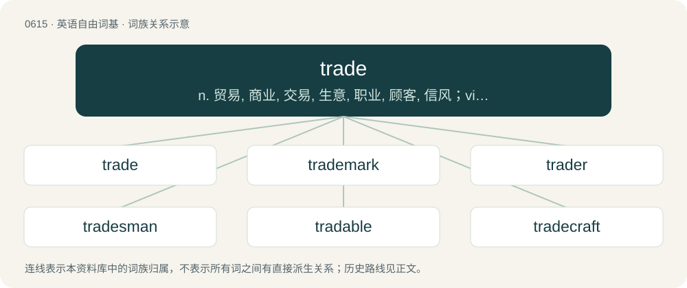

# 0685 · trade — n. 贸易, 商业, 交易, 生意, 职业, 顾客, 信风；vi. 进行交易, 做买卖, 经商, 对换, 购物；vt. 用...进行交换

[总目录](../00_总目录_按常用程度.md)

**类型**：英语自由词基　｜　**来源语言**：见词源记录

## 核心含义与来源

- 核心含义：n. 贸易, 商业, 交易, 生意, 职业, 顾客, 信风；vi. 进行交易, 做买卖, 经商, 对换, 购物；vt. 用...进行交换
- 英文含义：The buying and selling of goods and services on a market.
- 词形：trade

**来源记录 1**（名词；The buying and selling of goods and services on a market.）

From Middle English trade (“path, course of conduct”), introduced into English by Hanseatic merchants, from Middle Low German trade (“track, course”), from Old Saxon trada (“spoor, track”), from Proto-West Germanic \*tradu, from Proto-Germanic \*tradō (“track, way”), and cognate with Old English tredan (“to tread”); ultimately from Proto-Indo-European \*dreh₂- (“to tread, walk, step, run”). Cognate with Dutch trade, tra (“path, trail, course, trade”), German Low German Traad (“track, wagon trail”), Luxembourgish Tratt (“step, pace”), Icelandic tröð (“a lane between fences, enclosure, pen”).

## 词族图

## 单词速览（常用到不常用）

| 单词 | 音标 | 释义 |
|---|---|---|
| [trade](#w-1) | 英 /tɹeɪd/ | n. 贸易, 商业, 交易, 生意, 职业, 顾客, 信风；vi. 进行交易, 做买卖, 经商, 对换, 购物；vt. 用...进行交换 |
| [trademark](#w-2) | 英 /ˈtɹeɪdmɑːk/；美 /ˈtɹeɪdmɑɹk/ | n. 商标；\[法\] 商标 |
| [trader](#w-3) | 英 /ˈtɹeɪdə(ɹ)/；美 /ˈtɹeɪdɚ/ | n. 商人, 商船；\[经\] 交易者, 商船 |
| [tradesman](#w-4) | /ˈtreidzmən/ | n. 零售商, 工匠；\[经\] 商人, 店主, 零售商 |
| [tradable](#w-5) | /ˈtɹeɪdəbəl/ | a. 可贸易的, 可买卖的 |
| [tradecraft](#w-6) | /ˈtredkræft/ | 谍报技术 |

## 逐词详解

### 1. trade

**词性**：名词　｜　**音标**：英 /tɹeɪd/

**中文释义**：n. 贸易, 商业, 交易, 生意, 职业, 顾客, 信风；vi. 进行交易, 做买卖, 经商, 对换, 购物；vt. 用...进行交换

**英文义项**：The buying and selling of goods and services on a market. / A particular instance of buying or selling, or a series of related transactions executed as a single investment.

**词源与演化**：

From Middle English trade (“path, course of conduct”), introduced into English by Hanseatic merchants, from Middle Low German trade (“track, course”), from Old Saxon trada (“spoor, track”), from Proto-West Germanic \*tradu, from Proto-Germanic \*tradō (“track, way”), and cognate with Old English tredan (“to tread”); ultimately from Proto-Indo-European \*dreh₂- (“to tread, walk, step, run”). Cognate with Dutch trade, tra (“path, trail, course, trade”), German Low German Traad (“track, wagon trail”), Luxembourgish Tratt (“step, pace”), Icelandic tröð (“a lane between fences, enclosure, pen”).

**例句**：

> The skilled trades were the first to organize modern labor unions.

该用例对应义项：Those who perform a particular kind of skilled work.

### 2. trademark

**词性**：名词　｜　**音标**：英 /ˈtɹeɪdmɑːk/；美 /ˈtɹeɪdmɑɹk/

**中文释义**：n. 商标；\[法\] 商标

**英文义项**：A word, symbol, or phrase used to identify a particular company's product and differentiate it from other companies' products. / Especially, such a term that is registered with a government agency so as to have legal protection against use by other companies.

**构词拆分**：trade + mark

**词源与演化**：

From trade + mark.

**例句**：

> "A" logo is a trademark or registered trademark of A Corporation.

### 3. trader

**词性**：名词　｜　**音标**：英 /ˈtɹeɪdə(ɹ)/；美 /ˈtɹeɪdɚ/

**中文释义**：n. 商人, 商船；\[经\] 交易者, 商船

**英文义项**：One who earns a living by trading goods or securities.

**构词拆分**：trade + -er

**词源与演化**：

From trade + -er.

**例句**：

> A rich trader felt that the hour of his death was approaching.

### 4. tradesman

**词性**：名词　｜　**音标**：/ˈtreidzmən/

**中文释义**：n. 零售商, 工匠；\[经\] 商人, 店主, 零售商

**英文义项**：A skilled manual worker (implied male). / A manual worker (implied male) who visits private premises to perform his job.

**构词拆分**：trade + -s- + -man

**词源与演化**：

From trade + -s- + -man.

**例句**：

> The tradesman has the same religion all over the world.

### 5. tradable

**词性**：形容词　｜　**音标**：/ˈtɹeɪdəbəl/

**中文释义**：a. 可贸易的, 可买卖的

**英文义项**：Capable of being traded.

**构词拆分**：trade + -able

**词源与演化**：

From trade + -able.

**例句**：

> Oil is a tradable commodity.

该用例对应义项：Capable of being traded.

### 6. tradecraft

**词性**：名词　｜　**音标**：/ˈtredkræft/

**中文释义**：谍报技术

**英文义项**：The skills acquired through experience of a trade. / The methods used in espionage and clandestine operations.

**构词拆分**：trade + -craft

**词源与演化**：

From trade + -craft.

**例句**：

> Instructional designers are trained in something that might be called tradecraft.

该用例对应义项：skill acquired through experience in a trade; often used to discuss skill in espionage
