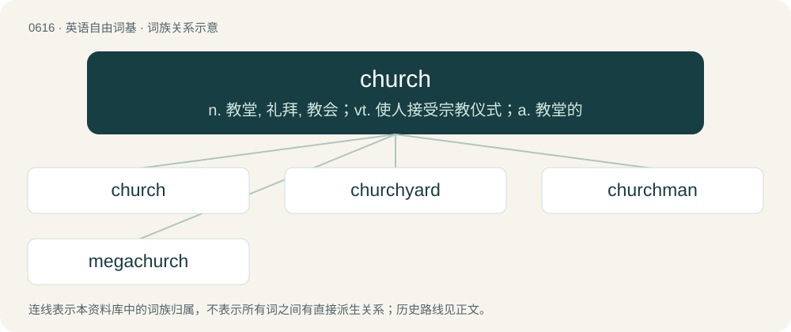

# 0686 · church — n. 教堂, 礼拜, 教会；vt. 使人接受宗教仪式；a. 教堂的

[总目录](../00_总目录_按常用程度.md)

**类型**：英语自由词基　｜　**来源语言**：见词源记录

## 核心含义与来源

- 核心含义：n. 教堂, 礼拜, 教会；vt. 使人接受宗教仪式；a. 教堂的
- 英文含义：A Christian house of worship; a building where Christian religious services take place.
- 词形：church

**来源记录 1**（名词；A Christian house of worship; a building where Christian religious services take place.）

From Middle English chirche, from Old English ċiriċe (“church”), from Proto-West Germanic \*kirikā, an early borrowing of Ancient Greek κυριακόν (kuriakón), neuter form of κυριακός (kuriakós, “belonging to the lord”), from κύριος (kúrios, “ruler, lord”), from Proto-Indo-European \*ḱewh₁- (“to swell, spread out, be strong, prevail”). Doublet of kirk. Additional etymological information For vowel evolution, see bury. Ancient Greek κυριακόν (kuriakón) was used of houses of Christian worship since circa 300 CE, especially in the East, though it was less common in this sense than ἐκκλησία (ekklēsía, “congregation”) or βασιλική (basilikḗ, “royal thing”). An example of the direct Greek-to-Germanic progress of many Christian words, possibly via the Goths; it was probably used by West Germanic people in their pre-Christian period. Cognate with Scots kirk (“church”), West Frisian tsjerke (“church”), Saterland Frisian Säärke (“church”), Dutch kerk (“church”), German Kirche (“church”), Danish kirke (“church”), Swedish kyrka (“church”), Norwegian Bokmål kirke, Norwegian Nynorsk kyrkje (“church”), and Faroese and Icelandic kirkja (“church”). Also picked up by Slavic, via Old High German chirihha (compare Old Church Slavonic црькꙑ (crĭky), Bulgarian църква (cărkva), Russian це́рковь (cérkovʹ)). Romance and Celtic languages use descendants of Latin ecclēsia.

## 词族图

## 单词速览（常用到不常用）

| 单词 | 音标 | 释义 |
|---|---|---|
| [church](#w-1) | 英 /t͡ʃɜːt͡ʃ/；美 /t͡ʃɝt͡ʃ/ | n. 教堂, 礼拜, 教会；vt. 使人接受宗教仪式；a. 教堂的 |
| [churchyard](#w-2) | 英 /ˈt͡ʃɜːt͡ʃ.jɑːd/；美 /ˈt͡ʃɝt͡ʃ.jɑɹd/ | n. 教堂墓地, 教堂庭院 |
| [churchman](#w-3) | 英 /ˈt͡ʃɜːt͡ʃmən/ | n. 牧师 |
| [megachurch](#w-4) |  | n. 大教会 |

## 逐词详解

### 1. church

**词性**：名词　｜　**音标**：英 /t͡ʃɜːt͡ʃ/；美 /t͡ʃɝt͡ʃ/

**中文释义**：n. 教堂, 礼拜, 教会；vt. 使人接受宗教仪式；a. 教堂的

**英文义项**：A Christian house of worship; a building where Christian religious services take place. / Christians collectively seen as a single spiritual community; Christianity; Christendom.

**词源与演化**：

From Middle English chirche, from Old English ċiriċe (“church”), from Proto-West Germanic \*kirikā, an early borrowing of Ancient Greek κυριακόν (kuriakón), neuter form of κυριακός (kuriakós, “belonging to the lord”), from κύριος (kúrios, “ruler, lord”), from Proto-Indo-European \*ḱewh₁- (“to swell, spread out, be strong, prevail”). Doublet of kirk. Additional etymological information For vowel evolution, see bury. Ancient Greek κυριακόν (kuriakón) was used of houses of Christian worship since circa 300 CE, especially in the East, though it was less common in this sense than ἐκκλησία (ekklēsía, “congregation”) or βασιλική (basilikḗ, “royal thing”). An example of the direct Greek-to-Germanic progress of many Christian words, possibly via the Goths; it was probably used by West Germanic people in their pre-Christian period. Cognate with Scots kirk (“church”), West Frisian tsjerke (“church”), Saterland Frisian Säärke (“church”), Dutch kerk (“church”), German Kirche (“church”), Danish kirke (“church”), Swedish kyrka (“church”), Norwegian Bokmål kirke, Norwegian Nynorsk kyrkje (“church”), and Faroese and Icelandic kirkja (“church”). Also picked up by Slavic, via Old High German chirihha (compare Old Church Slavonic црькꙑ (crĭky), Bulgarian църква (cărkva), Russian це́рковь (cérkovʹ)). Romance and Celtic languages use descendants of Latin ecclēsia.

**例句**：

> This building used to be a church before being converted into a library.

该用例对应义项：A Christian house of worship; a building where Christian religious services take place.

### 2. churchyard

**词性**：名词　｜　**音标**：英 /ˈt͡ʃɜːt͡ʃ.jɑːd/；美 /ˈt͡ʃɝt͡ʃ.jɑɹd/

**中文释义**：n. 教堂墓地, 教堂庭院

**英文义项**：A patch of land adjoining a church, often used as a graveyard.

**构词拆分**：church + yard

**词源与演化**：

Inherited from Middle English chircheyerd (also kirkeyerd &gt; English kirkyard), equivalent to church + yard. Compare also Middle English kurk-garth, kyrkgarth, kirrkegærd, from Old Norse kirkjugarðr (“churchyard; graveyard”). Replaced Middle English chirchetoun from Old English ċirictūn (churchtown).

**例句**：

> The faster the mouse, the bigger the churchyard.

### 3. churchman

**词性**：名词　｜　**音标**：英 /ˈt͡ʃɜːt͡ʃmən/

**中文释义**：n. 牧师

**英文义项**：A person (originally a man) of authority in a Christian religious organization (a church). / A member or adherent of an established church, especially the Church of England.

**构词拆分**：church + man

**词源与演化**：

From church + man. Compare kirkman and German Kirchmann.

**例句**：

> The bishop, a highly placed churchman, stated the religion's opinion.

该用例对应义项：A person (originally a man) of authority in a Christian religious organization (a church).

### 4. megachurch

**词性**：名词

**中文释义**：n. 大教会

**英文义项**：A church with an atypically large congregation.

**构词拆分**：mega- + church

**词源与演化**：

From mega- + church.

**例句**：

> The pastor asked his megachurch to fund his third private jet.
