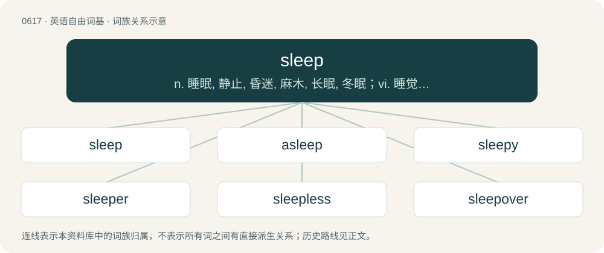

# 0688 · sleep — n. 睡眠, 静止, 昏迷, 麻木, 长眠, 冬眠；vi. 睡觉, 睡眠, 静止；vt. 睡

[总目录](../00_总目录_按常用程度.md)

**类型**：英语自由词基　｜　**来源语言**：见词源记录

## 核心含义与来源

- 核心含义：n. 睡眠, 静止, 昏迷, 麻木, 长眠, 冬眠；vi. 睡觉, 睡眠, 静止；vt. 睡
- 英文含义：To rest in a state of reduced consciousness.
- 词形：sleep

**多个词源／构词路径**：同一拼写可能有不同来源；以下按词性和含义分别列出。

**来源记录 1**（动词；To rest in a state of reduced consciousness.）

From Middle English slepen, from Anglian Old English slēpan (West Saxon Old English slǣpan), from Proto-West Germanic \*slāpan, from Proto-Germanic \*slēpaną (“to sleep”). Cognates Cognate with North Frisian sleepe, sliap, sliip, släipe (“to sleep”), Saterland Frisian släipe (“to sleep”), West Frisian sliepe (“to sleep”), Alemannic German schlaaffe, schlaafä, schlafe, schloafe, schloafen, schlofe, schlàfu (“to sleep”), Bavarian schlofn, schlåfn, sghlofn (“to sleep”), Central Franconian schlofe (“to sleep”), Cimbrian slaafan, slafan, slavan (“to sleep”), Dutch and Low German slapen (“to sleep”), German schlafen (“to sleep”), Limburgish schloëpe, slaope (“to sleep”), Luxembourgish schlofen (“to sleep”), Mòcheno schloven (“to sleep”), Vilamovian šłȫfa, śłöfa (“to sleep”), Yiddish שלאָפֿן (shlofn, “to sleep”), Crimean Gothic schlipen (“to sleep”), Gothic 𐍃𐌻𐌴𐍀𐌰𐌽 (slēpan, “to sleep”).

**来源记录 2**（名词；The state of reduced consciousness during which a human or animal rests in a daily rhythm.）

From Middle English slepe, sleep, sleepe, from Old English slǣp (“sleep”), from Proto-West Germanic \*slāp, from Proto-Germanic \*slēpaz (“sleep”). Cognates Cognate with Yola slepe (“sleep”), Saterland Frisian Släip (“sleep”), West Frisian sliep (“sleep”), Dutch slaap (“sleep”), German Schlaf (“sleep”), Luxembourgish Schlof (“sleep”), Vilamovian šłȫf, śłöf (“sleep”), Yiddish שלאָף (shlof, “sleep”), Gothic 𐍃𐌻𐌴𐍀𐍃 (slēps, “sleep”).

## 词族图

## 单词速览（常用到不常用）

| 单词 | 音标 | 释义 |
|---|---|---|
| [sleep](#w-1) | /sliːp/ | n. 睡眠, 静止, 昏迷, 麻木, 长眠, 冬眠；vi. 睡觉, 睡眠, 静止；vt. 睡 |
| [asleep](#w-2) | /əˈsliːp/ | a. 睡着的, 长眠的, 麻木的；adv. 熟睡地 |
| [sleepy](#w-3) | /ˈsliːpi/ | a. 困乏的, 欲睡的 |
| [sleeper](#w-4) | /ˈsliːpə(ɹ)/ | n. 睡眠者, 枕木, 卧铺；\[法\] 睡眠者, 懒人, 死人 |
| [sleepless](#w-5) | /ˈsliːpləs/ | a. 不睡眠的, 睡不着的, 不休息的 |
| [sleepover](#w-6) | /ˈsliːpəʊvə(r)/ | n. 就是孩子到别的小朋友家过夜。 |
| [sleepwear](#w-7) | /ˈsliːpwєə/ | n. 睡衣裤 |
| [sleepwalker](#w-8) | /ˈsliːpwɒːkə/ | n. 梦游病者 |
| [sleepwalk](#w-9) | /ˈsliːpwɔːk/ | vi. 梦游 |

## 逐词详解

### 1. sleep

**词性**：动词　｜　**音标**：/sliːp/

**中文释义**：n. 睡眠, 静止, 昏迷, 麻木, 长眠, 冬眠；vi. 睡觉, 睡眠, 静止；vt. 睡

**英文义项**：To rest in a state of reduced consciousness. / To have sexual intercourse (see sleep with).

**词源与演化**：

From Middle English slepen, from Anglian Old English slēpan (West Saxon Old English slǣpan), from Proto-West Germanic \*slāpan, from Proto-Germanic \*slēpaną (“to sleep”). Cognates Cognate with North Frisian sleepe, sliap, sliip, släipe (“to sleep”), Saterland Frisian släipe (“to sleep”), West Frisian sliepe (“to sleep”), Alemannic German schlaaffe, schlaafä, schlafe, schloafe, schloafen, schlofe, schlàfu (“to sleep”), Bavarian schlofn, schlåfn, sghlofn (“to sleep”), Central Franconian schlofe (“to sleep”), Cimbrian slaafan, slafan, slavan (“to sleep”), Dutch and Low German slapen (“to sleep”), German schlafen (“to sleep”), Limburgish schloëpe, slaope (“to sleep”), Luxembourgish schlofen (“to sleep”), Mòcheno schloven (“to sleep”), Vilamovian šłȫfa, śłöfa (“to sleep”), Yiddish שלאָפֿן (shlofn, “to sleep”), Crimean Gothic schlipen (“to sleep”), Gothic 𐍃𐌻𐌴𐍀𐌰𐌽 (slēpan, “to sleep”).

**例句**：

> After a failed connection attempt, the program sleeps for 5 seconds before trying again.

该用例对应义项：To wait for a period of time without performing any action.

### 2. asleep

**词性**：形容词　｜　**音标**：/əˈsliːp/

**中文释义**：a. 睡着的, 长眠的, 麻木的；adv. 熟睡地

**英文义项**：In a state of sleep; also, broadly, resting. / Inattentive.

**构词拆分**：a- (“in, on”) + sleep

**词源与演化**：

From Middle English aslepe, equivalent to a- (“in, on”) + sleep.

**例句**：

> My arm fell asleep. You know, like pins and needles.

该用例对应义项：Having a numb or prickling sensation accompanied by a degree of unresponsiveness.

### 3. sleepy

**词性**：形容词　｜　**音标**：/ˈsliːpi/

**中文释义**：a. 困乏的, 欲睡的

**英文义项**：Tired; feeling the need for sleep. / Suggesting tiredness.

**构词拆分**：sleep + -y

**词源与演化**：

From Middle English slepy, from Old English \*slǣpiġ (attested in unslǣpiġ (“sleepless”)), from Proto-West Germanic \*slāpag (“sleepy”), equivalent to sleep + -y. Cognate with Saterland Frisian släipich (“sleepy”), West Frisian sliepich (“sleepy”), dialectal Dutch slapig, slepig (“sleepy”), German Low German slapig, släpig, slöpig (“sleepy”), archaic German schlafig (“sleepy”).

**用法示例／搭配（非完整句）**：

> a sleepy drink or potion

该用例对应义项：Tending to induce sleep.

### 4. sleeper

**词性**：名词　｜　**音标**：/ˈsliːpə(ɹ)/

**中文释义**：n. 睡眠者, 枕木, 卧铺；\[法\] 睡眠者, 懒人, 死人

**英文义项**：Someone who sleeps. / That which lies dormant, as a law.

**构词拆分**：sleep + -er

**词源与演化**：

From Middle English sleper, equivalent to sleep + -er.

**例句**：

> We spent a night on an uncomfortable sleeper between Athens and Vienna.

该用例对应义项：A railway sleeping car.

### 5. sleepless

**词性**：形容词　｜　**音标**：/ˈsliːpləs/

**中文释义**：a. 不睡眠的, 睡不着的, 不休息的

**英文义项**：Characterized by an absence of sleep: wakeful.

**构词拆分**：sleep + -less

**词源与演化**：

From Middle English slepeles, from Old English slǣplēas; equivalent to sleep + -less.

**例句**：

> I spent a sleepless night worrying about the exams.

该用例对应义项：Characterized by an absence of sleep: wakeful.

### 6. sleepover

**词性**：名词　｜　**音标**：/ˈsliːpəʊvə(r)/

**中文释义**：n. 就是孩子到别的小朋友家过夜。

**英文义项**：The act of spending the night as a guest in another's house, especially when the participants are children. / An overnight guest.

**构词拆分**：sleep + over

**词源与演化**：

From sleep + over.

**例句**：

> Sami had a sleepover at Layla's house to help her with her assignment.

### 7. sleepwear

**词性**：名词　｜　**音标**：/ˈsliːpwєə/

**中文释义**：n. 睡衣裤

**英文义项**：garments designed to be worn in bed; nightclothes

**构词拆分**：sleep + -wear

**词源与演化**：

From sleep + -wear.

### 8. sleepwalker

**词性**：名词　｜　**音标**：/ˈsliːpwɒːkə/

**中文释义**：n. 梦游病者

**英文义项**：A somnambulist; one who walks, or is active, while asleep. / A person from whom a voodoo practitioner (a bocor) has taken over control of their mind, making them a zombie who must do the bocor's bidding.

**构词拆分**：sleep + walker；sleepwalk + -er

**词源与演化**：

From sleep + walker or sleepwalk + -er.

**例句**：

> When you walk like that you look like a sleepwalker.

### 9. sleepwalk

**词性**：动词　｜　**音标**：/ˈsliːpwɔːk/

**中文释义**：vi. 梦游

**英文义项**：To walk or perform other actions while sleeping; to somnambulate. / To perform actions without being aware of them; to do something that invites certain results without confronting that possibility.

**构词拆分**：sleep + walk

**词源与演化**：

From sleep + walk.

**例句**：

> They're trying to sleepwalk past their health problems.

该用例对应义项：To perform actions without being aware of them; to do something that invites certain results without confronting that possibility.
