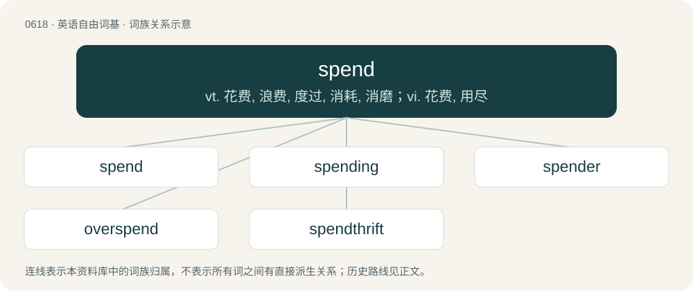

# 0689 · spend — vt. 花费, 浪费, 度过, 消耗, 消磨；vi. 花费, 用尽

[总目录](../00_总目录_按常用程度.md)

**类型**：英语自由词基　｜　**来源语言**：见词源记录

## 核心含义与来源

- 核心含义：vt. 花费, 浪费, 度过, 消耗, 消磨；vi. 花费, 用尽
- 英文含义：To pay out (money).
- 词形：spend

**来源记录 1**（动词；To pay out (money).）

From Middle English spenden, from Old English spendan (attested especially in compounds āspendan (“to spend”), forspendan (“to use up, consume”)), from Proto-West Germanic \*spendōn (“to spend”), borrowed from Latin expendere (“to weigh out”). Doublet of expend. Cognate with Old High German spentōn (“to consume, use, spend”) (whence German spenden (“to donate, provide”)), Middle Dutch spenden (“to spend, dedicate”), Old Icelandic spenna (“to spend”).

## 词族图

## 单词速览（常用到不常用）

| 单词 | 音标 | 释义 |
|---|---|---|
| [spend](#w-1) | 英 /spɛnd/；美 /spɪnd/ | vt. 花费, 浪费, 度过, 消耗, 消磨；vi. 花费, 用尽 |
| [spending](#w-2) | /ˈspɛndɪŋ/ | n. 经费, 开销；\[经\] 开支, 开销, 经费 |
| [spender](#w-3) | 英 /ˈspɛndə/；美 /ˈspɛndɚ/ | n. 挥霍者, 挥金如土的人；\[法\] 挥金如土者, 挥霍钱财者 |
| [overspend](#w-4) | /.əuvəˈspend/ | vt. 过度使用, 花费过多, 使筋疲力尽；vi. 超支 |
| [spendthrift](#w-5) | 英 /ˈspɛn(d)θɹɪft/；美 /ˈspɛn(d)ˌθɹɪft/ | n. 浪费的人；a. 浪费的, 挥霍无度的 |

## 逐词详解

### 1. spend

**词性**：动词　｜　**音标**：英 /spɛnd/；美 /spɪnd/

**中文释义**：vt. 花费, 浪费, 度过, 消耗, 消磨；vi. 花费, 用尽

**英文义项**：To pay out (money). / To bestow; to employ; often with on or upon.

**词源与演化**：

From Middle English spenden, from Old English spendan (attested especially in compounds āspendan (“to spend”), forspendan (“to use up, consume”)), from Proto-West Germanic \*spendōn (“to spend”), borrowed from Latin expendere (“to weigh out”). Doublet of expend. Cognate with Old High German spentōn (“to consume, use, spend”) (whence German spenden (“to donate, provide”)), Middle Dutch spenden (“to spend, dedicate”), Old Icelandic spenna (“to spend”).

**例句**：

> The fish spends his semen on eggs which he finds floating and whose mother he has never seen.

该用例对应义项：To have an orgasm; to ejaculate sexually.

### 2. spending

**词性**：名词　｜　**音标**：/ˈspɛndɪŋ/

**中文释义**：n. 经费, 开销；\[经\] 开支, 开销, 经费

**英文义项**：An amount that has been, or is planned to be spent.

**构词拆分**：spend + -ing

**词源与演化**：

From Middle English spendyng, spendynge, from Old English spendung (“spending”), equivalent to spend + -ing. Cognate with German Spendung (“contribution, donation”).

**用法示例／搭配（非完整句）**：

> excessive spendings

该用例对应义项：An amount that has been, or is planned to be spent.

### 3. spender

**词性**：名词　｜　**音标**：英 /ˈspɛndə/；美 /ˈspɛndɚ/

**中文释义**：n. 挥霍者, 挥金如土的人；\[法\] 挥金如土者, 挥霍钱财者

**英文义项**：A person who spends money.

**构词拆分**：spend + -er

**词源与演化**：

Inherited from Middle English spendere, equivalent to spend + -er.

**例句**：

> Germany is gearing up to become the world's third largest military spender.

### 4. overspend

**词性**：动词　｜　**音标**：/.əuvəˈspend/

**中文释义**：vt. 过度使用, 花费过多, 使筋疲力尽；vi. 超支

**英文义项**：To spend too much money; especially, to spend more than one earns.

**构词拆分**：over- + spend

**词源与演化**：

From over- + spend.

**例句**：

> To get out of debt, first keep a budget and be careful not to overspend.

该用例对应义项：To spend too much money; especially, to spend more than one earns.

### 5. spendthrift

**词性**：形容词　｜　**音标**：英 /ˈspɛn(d)θɹɪft/；美 /ˈspɛn(d)ˌθɹɪft/

**中文释义**：n. 浪费的人；a. 浪费的, 挥霍无度的

**英文义项**：Improvident, profligate, or wasteful. / Extravagant or lavish.

**构词拆分**：spend + thrift (“(archaic) savings; profits; wealth”)

**词源与演化**：

From spend + thrift (“(archaic) savings; profits; wealth”).

**例句**：

> Mary is a spendthrift when it comes to money.
