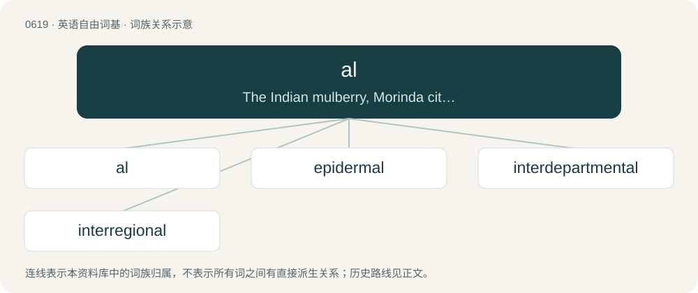

# 0690 · al — The Indian mulberry, Morinda citrifolia, especially as used to make dye.

[总目录](../00_总目录_按常用程度.md)

**类型**：英语自由词基　｜　**来源语言**：见词源记录

## 核心含义与来源

- 核心含义：The Indian mulberry, Morinda citrifolia, especially as used to make dye.
- 英文含义：The Indian mulberry, Morinda citrifolia, especially as used to make dye.
- 词形：al

**来源记录 1**（名词；The Indian mulberry, Morinda citrifolia, especially as used to make dye.）

From Hindi आल (āl).

## 词族图

## 单词速览（常用到不常用）

| 单词 | 音标 | 释义 |
|---|---|---|
| [al](#w-1) | /æl/ | 【英文】The Indian mulberry, Morinda citrifolia, especially as used to make dye. |
| [epidermal](#w-2) | /ˌɛpɪˈdɝməl/ | a. 表皮的；\[医\] 表皮的 |
| [interdepartmental](#w-3) | /,intə(ː)di,pɑːtˈmentl/ | a. 各部间的 |
| [interregional](#w-4) | /,intə(ː)ˈriːdʒənəl/ | 地区与地区间的 |

## 逐词详解

### 1. al

**词性**：名词　｜　**音标**：/æl/

**英文义项**：The Indian mulberry, Morinda citrifolia, especially as used to make dye.

**词源与演化**：

From Hindi आल (āl).

**例句**：

> In Portuguese, we usually say "alô", when we pick up the phone.

### 2. epidermal

**词性**：形容词　｜　**音标**：/ˌɛpɪˈdɝməl/

**中文释义**：a. 表皮的；\[医\] 表皮的

**英文义项**：Of or pertaining to the epidermis.

**构词拆分**：epi- + derm- + -al

**词源与演化**：

From international scientific vocabulary, reflecting New Latin combining forms. By surface analysis, epidermis + -al = epi- + derm- + -al.

### 3. interdepartmental

**词性**：形容词　｜　**音标**：/,intə(ː)di,pɑːtˈmentl/

**中文释义**：a. 各部间的

**英文义项**：Between departments; to do with the connection of departments. / Involving multiple departments; multidepartmental.

**构词拆分**：inter- + department + -al

**词源与演化**：

From inter- + department + -al.

**例句**：

> The memo discussed a new interdepartmental project that would require resources from nearly every group.

该用例对应义项：Involving multiple departments; multidepartmental.

### 4. interregional

**词性**：形容词　｜　**音标**：/,intə(ː)ˈriːdʒənəl/

**中文释义**：地区与地区间的

**英文义项**：Of, pertaining to, or connecting two or more regions.

**构词拆分**：inter- + region + -al

**词源与演化**：

From inter- + region + -al.

**例句**：

> I am playing in an interregional championship. We have only lost one game so far.
