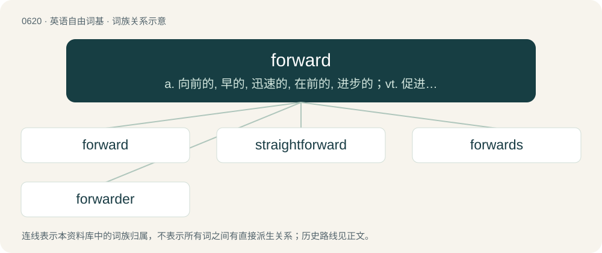

# 0691 · forward — a. 向前的, 早的, 迅速的, 在前的, 进步的；vt. 促进...的生长, 转寄, 运送；adv. 向前地

[总目录](../00_总目录_按常用程度.md)

**类型**：英语自由词基　｜　**来源语言**：见词源记录

## 核心含义与来源

- 核心含义：a. 向前的, 早的, 迅速的, 在前的, 进步的；vt. 促进...的生长, 转寄, 运送；adv. 向前地
- 英文含义：Situated toward or at the front of something.
- 词形：forward

**来源记录 1**（形容词；Situated toward or at the front of something.）

From Middle English foreward, from Old English foreweard (“forward, inclined to the front, fore, early, former”), from Proto-Germanic \*fura- (“fore-”), \*warþaz (“turned”), equivalent to fore + -ward. Cognate with Dutch voorwaarts (“forward”), German vorwärts (“forward”).

## 词族图

## 单词速览（常用到不常用）

| 单词 | 音标 | 释义 |
|---|---|---|
| [forward](#w-1) | 英 /ˈfɔːwəd/；美 /ˈfɔɹwəɹd/ | a. 向前的, 早的, 迅速的, 在前的, 进步的；vt. 促进...的生长, 转寄, 运送；adv. 向前地 |
| [straightforward](#w-2) | /ˌstɹeɪtˈfɔː(ɹ)wə(ɹ)d/ | a. 笔直的, 率直的, 明确的, 简单的, 直接的 |
| [forwards](#w-3) | 英 /ˈfɔːwədz/；美 /ˈfɔɹwɚdz/ | adv. 向前；今后 |
| [forwarder](#w-4) | /ˈfɔːwədə/ | \[计\] 传送器；\[经\] 转运商, 运输代理 |

## 逐词详解

### 1. forward

**词性**：形容词　｜　**音标**：英 /ˈfɔːwəd/；美 /ˈfɔɹwəɹd/

**中文释义**：a. 向前的, 早的, 迅速的, 在前的, 进步的；vt. 促进...的生长, 转寄, 运送；adv. 向前地

**英文义项**：Situated toward or at the front of something. / Situated toward or near the enemy lines.

**构词拆分**：fore + -ward

**词源与演化**：

From Middle English foreward, from Old English foreweard (“forward, inclined to the front, fore, early, former”), from Proto-Germanic \*fura- (“fore-”), \*warþaz (“turned”), equivalent to fore + -ward. Cognate with Dutch voorwaarts (“forward”), German vorwärts (“forward”).

**例句**：

> The grass is forward, or forward for the season. We have a forward spring.

该用例对应义项：Advanced beyond the usual degree; advanced for the season; precocious.

### 2. straightforward

**词性**：形容词　｜　**音标**：/ˌstɹeɪtˈfɔː(ɹ)wə(ɹ)d/

**中文释义**：a. 笔直的, 率直的, 明确的, 简单的, 直接的

**英文义项**：Proceeding in a straight course or manner; not deviating. / Easy, simple, uncomplicated, without difficulty.

**构词拆分**：straight + forward

**词源与演化**：

From straight + forward.

**例句**：

> He is not being as straightforward as it appears.

该用例对应义项：without evasion or compromise

### 3. forwards

**词性**：副词　｜　**音标**：英 /ˈfɔːwədz/；美 /ˈfɔɹwɚdz/

**中文释义**：adv. 向前；今后

**英文义项**：Synonym of forward in most senses.

**构词拆分**：forward + -s

**词源与演化**：

From forward + -s (adverbial suffix).

**例句**：

> Life can only be understood backwards; but it must be lived forwards.

### 4. forwarder

**词性**：名词　｜　**音标**：/ˈfɔːwədə/

**中文释义**：\[计\] 传送器；\[经\] 转运商, 运输代理

**英文义项**：One who, or that which, forwards something to another destination.

**构词拆分**：From forward (verb) + -er.

**词源与演化**：

From forward (verb) + -er.
